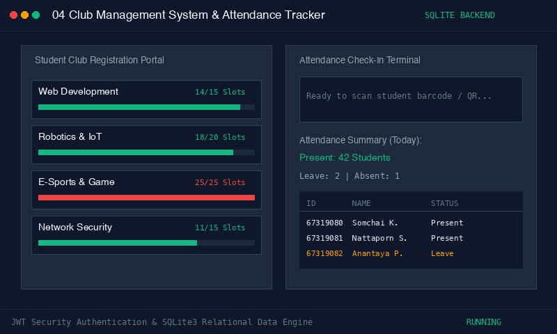

# Club Member Registration & Attendance Management System

> **หมวดหมู่:** Full-Stack Web Application & Educational Management
> **ผู้พัฒนา:** Phakhaphon Sukmee

---

|  | 

#### ภาพเคลื่อนไหวจำลองการทำงาน (Live Simulation Demo)


[ดูวิดีโอสาธิตการทำงานแบบเต็ม (Full HD MP4)](../assets/demo_04_club_management.mp4)
 |
| :---: | :---: |

## วิธีติดตั้งและเริ่มใช้งาน (Quick Start)

### 1. สิ่งที่ต้องมีในเครื่อง (Prerequisites)
* Node.js 16+

### 2. การติดตั้งและเปิดระบบ
```bash
cd backend
npm install
cp .env.example .env
node server.js
```
เซิร์ฟเวอร์จะเริ่มทำงานที่พอร์ต 3000

### 3. ลิงก์เข้าทดสอบระบบจริง
* **หน้าลงทะเบียนสมาชิกใหม่:** `http://localhost:3000/register.html`
 * ลองกรอกรหัสนักศึกษาและเลือกชมรม เพื่อทดสอบระบบตรวจสอบโควต้า
* **หน้าเช็คชื่อเข้าร่วมกิจกรรม:** `http://localhost:3000/attendance.html`
 * บันทึกการมาเรียน/ทำกิจกรรมแบบเรียลไทม์
* **หน้าควบคุมผู้ดูแลระบบ (Admin Dashboard):** `http://localhost:3000/admin.html`
 * ดูสถิติรายชื่อสมาชิกทั้งหมด และพิมพ์รายงานสรุปผล

#### โหมดทดสอบด่วน (Quick Test):
```bash
node test_simulation.js
```
---
