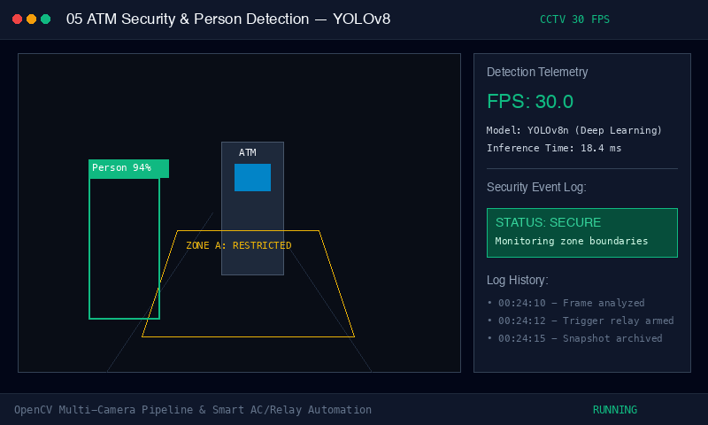

# ATM Security & Person Detection System (Computer Vision)
[](https://download-directory.github.io/?url=https://github.com/FANG9356/MyProject/tree/main/05_ATM-YOLOv8-Detector)
*ดาวน์โหลดเฉพาะโฟลเดอร์นี้เป็นไฟล์ ZIP (หรือ [ดาวน์โหลดผ่าน DownGit](https://minhaskamal.github.io/DownGit/#/home?url=https://github.com/FANG9356/MyProject/tree/main/05_ATM-YOLOv8-Detector))*

> **หมวดหมู่:** Computer Vision & Smart Surveillance
> **ผู้พัฒนา:** Phakhaphon Sukmee

---





## วิธีติดตั้งและเริ่มใช้งาน (Quick Start)

### 1. สิ่งที่ต้องมีในเครื่อง (Prerequisites)
* Python 3.9+ พร้อมกล้องเว็บแคม (หรือรันโหมดจำลองภาพได้โดยไม่ต้องมีกล้อง)

### 2. การติดตั้ง Dependencies
```bash
pip install ultralytics opencv-python numpy
```

### 3. การทดสอบระบบ

#### วิธีที่ 1: รันระบบตรวจจับจริงผ่านกล้อง (Live CCTV Detection)
```bash
python3 person_detector.py
```
* **การแสดงผลของระบบ:**
 * หน้าต่างกล้องจะเปิดขึ้นพร้อมตีกรอบสีเขียว (Bounding Box) รอบตัวบุคคลพร้อมแสดงค่าความมั่นใจ (Confidence Score เช่น 95%)
 * เมื่อมีบุคคลเดินเข้ามาในระยะตู้ ATM ระบบจะบันทึกภาพ Snapshot ลงโฟลเดอร์ `snapshots/` และบันทึกเวลาลง `detection_log.json` อัตโนมัติ

#### วิธีที่ 2: โหมดทดสอบจำลองความเร็วของโมเดล (Quick Simulation Test)
```bash
python3 test_simulation.py
```
* ตรวจสอบว่าโมเดล YOLOv8 โหลดครบ 80 คลาส และวัดเวลาการทำนายผล (Inference Time)

---
