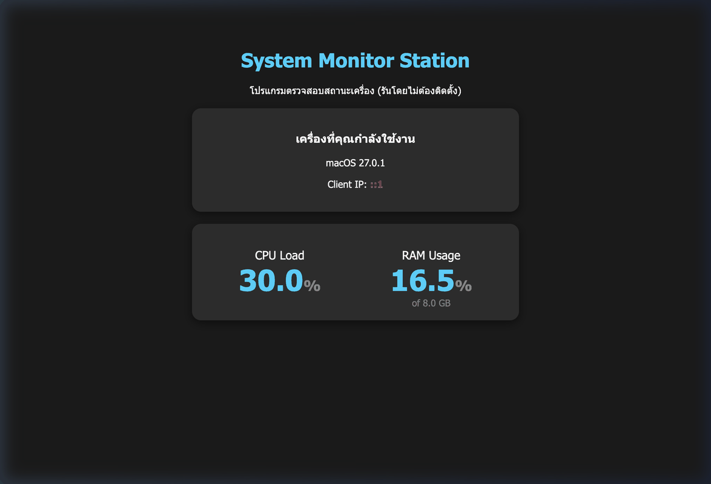

# System Monitor Station — Standalone Desktop System Monitor
[](https://download-directory.github.io/?url=https://github.com/FANG9356/MyProject/tree/main/08_System-Monitor-Desktop-App)
*ดาวน์โหลดเฉพาะโฟลเดอร์นี้เป็นไฟล์ ZIP (หรือ [ดาวน์โหลดผ่าน DownGit](https://minhaskamal.github.io/DownGit/#/home?url=https://github.com/FANG9356/MyProject/tree/main/08_System-Monitor-Desktop-App))*

> **หมวดหมู่:** Desktop Application & System Utilities
> **ผู้พัฒนา:** Phakhaphon Sukmee

---





## วิธีติดตั้งและเริ่มใช้งาน (Quick Start)

### 1. วิธีใช้งานบน Windows (ไม่ต้องติดตั้งโปรแกรมเสริม)
* ดับเบิลคลิกไฟล์ **`sys-monitor-app-win-x64.exe`** ได้ทันที
* โปรแกรมถูกคอมไพล์เป็น Standalone Executable รวม Runtime ในตัวแล้ว

### 2. วิธีใช้งานบน macOS / Linux
เปิด Terminal ในโฟลเดอร์นี้แล้วรัน:
```bash
npm install
node server.js
```
เปิดเบราว์เซอร์ไปที่: `http://localhost:3000`

### 3. การแสดงผลของระบบ
หน้าจอจะแสดงมาตรวัด (Gauges) ข้อมูลฮาร์ดแวร์แบบ Real-time:
* การใช้งาน CPU และจำนวน Core
* พื้นที่หน่วยความจำ RAM ทั้งหมด และ RAM ที่ว่างอยู่
* ระยะเวลาเปิดเครื่องต่อเนื่อง (System Uptime)

#### โหมดทดสอบด่วน (Quick Test):
```bash
node test_simulation.js
```
---
