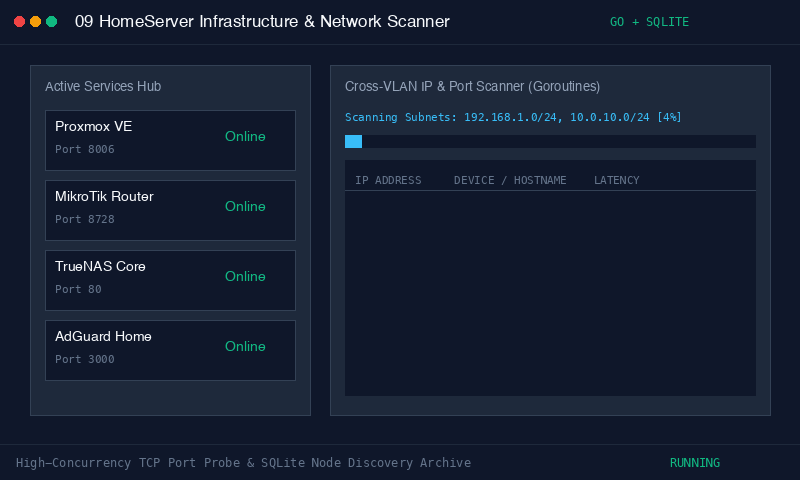

# HomeServer Infrastructure & Network Scanner
[](https://download-directory.github.io/?url=https://github.com/FANG9356/MyProject/tree/main/09_HomeServer-Infrastructure)
*ดาวน์โหลดเฉพาะโฟลเดอร์นี้เป็นไฟล์ ZIP (หรือ [ดาวน์โหลดผ่าน DownGit](https://minhaskamal.github.io/DownGit/#/home?url=https://github.com/FANG9356/MyProject/tree/main/09_HomeServer-Infrastructure))*

> **ผู้พัฒนา:** Phakhaphon Sukmee
> **เทคโนโลยี:** Go, SQLite, React, Tailwind CSS, Docker

---




## โครงสร้างระบบ (System Overview)

แดชบอร์ดรวมศูนย์สำหรับเปิดดูสถานะบริการภายในบ้าน และเครื่องมือสแกนหา IP อุปกรณ์ในเครือข่าย:
* **Frontend:** React + Tailwind CSS สำหรับแสดงผลรายการบริการ และหน้าตารางผลการสแกน IP
* **Backend:** Go ให้บริการ REST API และใช้ Goroutine ช่วยตรวจเช็กพอร์ต TCP ตาม Subnet ที่กำหนด
* **Database:** SQLite สำหรับบันทึกรายชื่อบริการและประวัติอุปกรณ์ที่ตรวจพบ

---

## การเริ่มต้นใช้งาน (Quick Start)

### 1. รันผ่าน Go และ React

**Backend (Go):**
```bash
cd backend
go run .
```

**Frontend (React + Tailwind):**
```bash
cd frontend
npm install
npm run dev
```

เปิดเบราว์เซอร์ไปที่: `http://localhost:8001` (หรือ `http://localhost:5173`)

### 2. รันผ่าน Docker

```bash
docker compose up -d --build
```

---

## การทำงานของระบบ (Features)

1. **Services Hub:** รวมทางเข้าและเช็กสถานะการทำงาน (Latency) ของบริการภายในเครื่อง เช่น Immich, Jellyfin, FileBrowser, Bitwarden, Memos
2. **Network Scanner:** ค้นหา IP และอุปกรณ์ที่เชื่อมต่ออยู่ในวง LAN หรือระบุ Subnet อื่นเพื่อค้นหาข้ามวง VLAN พร้อมเช็กพอร์ตพื้นฐานที่เปิดอยู่
3. **SQLite Storage:** เก็บข้อมูลบริการและอุปกรณ์ที่สแกนเจอบันทึกไว้ในฐานข้อมูล SQLite

---

## โหมดทดสอบระบบ (Test Simulation)

```bash
python3 test_simulation.py
```
