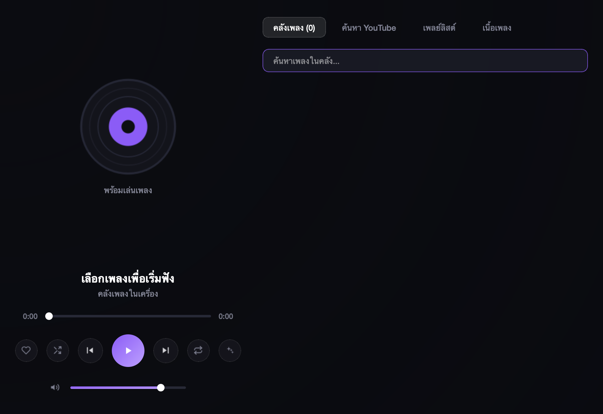
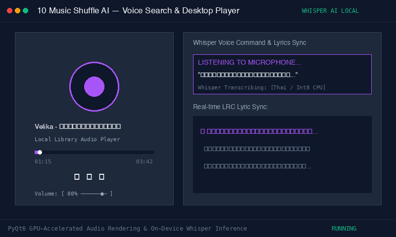

# Music Shuffle AI — Desktop Music Player with Whisper Voice Control

> **หมวดหมู่:** Desktop Application & AI Audio  
> **ผู้พัฒนา:** Phakhaphon Sukmee  
> **เทคโนโลยี:** Python, PyQt6, faster-whisper, mutagen, yt-dlp

---



#### ภาพเคลื่อนไหวจำลองการทำงาน (Live Simulation Demo)



## ภาพรวมของระบบ

Music Shuffle AI เป็นโปรแกรมเล่นเพลงบนเดสก์ท็อปที่พัฒนาด้วยภาษา Python และ PyQt6 ออกแบบมาเพื่อจัดการคลังเพลงในเครื่องและการสตรีมเสียง มีระบบค้นหาและสั่งการด้วยเสียงผ่านโมเดล faster-whisper (รองรับภาษาไทยและอังกฤษ) รวมถึงการดึงปกอัลบั้มและแสดงเนื้อเพลงคาราโอเกะแบบซิงค์เวลาจริง

---

## ความสามารถหลัก

1. **อินเทอร์เฟซเดสก์ท็อป (PyQt6 GUI)**
   - จัดการเพลย์ลิสต์ รายการโปรด (Favorites) และคิวการเล่นเพลง
   - วิดเจ็ตแถบเลื่อนเวลาแบบกำหนดเอง (Clickable Slider) พร้อมตัวแสดงสถานะเวลา
   - ปรับแต่งการแสดงผลและแอนิเมชันสำหรับรายการแทร็กเพลง

2. **ระบบรับคำสั่งเสียงผ่าน AI (Whisper Speech-to-Text)**
   - ทำงานร่วมกับโมเดล faster-whisper ทำงานแบบประมวลผลบนเครื่อง (On-Device/Local)
   - ถอดเสียงพูดภาษาไทยและภาษาอังกฤษเพื่อค้นหาเพลงในคลังโดยอัตโนมัติ

3. **ระบบแสดงเนื้อเพลงและคาราโอเกะ (LRC Lyrics Sync)**
   - สกัดและแสดงผลเนื้อเพลงบรรทัดต่อบรรทัดตามเวลาการเล่นของเสียง
   - อัปเดตตัวอักษรและสีไฮไลต์ตามจังหวะเพลง

4. **เครื่องมือจัดการปกเพลงอัตโนมัติ (Cover Art Pipeline)**
   - โมดูล `fetch_covers.py` สำหรับค้นหาภาพปกจาก iTunes Search API และ YouTube
   - ฝังภาพปกลงในแท็ก ID3 (APIC สำหรับ MP3 หรือ covr สำหรับ MP4/M4A) โดยอัตโนมัติผ่านไลบรารี `mutagen`

---

## วิธีติดตั้งและเริ่มใช้งาน

### 1. ติดตั้งแพ็กเกจที่จำเป็น
```bash
pip install -r requirements.txt
```

### 2. รันโปรแกรมหลัก
```bash
python3 main.py
```

### 3. รันสคริปต์ดึงปกเพลง (ถ้าต้องการฝังปกให้ไฟล์เพลงในคลัง)
```bash
python3 fetch_covers.py
```

---

## การทดสอบระบบ (Quick Test)

สามารถทดสอบความสมบูรณ์ของโครงสร้างโค้ด คลาสระบบ และไฟล์คอนฟิกได้ด้วยคำสั่ง:
```bash
python3 test_simulation.py
```
