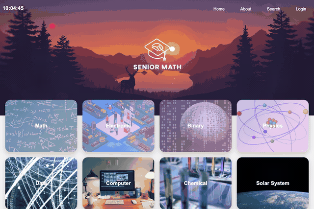

# General Education Web (เว็บไซต์แนะนำการศึกษาประเภทวิชาสามัญ - Seniormath)

เว็บพอร์ทัลสื่อการเรียนรู้ออนไลน์สำหรับกลุ่มวิชาสามัญและพื้นฐานวิชาชีพ ครอบคลุมคณิตศาสตร์ ฟิสิกส์ วิศวกรรมไฟฟ้าพื้นฐาน ระบบเลขฐานคอมพิวเตอร์ และเครื่องมือคำนวณออนไลน์ ออกแบบด้วย Vanilla HTML/CSS/JavaScript พร้อมแอนิเมชันและการแสดงผลแบบอินเทอร์แอคทีฟ



## ข้อมูลโครงการและเอกสารหลักสูตร

- ผู้พัฒนา: ภคพล สุขมี (Phakhaphon Sukmee)
- เอกสารหลักสูตรและเนื้อหา:
  - คณิตศาสตร์: [docs/เนื้อหาคณิค.txt](docs/เนื้อหาคณิค.txt)
  - ฟิสิกส์: [docs/เนื้อหาฟิสิกส์.txt](docs/เนื้อหาฟิสิกส์.txt)
  - เลขฐานและตรรกศาสตร์: [docs/เนื้อหาเลขฐาน.txt](docs/เนื้อหาเลขฐาน.txt)
  - ไฟฟ้าและอิเล็กทรอนิกส์: [docs/เนื้อหาไฟฟ้า.txt](docs/เนื้อหาไฟฟ้า.txt)

## คุณสมบัติของระบบ

- แนะนำหลักสูตรวิชาสามัญระดับมัธยมและ ปวช. ครบถ้วน
- ระบบคำนวณและแปลงเลขฐาน (Binary, Decimal, Hexadecimal)
- เครื่องคิดเลขแบบ Glassmorphism Calculator พร้อมรองรับการคำนวณพีชคณิต
- ระบบนำทางแบบ Responsive Header, Sidebar Navigation และแอนิเมชัน CSS
- หน้าเนื้อหาพร้อมวิดีโอและภาพประกอบการเรียนรู้ในแต่ละหมวดวิชา

## โครงสร้างไดเรกทอรี

```
13_General-Education-Web/
├── docs/
│   ├── เนื้อหาคณิค.txt
│   ├── เนื้อหาฟิสิกส์.txt
│   ├── เนื้อหาเลขฐาน.txt
│   └── เนื้อหาไฟฟ้า.txt
├── picture/
├── video/
├── music/
├── index.html
├── Seniormath.html
├── Math.html
├── Physics.html
├── Electronic.html
├── Binary.html
├── Binary1.html
├── calculator.html
├── About.html
├── Aboutme.html
├── Login.html
├── Time.html
├── styles.css
├── script.js
├── test_simulation.py
├── PORTFOLIO_INFO.md
└── README.md
```

## การทดสอบระบบ

รันชุดทดสอบตรวจสอบความสมบูรณ์ของโครงสร้างหน้าเว็บ ลิงก์ และฟังก์ชันคำนวณ:

```bash
python3 test_simulation.py
```
