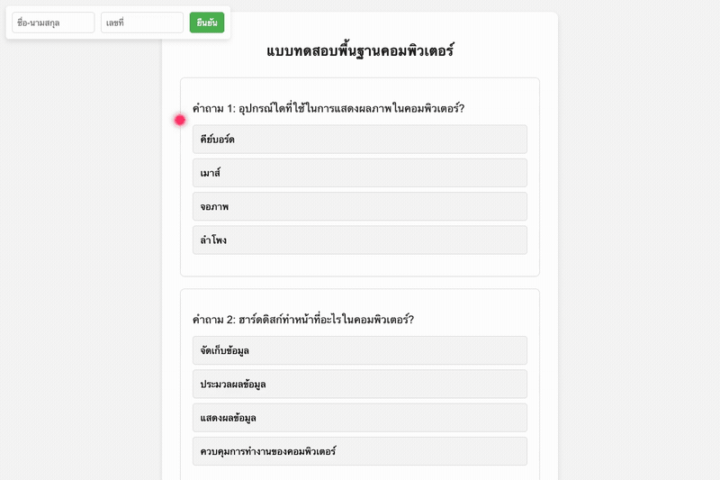

# Computer Quiz System (เว็บไซต์ทำแบบทดสอบพื้นฐานคอมพิวเตอร์)

ระบบทำแบบทดสอบและประเมินผลความรู้พื้นฐานคอมพิวเตอร์ออนไลน์ พัฒนาด้วย Vanilla HTML, CSS และ JavaScript เชื่อมต่อคลังข้อสอบแบบ JSON จำนวน 400 ข้อ พร้อมระบบบันทึกข้อมูลผู้สอบ ตรวจสอบคำตอบแบบเรียลไทม์ และระบบคำนวณตัดเกรดอัตโนมัติ



## ข้อมูลโครงการและเอกสารคลังข้อสอบ

- ผู้พัฒนา: ภคพล สุขมี (Phakhaphon Sukmee)
- เอกสารคลังข้อสอบฉบับเต็ม (400 ข้อ): [docs/quiz_question_bank_summary.md](docs/quiz_question_bank_summary.md)
- คลังคำถามและเฉลย: [json/q.json](json/q.json)

## คุณสมบัติเด่น

- ระบบลงทะเบียนข้อมูลผู้สอบ (ชื่อ-นามสกุล และเลขที่) พร้อมการตรวจสอบความถูกต้องของข้อมูล (Validation)
- โหลดคำถามแบบอะซิงโครนัสจากฐานข้อมูล JSON (Asynchronous Question Fetching)
- ป้องกันการคัดลอกข้อความระหว่างการทำแบบทดสอบ (Anti-Cheat Copy/Cut Prevention)
- ระบบคำนวณคะแนนแสดงผลทันทีผ่าน Modal Popup (จำนวนข้อที่ตอบถูก, ตอบผิด, คิดเป็นเปอร์เซ็นต์ และคะแนนปรับเทียบ)
- ออกแบบส่วนติดต่อผู้ใช้ให้ตอบสนองรวดเร็วและรองรับการเลื่อนหน้าแบบ Smooth Scrolling

## โครงสร้างไดเรกทอรี

```
14_Computer-Quiz-System/
├── docs/
│   └── quiz_question_bank_summary.md
├── css/
│   └── c.css
├── script/
│   └── s.js
├── json/
│   └── q.json
├── picture/
│   └── bow.png
├── index.html
├── test_simulation.py
├── PORTFOLIO_INFO.md
└── README.md
```

## การทดสอบระบบ

รันชุดทดสอบตรวจสอบโครงสร้างไฟล์ ความสมบูรณ์ของคลังข้อสอบ 400 ข้อ และตรรกะการคำนวณคะแนน:

```bash
python3 test_simulation.py
```
