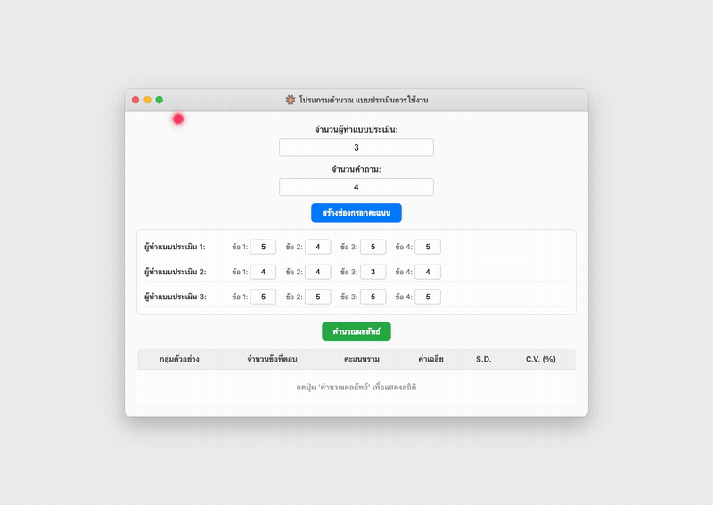

# SD Calculator Python (โปรแกรมคำนวณค่า S.D. ด้วย Python)

โปรแกรมประยุกต์สำหรับประมวลผลข้อมูลทางสถิติและคำนวณแบบประเมินผลความพึงพอใจการใช้งาน พัฒนาด้วยภาษา Python, Tkinter GUI และ NumPy สามารถสร้างตารางกรอกข้อมูลคะแนนตามจำนวนกลุ่มตัวอย่างและข้อคำถามแบบไดนามิก พร้อมประมวลผลคะแนนรวม (Sum), ค่าเฉลี่ย (Mean), ส่วนเบี่ยงเบนมาตรฐาน (Standard Deviation - S.D.) และสัมประสิทธิ์การแปรผัน (Coefficient of Variation - C.V. %) แสดงผลในรูปแบบตาราง Treeview



## ข้อมูลโครงการและเอกสารคู่มือทางสถิติ

- ผู้พัฒนา: ภคพล สุขมี (Phakhaphon Sukmee)
- เอกสารคู่มือสูตรทางสถิติและการแปลผล: [docs/statistics_formula_manual.md](docs/statistics_formula_manual.md)
- สเปกการคอมไพล์ไบนารี Windows: [sd.spec](sd.spec)

## คุณสมบัติเด่น

- สร้างฟิลด์กรอกข้อมูลแบบไดนามิกตามจำนวนผู้ตอบแบบประเมินและจำนวนข้อคำถาม
- รองรับการเลื่อนดูข้อมูลทั้งแนวตั้งและแนวนอน (Canvas Vertical/Horizontal Scrollbars)
- ประมวลผลทางสถิติความเร็วสูงด้วยการคำนวณแบบ Vectorization บน NumPy
- คำนวณค่า C.V. (%) เพื่อเปรียบเทียบความแปรปรวนของกลุ่มตัวอย่าง
- แสดงผลลัพธ์ในรูปแบบตารางสรุปมาตรฐาน พร้อมแจ้งเตือนข้อผิดพลาดเมื่อกรอกข้อมูลไม่ถูกต้อง

## โครงสร้างไดเรกทอรี

```
15_SD-Calculator-Python/
├── docs/
│   └── statistics_formula_manual.md
├── sd.py
├── sd.spec
├── sun.png
├── sun.ico
├── sd_sim.html
├── test_simulation.py
├── PORTFOLIO_INFO.md
└── README.md
```

## การทดสอบและจำลองการคำนวณ

รันชุดทดสอบตรวจสอบโครงสร้างไฟล์ ตรรกะการประมวลผลสถิติ และการป้องกันข้อผิดพลาด:

```bash
python3 test_simulation.py
```
