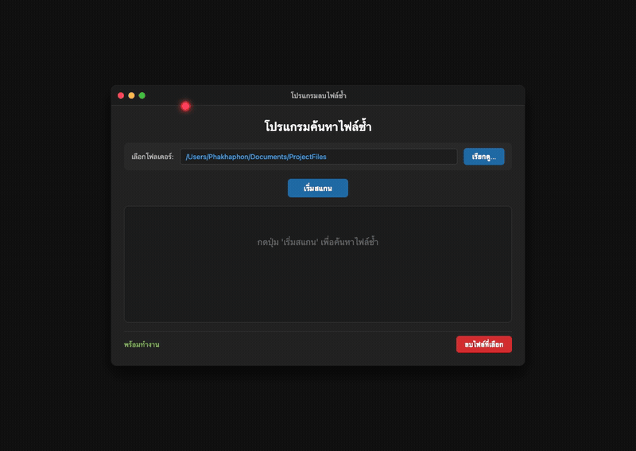

# Duplicate File Cleaner (โปรแกรมค้นหาไฟล์ซ้ำ ด้วย Python)
[](https://download-directory.github.io/?url=https://github.com/FANG9356/MyProject/tree/main/16_Duplicate-File-Cleaner)
*ดาวน์โหลดเฉพาะโฟลเดอร์นี้เป็นไฟล์ ZIP (หรือ [ดาวน์โหลดผ่าน DownGit](https://minhaskamal.github.io/DownGit/#/home?url=https://github.com/FANG9356/MyProject/tree/main/16_Duplicate-File-Cleaner))*

โปรแกรมอรรถประโยชน์บนเดสก์ท็อปสำหรับค้นหาและกำจัดไฟล์ซ้ำซ้อนภายในฮาร์ดดิสก์หรือโฟลเดอร์ พัฒนาด้วยภาษา Python และ CustomTkinter ในธีมสีมืด (Dark Mode) ผสมผสานขั้นตอนวิธีกรองไฟล์สองชั้น (Two-Tier Filtering) ด้วยขนาดไฟล์ (File Size) และการเข้ารหัสแฮชแบบแบ่งบล็อก SHA-256 (Chunked Cryptographic Hashing) เพื่อความเร็วสูงสุดและปลอดภัยต่อหน่วยความจำ



## ข้อมูลโครงการและเอกสารสถาปัตยกรรม

- ผู้พัฒนา: ภคพล สุขมี (Phakhaphon Sukmee)
- เอกสารทางเทคนิคและขั้นตอนวิธี: [docs/duplicate_detection_algorithm.md](docs/duplicate_detection_algorithm.md)

## คุณสมบัติเด่น

- สถาปัตยกรรมค้นหาความเร็วสูง 2 ชั้น: กรองไฟล์ด้วยขนาดก่อน แล้วยืนยันความถูกต้องด้วย SHA-256
- ประมวลผลไฟล์ขนาดใหญ่ได้โดยไม่เปลืองแรมด้วยการอ่านข้อมูลทีละบล็อก 64 KB
- แสดงผลลัพธ์แยกตามกลุ่มของค่าแฮช (Hash Prefix 8 ตัวอักษร) พร้อมขนาดไฟล์
- มีระบบ Checkbox เลือกไฟล์ที่ต้องการลบเฉพาะชุดที่ซ้ำซ้อน
- ป้องกันการลบข้อมูลผิดพลาดด้วยหน้าต่างยืนยันการลบ (Confirmation Dialog) และสรุปผลพื้นที่ที่ประหยัดได้

## โครงสร้างไดเรกทอรี

```
16_Duplicate-File-Cleaner/
├── docs/
│   └── duplicate_detection_algorithm.md
├── clean.py
├── clean_sim.html
├── test_simulation.py
├── PORTFOLIO_INFO.md
└── README.md
```

## การทดสอบระบบ

รันชุดทดสอบสร้างชุดไฟล์ทดสอบจำลอง ตรวจสอบการหากลุ่มไฟล์ซ้ำ และยืนยันความถูกต้องของการลบ:

```bash
python3 test_simulation.py
```
