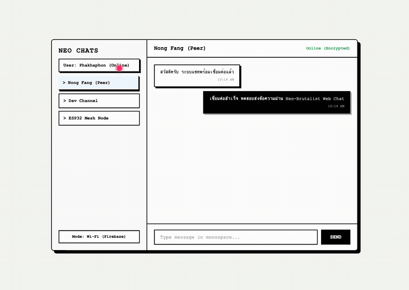

# Neo Web Chat (เว็บไซต์คุยแชทออนไลน์ และระบบแชทออฟไลน์ BLE)
[](https://download-directory.github.io/?url=https://github.com/FANG9356/MyProject/tree/main/18_Neo-Web-Chat)
*ดาวน์โหลดเฉพาะโฟลเดอร์นี้เป็นไฟล์ ZIP (หรือ [ดาวน์โหลดผ่าน DownGit](https://minhaskamal.github.io/DownGit/#/home?url=https://github.com/FANG9356/MyProject/tree/main/18_Neo-Web-Chat))*

ระบบสื่อสารข้อความสองโหมด (Dual-Mode Messaging System) ประกอบด้วยเว็บแอปพลิเคชันสไตล์ Neo-Brutalist เชื่อมต่อระบบคลาวด์แบบเรียลไทม์ และโปรแกรมเดสก์ท็อปรองรับการสื่อสารไร้สายระยะสั้นผ่านโปรโตคอล Bluetooth Low Energy (BLE) โดยตรงกับไมโครคอนโทรลเลอร์ ESP32 โดยไม่ต้องพึ่งพาอินเทอร์เน็ต



## ข้อมูลโครงการและเอกสารสถาปัตยกรรมระบบ

- ผู้พัฒนา: ภคพล สุขมี (Phakhaphon Sukmee)
- เอกสารสถาปัตยกรรมระบบและโปรโตคอลการสื่อสาร: [docs/chat_architecture_and_protocol.md](docs/chat_architecture_and_protocol.md)
- อินเทอร์เฟซแชร์หน้าจอ: [discord_style_sharing.html](discord_style_sharing.html)
- ไคลเอนต์สื่อสารผ่านบลูทูธ (Python BLE): [app.py](app.py)

## คุณสมบัติเด่น

- การออกแบบส่วนติดต่อผู้ใช้สไตล์ Neo-Brutalist: เส้นขอบดำสนิท เงาแข็ง (Hard Drop Shadow) และชุดตัวอักษร Monospace
- โหมดออนไลน์ (Wi-Fi): สื่อสารและซิงค์ข้อความแบบเรียลไทม์ พร้อมระบบยืนยันตัวตน (Authentication)
- โหมดออฟไลน์ (Bluetooth Low Energy): เชื่อมต่อและแลกเปลี่ยนข้อมูลผ่าน BLE GATT Profile (Nordic UART Service)
- ระบบสลับโหมดการทำงานระหว่าง Wi-Fi และ Bluetooth Mesh ภายในคลิกเดียว
- ระบบจัดการคิวข้อความแบบ Asynchronous ด้วย Python และ asyncio.Queue ป้องกัน GUI ค้าง

## โครงสร้างไดเรกทอรี

```
18_Neo-Web-Chat/
├── docs/
│   └── chat_architecture_and_protocol.md
├── index.html
├── discord_style_sharing.html
├── app.py
├── chat_sim.html
├── test_simulation.py
├── PORTFOLIO_INFO.md
└── README.md
```

## การทดสอบระบบ

รันชุดทดสอบตรวจสอบโครงสร้างไฟล์ โครงสร้าง DOM องค์ประกอบแชท ค่า UUID ของโปรโตคอล BLE และการส่งข้อมูลผ่านอะซิงโครนัสคิว:

```bash
python3 test_simulation.py
```
