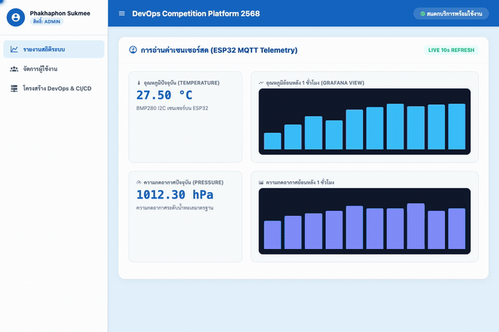

# 19_DevOps-Competition-Platform
[](https://download-directory.github.io/?url=https://github.com/FANG9356/MyProject/tree/main/19_DevOps-Competition-Platform)
*ดาวน์โหลดเฉพาะโฟลเดอร์นี้เป็นไฟล์ ZIP (หรือ [ดาวน์โหลดผ่าน DownGit](https://minhaskamal.github.io/DownGit/#/home?url=https://github.com/FANG9356/MyProject/tree/main/19_DevOps-Competition-Platform))*

ระบบแพลตฟอร์มการแข่งขันทักษะวิชาชีพด้าน DevOps และ IoT ครอบคลุมการพัฒนาเว็บแอปพลิเคชัน การวางระบบส่งข้อมูลเซนเซอร์ และการบริหารจัดการโครงสร้างพื้นฐานเครือข่าย

## ภาพถ่ายหน้าจอการทำงานจริง (Screenshot)


## ภาพเคลื่อนไหวสาธิตการทำงาน (Demonstration)


## ผู้พัฒนา
Phakhaphon Sukmee

## รายละเอียดส่วนประกอบ
- **backend**: Express.js REST API พร้อมระบบยืนยันตัวตน JWT และการจัดการข้อมูลผู้ใช้งาน
- **frontend**: Nuxt 3 และ Vue 3 พัฒนาด้วย TypeScript และ TailwindCSS
- **iot**: เฟิร์มแวร์ ESP32 อ่านค่าอุณหภูมิและความดันบรรยากาศ ส่งผ่าน MQTT และแดชบอร์ด Node-RED / Grafana
- **devops_infrastructure**: การติดตั้ง Proxmox VE, Docker Compose สแตกบริการคลาวด์ และสคริปต์เน็ตเวิร์ก
- **competition_criteria**: เอกสารเกณฑ์การแข่งขันระดับประเทศและระดับภาค

## วิธีการทดสอบ
```bash
node test_simulation.js
```
