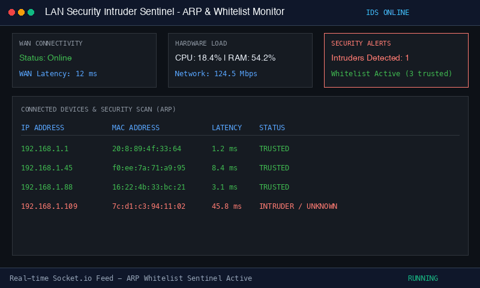

# 24_LAN-Security-Intruder-Sentinel

ระบบตรวจสอบความปลอดภัยเครือข่ายแลน ตรวจจับอุปกรณ์แปลกปลอมด้วย MAC Address Whitelist พร้อมแดชบอร์ดแสดงสถานะแบบเรียลไทม์

## ตัวอย่างการทำงานจริง (Demonstration)


## ผู้พัฒนา
Phakhaphon Sukmee

## คุณสมบัติหลัก
- สแกนอุปกรณ์ในเครือข่ายท้องถิ่นผ่านตาราง ARP
- ตรวจจับอุปกรณ์ที่ไม่ได้อยู่ในบัญชีขาว (Whitelist) พร้อมแจ้งเตือนทันที
- วัดค่า Latency ของแต่ละอุปกรณ์ในวงเครือข่าย
- ตรวจสอบสถานะการเชื่อมต่ออินเทอร์เน็ต WAN
- ถ่ายทอดข้อมูลแบบเรียลไทม์ผ่าน Socket.io สู่หน้าเว็บแดชบอร์ด

## วิธีการทดสอบ
```bash
node test_simulation.js
```
