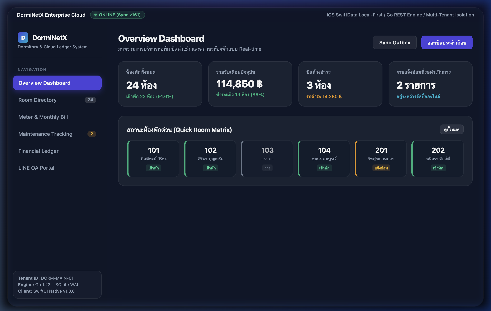
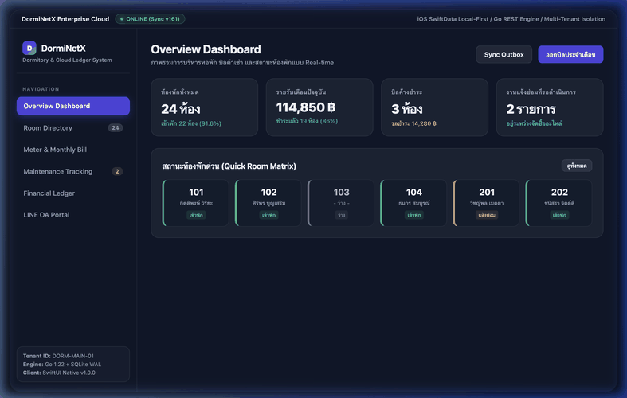

# 26_DormiNetX-Enterprise-iOS-Cloud
[](https://download-directory.github.io/?url=https://github.com/FANG9356/MyProject/tree/main/26_DormiNetX-Enterprise-iOS-Cloud)
*ดาวน์โหลดเฉพาะโฟลเดอร์นี้เป็นไฟล์ ZIP (หรือ [ดาวน์โหลดผ่าน DownGit](https://minhaskamal.github.io/DownGit/#/home?url=https://github.com/FANG9356/MyProject/tree/main/26_DormiNetX-Enterprise-iOS-Cloud))*

ระบบบริหารจัดการหอพักระดับองค์กร รองรับ Native iOS/iPadOS (SwiftUI + SwiftData) ร่วมกับคลาวด์แบ็กเอนด์ภาษา Go, ระบบบัญชี Financial Ledger พร้อม SHA-256 Audit Trail และการเชื่อมต่อ LINE Official Account / LIFF Portal

## ภาพถ่ายหน้าจอการทำงานจริง (Screenshot)


## ภาพเคลื่อนไหวสาธิตการทำงาน (Demonstration)


## ผู้พัฒนา
Phakhaphon Sukmee

## คุณสมบัติหลัก
- แอปพลิเคชัน Native iOS และ iPadOS พัฒนาด้วย Swift 5.9, SwiftUI และ SwiftData ทำงานแบบ Local-First 100%
- แบ็กเอนด์ประสิทธิภาพสูงด้วยภาษา Go 1.22 แยกฐานข้อมูล Multi-Tenant SQLite อิสระต่อหอพัก ป้องกันข้อมูลรั่วไหล
- ผ่านการทดสอบ Concurrency Safety และ Data Race ด้วย Go Race Detector เป็นศูนย์ (0 Data Race)
- ระบบบัญชีและการคำนวณบิลรายเดือน พร้อม Immutable Financial Ledger ตรวจสอบย้อนหลังด้วย SHA-256
- ระบบแจ้งหนี้อัตโนมัติผ่าน LINE OA ด้วย Flex Messages และพอร์ทัลลูกบ้านผ่าน LINE LIFF
- ระบบตรวจสอบสลิปอัตโนมัติ (Slip Verification) พร้อมระบบป้องกันสลิปซ้ำและการ Fail-Closed
- กระบวนการซ่อมแซม 6 ขั้นตอน ควบคุมสิทธิ์การอนุมัติและเก็บบันทึกหลักฐาน
- รองรับการแปลภาษา 4 ภาษา (ไทย, อังกฤษ, พม่า, จีน) สมบูรณ์ 100%

## โครงสร้างไฟล์สำคัญ
- `DormAppSwift_Sources/`: ซอร์สโค้ดแอปพลิเคชัน Native iOS/iPadOS (SwiftUI, SwiftData, Models, Views, Services)
- `backend-dorm/`: คลาวด์แบ็กเอนด์ภาษา Go (Go REST API, Multi-tenant Handlers, SQLite, LINE Bot, LIFF Portal)
- `docs/`: เอกสารสถาปัตยกรรมระบบ, Core Hardening, Server Restore Runbook และ Incident Management
- `project-tracking/`: รายงานสถานะการส่งมอบงานและการทดสอบเชิงวิศวกรรม
- `standalone_demo.html`: ตัวอย่างการใช้งานและจำลองหน้าต่างโปรแกรมแบบ Interactive
- `test_simulation.js`: สคริปต์ทดสอบการทำงานระบบอัตโนมัติ

## วิธีการทดสอบ
```bash
node test_simulation.js
```
