# My Projects

> **ผู้พัฒนา:** Phakhaphon Sukmee
> **GitHub Repository:** [FANG9356/MyProject](https://github.com/FANG9356/MyProject)

คลังรวบรวมโค้ดและโปรเจกต์ต่างๆ ที่ทำไว้ แต่ละโฟลเดอร์มีโค้ด ตัวอย่างการรัน และสคริปต์สำหรับทดสอบ

---

## การดาวน์โหลดเฉพาะโฟลเดอร์โปรเจกต์ (Download Individual Project)

หากต้องการดาวน์โหลดเฉพาะโฟลเดอร์ของโปรเจกต์ที่สนใจ โดยไม่ต้องดาวน์โหลดทั้งคลัง Repository:
1. **กดปุ่ม `Download ZIP`** ในตารางสารบัญ หรือในหัวข้อรายละเอียดของแต่ละโปรเจกต์
2. ระบบจะทำการดึงไฟล์เฉพาะโฟลเดอร์นั้นจาก GitHub และสร้างไฟล์ `.zip` ให้ดาวน์โหลดลงเครื่องทันที (ผ่านบริการ GitHub Directory Downloader)
3. หรือสามารถคลิกที่ลิงก์สำรอง **`DownGit`** ที่ระบุไว้ในแต่ละโปรเจกต์เพื่อดาวน์โหลดได้เช่นกัน

---

## สารบัญโปรเจกต์

| ลำดับ | โปรเจกต์ | หมวดหมู่ | ดาวน์โหลด (ZIP) | คำสั่งรัน | URL | คำสั่งทดสอบ |
| :---: | :--- | :--- | :---: | :--- | :---: | :---: |
| **01** | [`01_AI-WiFi-Sensing-Wall`](./01_AI-WiFi-Sensing-Wall) | AI & RF Sensing | [](https://download-directory.github.io/?url=https://github.com/FANG9356/MyProject/tree/main/01_AI-WiFi-Sensing-Wall) | `python3 ai_web_server.py` | `http://localhost:8050` | `python3 test_simulation.py` |
| **02** | [`02_Smart-Doc-AI`](./02_Smart-Doc-AI) | GenAI Agent | [](https://download-directory.github.io/?url=https://github.com/FANG9356/MyProject/tree/main/02_Smart-Doc-AI) | `docker compose up -d` | `http://localhost:5173` | `python3 test_simulation.py` |
| **03** | [`03_Tip-Desk-PromptPay`](./03_Tip-Desk-PromptPay) | FinTech / Web | [](https://download-directory.github.io/?url=https://github.com/FANG9356/MyProject/tree/main/03_Tip-Desk-PromptPay) | `uvicorn main:app` & `npm run dev` | `http://localhost:5173` | `python3 test_simulation.py` |
| **04** | [`04_Club-Management-System`](./04_Club-Management-System) | Web Management | [](https://download-directory.github.io/?url=https://github.com/FANG9356/MyProject/tree/main/04_Club-Management-System) | `cd backend && node server.js` | `http://localhost:3000` | `node test_simulation.js` |
| **05** | [`05_ATM-YOLOv8-Detector`](./05_ATM-YOLOv8-Detector) | Computer Vision | [](https://download-directory.github.io/?url=https://github.com/FANG9356/MyProject/tree/main/05_ATM-YOLOv8-Detector) | `python3 person_detector.py` | หน้าต่างกล้อง | `python3 test_simulation.py` |
| **06** | [`06_Karaoke-Streaming-System`](./06_Karaoke-Streaming-System) | Streaming Server | [](https://download-directory.github.io/?url=https://github.com/FANG9356/MyProject/tree/main/06_Karaoke-Streaming-System) | `python3 main.py` | `http://localhost:8000` (รีโมต: `/remote.html`) | `python3 test_simulation.py` |
| **07** | [`07_AdGuard-Time-Portal`](./07_AdGuard-Time-Portal) | Network & Admin | [](https://download-directory.github.io/?url=https://github.com/FANG9356/MyProject/tree/main/07_AdGuard-Time-Portal) | `node server.js` | `http://localhost:8080` (แอดมิน: `/admin.html`) | `node test_simulation.js` |
| **08** | [`08_System-Monitor-Desktop-App`](./08_System-Monitor-Desktop-App) | Desktop Utility | [](https://download-directory.github.io/?url=https://github.com/FANG9356/MyProject/tree/main/08_System-Monitor-Desktop-App) | `.exe` (Win) หรือ `node server.js` | `http://localhost:3000` | `node test_simulation.js` |
| **09** | [`09_HomeServer-Infrastructure`](./09_HomeServer-Infrastructure) | Go, SQLite & React | [](https://download-directory.github.io/?url=https://github.com/FANG9356/MyProject/tree/main/09_HomeServer-Infrastructure) | `cd backend && go run .` | `http://localhost:8001` | `python3 test_simulation.py` |
| **10** | [`10_Music-Shuffle-AI`](./10_Music-Shuffle-AI) | AI Desktop Player | [](https://download-directory.github.io/?url=https://github.com/FANG9356/MyProject/tree/main/10_Music-Shuffle-AI) | `python3 main.py` | หน้าต่างโปรแกรม Desktop | `python3 test_simulation.py` |
| **11** | [`11_Bottle-Can-Sorter`](./11_Bottle-Can-Sorter) | Embedded & IoT | [](https://download-directory.github.io/?url=https://github.com/FANG9356/MyProject/tree/main/11_Bottle-Can-Sorter) | `arduino/bottle_can_sorter.ino` | ฮาร์ดแวร์ / `sorter_sim.html` | `python3 test_simulation.py` |
| **12** | [`12_Smart-Plant-Watering`](./12_Smart-Plant-Watering) | Smart Agriculture | [](https://download-directory.github.io/?url=https://github.com/FANG9356/MyProject/tree/main/12_Smart-Plant-Watering) | `arduino/blynk_valve_control.ino` | ฮาร์ดแวร์ / `watering_sim.html` | `python3 test_simulation.py` |
| **13** | [`13_General-Education-Web`](./13_General-Education-Web) | EdTech / Web | [](https://download-directory.github.io/?url=https://github.com/FANG9356/MyProject/tree/main/13_General-Education-Web) | `open index.html` | `index.html` | `python3 test_simulation.py` |
| **14** | [`14_Computer-Quiz-System`](./14_Computer-Quiz-System) | Web Assessment | [](https://download-directory.github.io/?url=https://github.com/FANG9356/MyProject/tree/main/14_Computer-Quiz-System) | `open index.html` | `index.html` | `python3 test_simulation.py` |
| **15** | [`15_SD-Calculator-Python`](./15_SD-Calculator-Python) | Data Science GUI | [](https://download-directory.github.io/?url=https://github.com/FANG9356/MyProject/tree/main/15_SD-Calculator-Python) | `python3 sd.py` | หน้าต่างโปรแกรม Desktop | `python3 test_simulation.py` |
| **16** | [`16_Duplicate-File-Cleaner`](./16_Duplicate-File-Cleaner) | Desktop Utility | [](https://download-directory.github.io/?url=https://github.com/FANG9356/MyProject/tree/main/16_Duplicate-File-Cleaner) | `python3 clean.py` | หน้าต่างโปรแกรม Desktop | `python3 test_simulation.py` |
| **17** | [`17_Grade-Calculator-Python`](./17_Grade-Calculator-Python) | Educational Tools | [](https://download-directory.github.io/?url=https://github.com/FANG9356/MyProject/tree/main/17_Grade-Calculator-Python) | `python3 cal.py` | หน้าต่างโปรแกรม Desktop | `python3 test_simulation.py` |
| **18** | [`18_Neo-Web-Chat`](./18_Neo-Web-Chat) | Web & Wireless | [](https://download-directory.github.io/?url=https://github.com/FANG9356/MyProject/tree/main/18_Neo-Web-Chat) | `open index.html` / `python3 app.py` | `index.html` | `python3 test_simulation.py` |
| **19** | [`19_DevOps-Competition-Platform`](./19_DevOps-Competition-Platform) | DevOps & IoT | [](https://download-directory.github.io/?url=https://github.com/FANG9356/MyProject/tree/main/19_DevOps-Competition-Platform) | `cd backend && node server.js` | `http://localhost:5000` | `node test_simulation.js` |
| **20** | [`20_Color-Detection-Kalman-YOLO`](./20_Color-Detection-Kalman-YOLO) | Computer Vision | [](https://download-directory.github.io/?url=https://github.com/FANG9356/MyProject/tree/main/20_Color-Detection-Kalman-YOLO) | `python3 realtime_camera.py` | หน้าต่างกล้อง | `python3 test_simulation.py` |
| **21** | [`21_Robot-Moisture-Tracker`](./21_Robot-Moisture-Tracker) | Robotics & Geolocation | [](https://download-directory.github.io/?url=https://github.com/FANG9356/MyProject/tree/main/21_Robot-Moisture-Tracker) | `open index.html` | `index.html` | `node test_simulation.js` |
| **22** | [`22_PDF-Speech-Synthesizer`](./22_PDF-Speech-Synthesizer) | NLP / Text-to-Speech | [](https://download-directory.github.io/?url=https://github.com/FANG9356/MyProject/tree/main/22_PDF-Speech-Synthesizer) | `python3 pdf_to_speech.py` | สังเคราะห์ไฟล์ MP3 | `python3 test_simulation.py` |
| **23** | [`23_Discord-Voice-Screen-Share`](./23_Discord-Voice-Screen-Share) | Socket Streaming / Voice | [](https://download-directory.github.io/?url=https://github.com/FANG9356/MyProject/tree/main/23_Discord-Voice-Screen-Share) | `python3 server.py` | พอร์ต 65432/65433 | `python3 test_simulation.py` |
| **24** | [`24_LAN-Security-Intruder-Sentinel`](./24_LAN-Security-Intruder-Sentinel) | Network Security / IDS | [](https://download-directory.github.io/?url=https://github.com/FANG9356/MyProject/tree/main/24_LAN-Security-Intruder-Sentinel) | `node server.js` | `http://localhost:3080` | `node test_simulation.js` |
| **25** | [`25_DormiNetX-Windows-Desktop`](./25_DormiNetX-Windows-Desktop) | Windows Desktop / Wails | [](https://download-directory.github.io/?url=https://github.com/FANG9356/MyProject/tree/main/25_DormiNetX-Windows-Desktop) | `bin/DormiNetX.exe` หรือ `open standalone_demo.html` | Standalone App / `standalone_demo.html` | `node test_simulation.js` |
| **26** | [`26_DormiNetX-Enterprise-iOS-Cloud`](./26_DormiNetX-Enterprise-iOS-Cloud) | Native iOS & Cloud Platform | [](https://download-directory.github.io/?url=https://github.com/FANG9356/MyProject/tree/main/26_DormiNetX-Enterprise-iOS-Cloud) | `open Xcode` / `cd backend-dorm && go run main.go` | iOS App / Web LIFF | `cd backend-dorm && go test ./...` |

---

## การรันชุดทดสอบ

ในโฟลเดอร์หลักมีสคริปต์ [`run_all_tests.sh`](./run_all_tests.sh) สำหรับรัน Simulation Test ของทั้ง 26 โปรเจกต์ สามารถทดสอบได้ด้วยคำสั่ง:
```bash
./run_all_tests.sh
```

---

## รายละเอียดโปรเจกต์

---

### 1. [01_AI-WiFi-Sensing-Wall](./01_AI-WiFi-Sensing-Wall) — ระบบตรวจจับการเคลื่อนไหวผ่านสัญญาณ WiFi (CSI)

> [](https://download-directory.github.io/?url=https://github.com/FANG9356/MyProject/tree/main/01_AI-WiFi-Sensing-Wall)
> *ดาวน์โหลดเฉพาะโฟลเดอร์นี้เป็นไฟล์ ZIP (หรือ [ดาวน์โหลดผ่าน DownGit](https://minhaskamal.github.io/DownGit/#/home?url=https://github.com/FANG9356/MyProject/tree/main/01_AI-WiFi-Sensing-Wall))*

> **เทคโนโลยี:** ESP32, WiFi CSI, Scikit-Learn, Python, HTML5 Dashboard

#### ภาพรวมโครงการ (Project Overview)
ระบบตรวจจับการเคลื่อนไหวและการหกล้มของบุคคลผ่านการวิเคราะห์สัญญาณคลื่นวิทยุ WiFi CSI จากบอร์ด ESP32 โดยใช้โมเดล Machine Learning (Random Forest) จำแนกรูปแบบคลื่นสัญญาณที่เปลี่ยนไป (ห้องว่าง, มีคนเดิน, หกล้ม) และแสดงผลบนหน้าเว็บแดชบอร์ด

#### ตัวอย่างหน้าจอ (Screenshots)


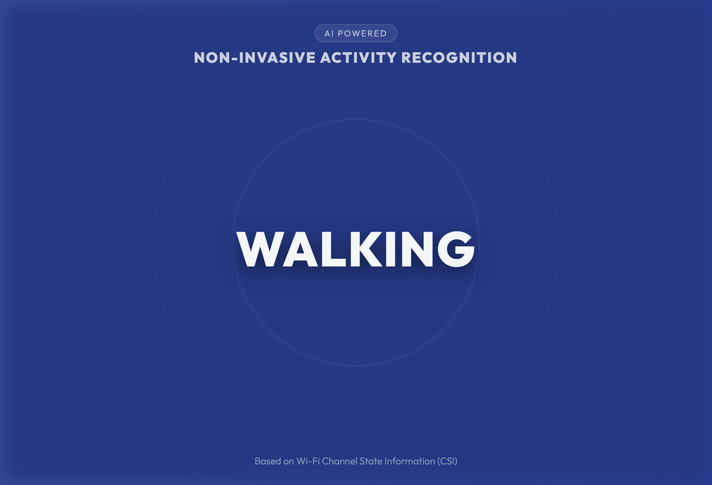

#### แผนภาพการทำงาน (Architecture)
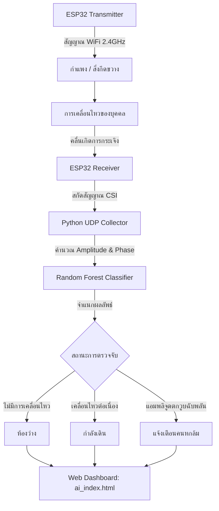

#### วิธีรันระบบ (How to Run)
1. **ติดตั้ง Dependencies:**
  ```bash
  cd 01_AI-WiFi-Sensing-Wall
  pip install scikit-learn pandas numpy joblib
  ```
2. **รันโหมดทดสอบจำลอง (Simulation Mode):**
  ```bash
  python3 test_simulation.py
  ```
3. **เปิดหน้า Web Dashboard:**
  ```bash
  python3 ai_web_server.py
  ```
  เปิดเบราว์เซอร์ที่: `http://localhost:8050`

---

### 2. [02_Smart-Doc-AI](./02_Smart-Doc-AI) — เครื่องมือค้นคว้าข้อมูลและร่างเอกสาร Word

> [](https://download-directory.github.io/?url=https://github.com/FANG9356/MyProject/tree/main/02_Smart-Doc-AI)
> *ดาวน์โหลดเฉพาะโฟลเดอร์นี้เป็นไฟล์ ZIP (หรือ [ดาวน์โหลดผ่าน DownGit](https://minhaskamal.github.io/DownGit/#/home?url=https://github.com/FANG9356/MyProject/tree/main/02_Smart-Doc-AI))*

> **เทคโนโลยี:** React, Tailwind CSS, Vite, FastAPI, Wikipedia API, DuckDuckGo, ArXiv API, python-docx, Docker

#### ภาพรวมโครงการ (Project Overview)
ระบบช่วยรวบรวมข้อมูลตามหัวข้อที่ต้องการจากแหล่งข้อมูลออนไลน์ (Wikipedia, ArXiv, Web Search) และจัดรูปแบบเป็นเอกสาร Word (.docx) พร้อมดาวน์โหลด

#### ตัวอย่างหน้าจอ (Screenshots)


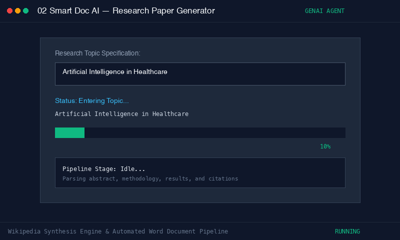

#### แผนภาพการทำงาน (Architecture)
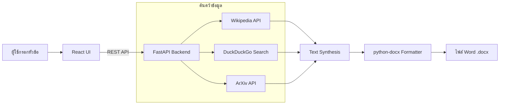

#### วิธีรันระบบ (How to Run)
* **รันผ่าน Docker Compose:**
  ```bash
  cd 02_Smart-Doc-AI
  docker compose up -d
  ```
  เปิดเบราว์เซอร์ที่: `http://localhost:5173`
* **รันแบบ Manual:**
  * Backend: `cd 02_Smart-Doc-AI/app && pip install -r requirements.txt && uvicorn main:app --reload --port 8000`
  * Frontend: `cd 02_Smart-Doc-AI/frontend && npm install && npm run dev`

---

### 3. [03_Tip-Desk-PromptPay](./03_Tip-Desk-PromptPay) — ระบบรับเงินบริจาค PromptPay พร้อมเสียงอ่านชื่อ

> [](https://download-directory.github.io/?url=https://github.com/FANG9356/MyProject/tree/main/03_Tip-Desk-PromptPay)
> *ดาวน์โหลดเฉพาะโฟลเดอร์นี้เป็นไฟล์ ZIP (หรือ [ดาวน์โหลดผ่าน DownGit](https://minhaskamal.github.io/DownGit/#/home?url=https://github.com/FANG9356/MyProject/tree/main/03_Tip-Desk-PromptPay))*

> **เทคโนโลยี:** React, TypeScript, Vite, FastAPI, SQLite, EMVCo QR Code, Web Speech API

#### ภาพรวมโครงการ (Project Overview)
ระบบรับบริจาค/ทิปผ่าน PromptPay QR Code ตามมาตรฐาน EMVCo รองรับการอัปเดตยอดเงินแบบเรียลไทม์ และอ่านชื่อผู้ส่งพร้อมข้อความผ่าน Text-to-Speech

#### ตัวอย่างหน้าจอ (Screenshots)


#### แผนภาพการทำงาน (Architecture)
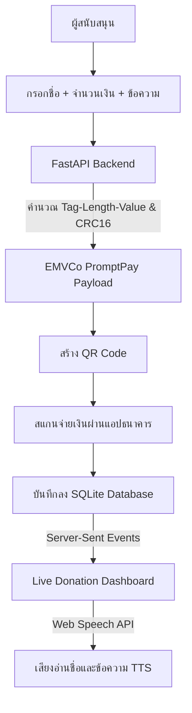

#### วิธีรันระบบ (How to Run)
1. **Backend (FastAPI):**
  ```bash
  cd 03_Tip-Desk-PromptPay/backend
  pip install -r requirements.txt
  cp .env.example .env
  uvicorn main:app --reload --port 8000
  ```
2. **Frontend (React):**
  ```bash
  cd 03_Tip-Desk-PromptPay
  npm install
  npm run dev
  ```
  เปิดเบราว์เซอร์ที่: `http://localhost:5173`

---

### 4. [04_Club-Management-System](./04_Club-Management-System) — ระบบลงทะเบียนและเช็คชื่อสมาชิกชมรม

> [](https://download-directory.github.io/?url=https://github.com/FANG9356/MyProject/tree/main/04_Club-Management-System)
> *ดาวน์โหลดเฉพาะโฟลเดอร์นี้เป็นไฟล์ ZIP (หรือ [ดาวน์โหลดผ่าน DownGit](https://minhaskamal.github.io/DownGit/#/home?url=https://github.com/FANG9356/MyProject/tree/main/04_Club-Management-System))*

> **เทคโนโลยี:** Node.js, Express, SQLite, Tailwind CSS, JWT

#### ภาพรวมโครงการ (Project Overview)
เว็บแอปพลิเคชันสำหรับลงทะเบียนสมาชิกชมรม เช็คชื่อเข้าร่วมกิจกรรม และมีหน้าแอดมินสำหรับดูสถิติและรายชื่อสมาชิก

#### ตัวอย่างหน้าจอ (Screenshots)
| หน้าลงทะเบียน (`/register.html`) | หน้าเช็คชื่อ (`/attendance.html`) |
| :---: | :---: |
|  |  |


#### แผนภาพการทำงาน (Architecture)
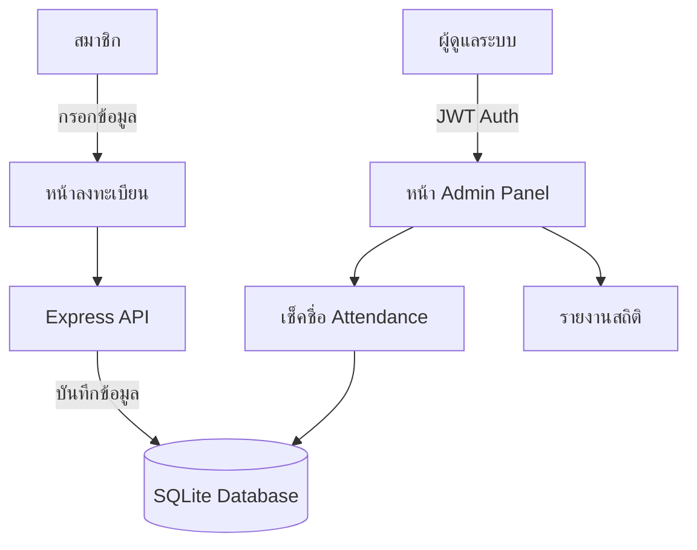

#### วิธีรันระบบ (How to Run)
```bash
cd 04_Club-Management-System/backend
npm install
cp .env.example .env
node server.js
```
เปิดใช้งานที่พอร์ต `3000`:
* หน้าลงทะเบียน: `http://localhost:3000/register.html`
* หน้าเช็คชื่อ: `http://localhost:3000/attendance.html`
* หน้าแอดมิน: `http://localhost:3000/admin.html`

---

### 5. [05_ATM-YOLOv8-Detector](./05_ATM-YOLOv8-Detector) — ระบบตรวจจับบุคคลหน้าตู้ ATM ด้วย YOLOv8

> [](https://download-directory.github.io/?url=https://github.com/FANG9356/MyProject/tree/main/05_ATM-YOLOv8-Detector)
> *ดาวน์โหลดเฉพาะโฟลเดอร์นี้เป็นไฟล์ ZIP (หรือ [ดาวน์โหลดผ่าน DownGit](https://minhaskamal.github.io/DownGit/#/home?url=https://github.com/FANG9356/MyProject/tree/main/05_ATM-YOLOv8-Detector))*

> **เทคโนโลยี:** Python, OpenCV, YOLOv8

#### ภาพรวมโครงการ (Project Overview)
โปรแกรมตรวจจับบุคคลบริเวณหน้าตู้ ATM โดยใช้โมเดล YOLOv8 วิเคราะห์ภาพจากกล้องวงจรปิด บันทึกภาพ Snapshot เมื่อพบบุคคล และเก็บประวัติเวลาไว้ในไฟล์ JSON Log

#### ตัวอย่างหน้าจอ (Screenshots)


#### แผนภาพการทำงาน (Architecture)
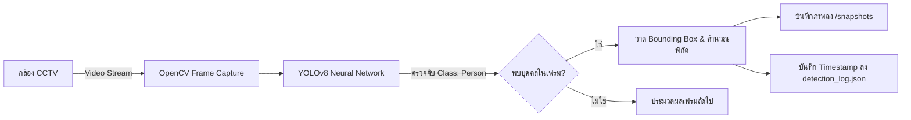

#### วิธีรันระบบ (How to Run)
1. **ติดตั้ง Dependencies:**
  ```bash
  cd 05_ATM-YOLOv8-Detector
  pip install ultralytics opencv-python numpy
  ```
2. **รันผ่านกล้องเว็บแคม:**
  ```bash
  python3 person_detector.py
  ```
3. **หรือรันโหมดจำลอง (Simulation):**
  ```bash
  python3 test_simulation.py
  ```

---

### 6. [06_Karaoke-Streaming-System](./06_Karaoke-Streaming-System) — ระบบสตรีมมิ่งคาราโอเกะพร้อมรีโมตมือถือ

> [](https://download-directory.github.io/?url=https://github.com/FANG9356/MyProject/tree/main/06_Karaoke-Streaming-System)
> *ดาวน์โหลดเฉพาะโฟลเดอร์นี้เป็นไฟล์ ZIP (หรือ [ดาวน์โหลดผ่าน DownGit](https://minhaskamal.github.io/DownGit/#/home?url=https://github.com/FANG9356/MyProject/tree/main/06_Karaoke-Streaming-System))*

> **เทคโนโลยี:** FastAPI, yt-dlp, HTML5 Video, WebSocket, REST API

#### ภาพรวมโครงการ (Project Overview)
ระบบสตรีมมิ่งคาราโอเกะสำหรับเปิดเล่นเพลงบนหน้าจอหลัก และมีหน้ารีโมตผ่านเว็บสำหรับให้คนอื่นใช้มือถือค้นหาเพลงและจัดการคิวเพลงพร้อมกัน

#### ตัวอย่างหน้าจอ (Screenshots)
**1. หน้าจอหลักเล่นเพลง (`/index.html`):**


**2. หน้ารีโมตควบคุมบนมือถือ (`/remote.html`):**
<p align="center">
  
</p>


#### แผนภาพการทำงาน (Architecture)
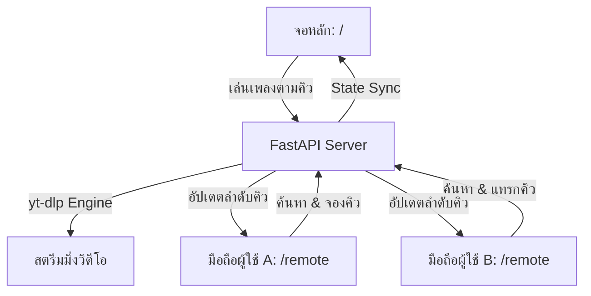

#### วิธีรันระบบ (How to Run)
1. **ติดตั้งและรันเซิร์ฟเวอร์:**
  ```bash
  cd 06_Karaoke-Streaming-System
  pip install fastapi uvicorn yt-dlp
  python3 main.py
  ```
2. **เปิดหน้าจอ:**
  * หน้าจอหลัก (Player): `http://localhost:8000`
  * หน้ารีโมตมือถือ (Remote): `http://localhost:8000/remote.html`

---

### 7. [07_AdGuard-Time-Portal](./07_AdGuard-Time-Portal) — ระบบจัดการเวลาอินเทอร์เน็ตผ่าน AdGuard Home API

> [](https://download-directory.github.io/?url=https://github.com/FANG9356/MyProject/tree/main/07_AdGuard-Time-Portal)
> *ดาวน์โหลดเฉพาะโฟลเดอร์นี้เป็นไฟล์ ZIP (หรือ [ดาวน์โหลดผ่าน DownGit](https://minhaskamal.github.io/DownGit/#/home?url=https://github.com/FANG9356/MyProject/tree/main/07_AdGuard-Time-Portal))*

> **เทคโนโลยี:** Node.js, Express, AdGuard Home REST API, SQLite, Node-Schedule

#### ภาพรวมโครงการ (Project Overview)
หน้าพอร์ทัลควบคุมการใช้งานอินเทอร์เน็ตของอุปกรณ์ในเครือข่าย โดยผู้ใช้กรอกรหัส PIN เพื่อเปิดใช้งานตามเวลาที่กำหนด และสั่งบล็อกระดับ DNS ผ่าน AdGuard Home API เมื่อหมดเวลา

#### ตัวอย่างหน้าจอ (Screenshots)
| หน้ากรอกรหัส PIN (`/index.html`) | หน้าแอดมินสร้างรหัส PIN (`/admin.html`) |
| :---: | :---: |
|  |  |


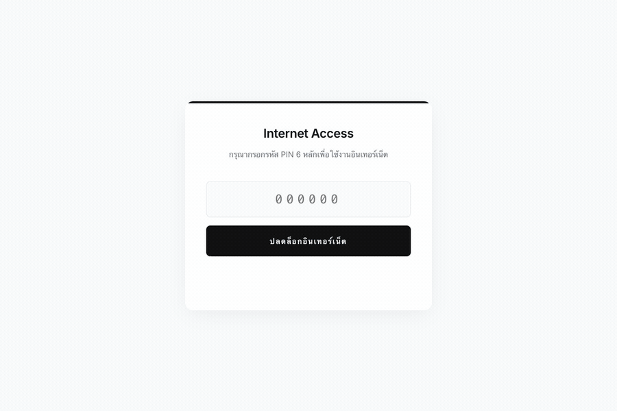

#### แผนภาพการทำงาน (Architecture)
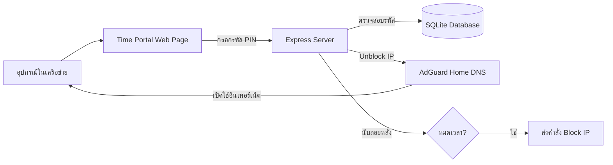

#### วิธีรันระบบ (How to Run)
```bash
cd 07_AdGuard-Time-Portal
npm install
cp .env.example .env
node server.js
```
เปิดใช้งานที่พอร์ต `8080`:
* หน้ากรอก PIN: `http://localhost:8080/index.html`
* หน้าแอดมิน: `http://localhost:8080/admin.html`

---

### 8. [08_System-Monitor-Desktop-App](./08_System-Monitor-Desktop-App) — โปรแกรมมอนิเตอร์สถานะระบบคอมพิวเตอร์

> [](https://download-directory.github.io/?url=https://github.com/FANG9356/MyProject/tree/main/08_System-Monitor-Desktop-App)
> *ดาวน์โหลดเฉพาะโฟลเดอร์นี้เป็นไฟล์ ZIP (หรือ [ดาวน์โหลดผ่าน DownGit](https://minhaskamal.github.io/DownGit/#/home?url=https://github.com/FANG9356/MyProject/tree/main/08_System-Monitor-Desktop-App))*

> **เทคโนโลยี:** Node.js, Express, pkg

#### ภาพรวมโครงการ (Project Overview)
โปรแกรมมอนิเตอร์ทรัพยากรเครื่อง (CPU, RAM, Uptime) แสดงผลผ่านหน้าเว็บเบราว์เซอร์ โดยคอมไพล์เป็นไฟล์ .exe แบบ Standalone ใช้งานได้ทันทีโดยไม่ต้องติดตั้ง Node.js เพิ่มเติม

#### ตัวอย่างหน้าจอ (Screenshots)


#### แผนภาพการทำงาน (Architecture)
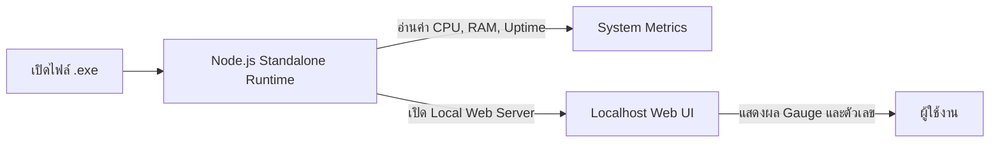

#### วิธีรันระบบ (How to Run)
* **บน Windows:**
  ดับเบิลคลิกไฟล์ `sys-monitor-app-win-x64.exe` ได้ทันที
* **บน macOS / Linux:**
  ```bash
  cd 08_System-Monitor-Desktop-App
  npm install
  node server.js
  ```
  เปิดเบราว์เซอร์ที่: `http://localhost:3000`

---

### 9. [09_HomeServer-Infrastructure](./09_HomeServer-Infrastructure) — HomeServer Services & Network Scanner

> [](https://download-directory.github.io/?url=https://github.com/FANG9356/MyProject/tree/main/09_HomeServer-Infrastructure)
> *ดาวน์โหลดเฉพาะโฟลเดอร์นี้เป็นไฟล์ ZIP (หรือ [ดาวน์โหลดผ่าน DownGit](https://minhaskamal.github.io/DownGit/#/home?url=https://github.com/FANG9356/MyProject/tree/main/09_HomeServer-Infrastructure))*

> **เทคโนโลยี:** Go, SQLite, React, Tailwind CSS, Docker

#### ภาพรวมโครงการ (Project Overview)
แดชบอร์ดรวบรวมทางเข้าบริการต่างๆ ในบ้าน และมีเครื่องมือสแกนหา IP อุปกรณ์ในเครือข่าย:
1. **Services Hub:** หน้ารวมทางเข้าและเช็กสถานะการทำงานของบริการภายในบ้าน เช่น Immich, Jellyfin, FileBrowser, Bitwarden, Memos
2. **Network Scanner:** ค้นหา IP และอุปกรณ์ที่เชื่อมต่ออยู่ในวง LAN เดียวกัน หรือระบุ Subnet เพื่อค้นหาข้ามวง VLAN พร้อมเช็กพอร์ตพื้นฐานที่เปิดอยู่ และบันทึกผลลง SQLite

#### ตัวอย่างหน้าจอ (Screenshots)
| Services Hub | Network Scanner |
| :---: | :---: |
|  |  |


#### แผนภาพการทำงาน (Architecture)
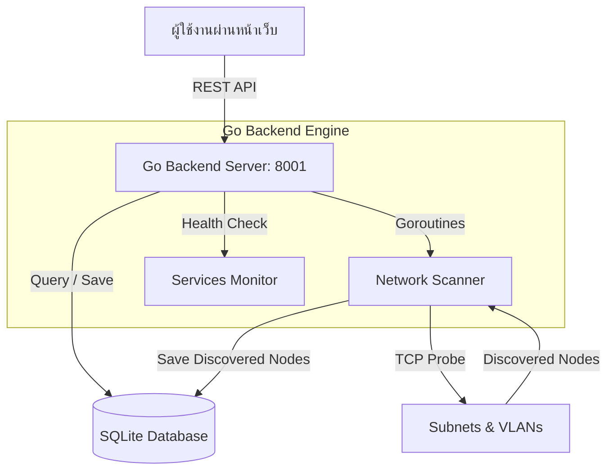

#### วิธีรันระบบ (How to Run)
1. **Backend (Go):**
  ```bash
  cd 09_HomeServer-Infrastructure/backend
  go run .
  ```
2. **Frontend (React + Tailwind):**
  ```bash
  cd 09_HomeServer-Infrastructure/frontend
  npm install
  npm run dev
  ```
  *(หรือรันผ่าน Docker: `docker compose up -d --build`)*
  เปิดเบราว์เซอร์ที่: `http://localhost:8001`

---

### 10. [10_Music-Shuffle-AI](./10_Music-Shuffle-AI) — โปรแกรมเล่นเพลงเดสก์ท็อปพร้อมระบบค้นหาด้วยเสียงผ่าน AI (Whisper)

> [](https://download-directory.github.io/?url=https://github.com/FANG9356/MyProject/tree/main/10_Music-Shuffle-AI)
> *ดาวน์โหลดเฉพาะโฟลเดอร์นี้เป็นไฟล์ ZIP (หรือ [ดาวน์โหลดผ่าน DownGit](https://minhaskamal.github.io/DownGit/#/home?url=https://github.com/FANG9356/MyProject/tree/main/10_Music-Shuffle-AI))*

* **หมวดหมู่:** Desktop Application & AI Audio
* **เทคโนโลยี:** Python, PyQt6, faster-whisper, mutagen, yt-dlp

#### สรุปโปรเจกต์
โปรแกรมเล่นเพลงบนระบบปฏิบัติการเดสก์ท็อปที่พัฒนาด้วย PyQt6 เชื่อมต่อโมเดล faster-whisper เพื่อให้สามารถรับคำสั่งเสียงพูด (Speech-to-Text) ภาษาไทยและภาษาอังกฤษเพื่อค้นหาเพลงในคลังได้โดยตรงบนเครื่อง ตัวโปรแกรมรองรับการสร้างเพลย์ลิสต์ รายการโปรด การแสดงเนื้อเพลงแบบคาราโอเกะ (LRC Sync) และมีเครื่องมือค้นหาและฝังภาพปกเพลงอัตโนมัติผ่าน iTunes API และ YouTube


#### สถาปัตยกรรมระบบ
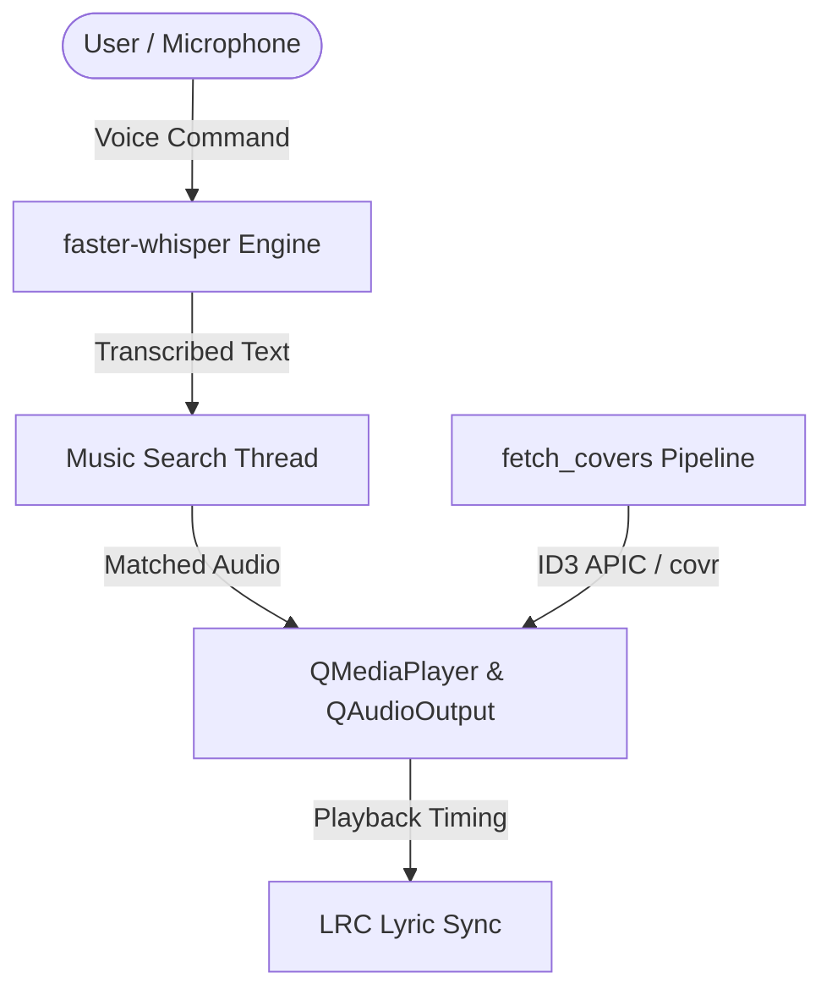

#### วิธีรันระบบ (How to Run)
```bash
cd 10_Music-Shuffle-AI
pip install -r requirements.txt
python3 main.py
```

โหมดทดสอบด่วน (Quick Test):
```bash
python3 test_simulation.py
```

---

### 11. [11_Bottle-Can-Sorter](./11_Bottle-Can-Sorter) — เครื่องคัดแยกขวดพลาสติกและกระป๋องโลหะอัตโนมัติ

> [](https://download-directory.github.io/?url=https://github.com/FANG9356/MyProject/tree/main/11_Bottle-Can-Sorter)
> *ดาวน์โหลดเฉพาะโฟลเดอร์นี้เป็นไฟล์ ZIP (หรือ [ดาวน์โหลดผ่าน DownGit](https://minhaskamal.github.io/DownGit/#/home?url=https://github.com/FANG9356/MyProject/tree/main/11_Bottle-Can-Sorter))*

* **หมวดหมู่:** Embedded Systems & Robotics / Waste Management
* **เทคโนโลยี:** Arduino Uno, C++, Stepper Motor, Servo Motor, HX711 Load Cell, Inductive Sensor, Ultrasonic Sensor, I2C LCD

#### สรุปโปรเจกต์
ระบบคัดแยกขยะรีไซเคิลอัตโนมัติสำหรับขวดพลาสติกและกระป๋องเครื่องดื่มอลูมิเนียม ควบคุมด้วยบอร์ด Arduino Uno เซนเซอร์อัลตราโซนิกตรวจจับการเข้าใกล้เพื่อเปิดฝาถังอัตโนมัติ เซนเซอร์ตรวจจับโลหะแบบเหนี่ยวนำ (Inductive Proximity Sensor) จำแนกกระป๋องโลหะ และโหลดเซลล์ HX711 ตรวจสอบน้ำหนัก ขับเคลื่อนถาดคัดแยกสองทิศทางด้วย Stepper Motor และแสดงปริมาณขยะพร้อมแจ้งเตือนสถานะถังเต็มบนจอ LCD I2C 16x2

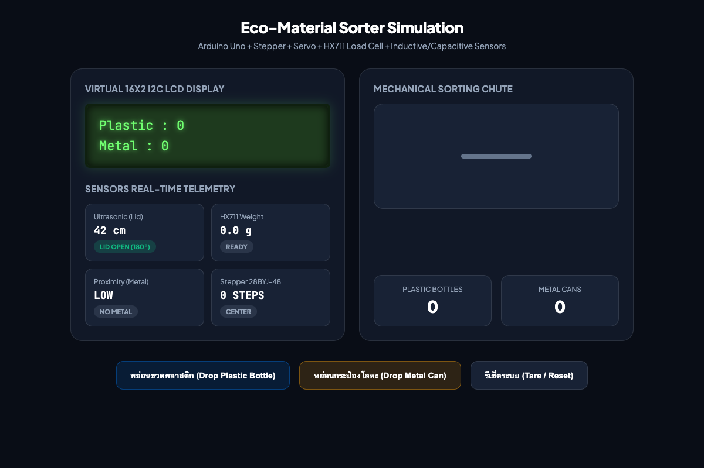

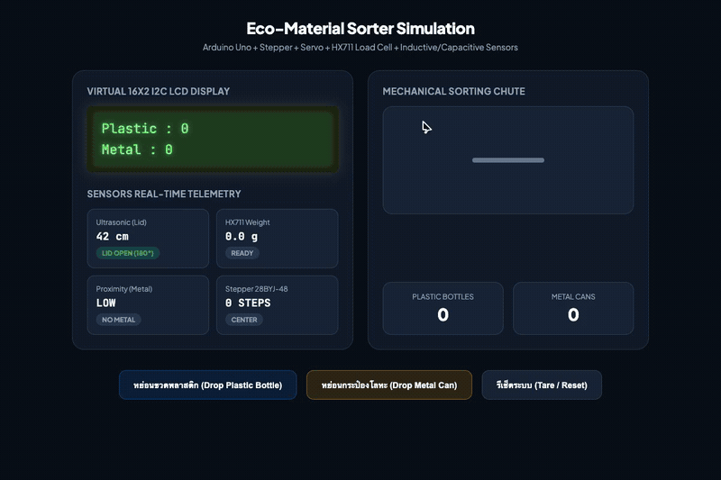

#### เอกสารประกอบโครงงาน
* รายงานโครงงานฉบับสมบูรณ์ (83 หน้า): [11_Bottle-Can-Sorter/docs/project_report_full.pdf](./11_Bottle-Can-Sorter/docs/project_report_full.pdf)
* แบบประเมินโครงงาน ทค.3 / ทค.5 และใบรับรอง: [11_Bottle-Can-Sorter/docs/](./11_Bottle-Can-Sorter/docs/)

#### วิธีรันระบบ (How to Run)
1. อัปโหลดเฟิร์มแวร์เข้าสู่ Arduino Uno:
   ```bash
   arduino-cli compile --fqbn arduino:avr:uno 11_Bottle-Can-Sorter/arduino/bottle_can_sorter.ino
   ```
2. รันโหมดทดสอบจำลอง (Simulation Mode):
   ```bash
   python3 11_Bottle-Can-Sorter/test_simulation.py
   ```

---

### 12. [12_Smart-Plant-Watering](./12_Smart-Plant-Watering) — เครื่องรดน้ำต้นไม้อัตโนมัติควบคุมระยะไกลด้วยมือถือ

> [](https://download-directory.github.io/?url=https://github.com/FANG9356/MyProject/tree/main/12_Smart-Plant-Watering)
> *ดาวน์โหลดเฉพาะโฟลเดอร์นี้เป็นไฟล์ ZIP (หรือ [ดาวน์โหลดผ่าน DownGit](https://minhaskamal.github.io/DownGit/#/home?url=https://github.com/FANG9356/MyProject/tree/main/12_Smart-Plant-Watering))*

* **หมวดหมู่:** IoT & Smart Agriculture
* **เทคโนโลยี:** ESP8266 NodeMCU, C++, Blynk IoT Platform, Soil Moisture Sensor, 4-Channel Relay, Solenoid Valve

#### สรุปโปรเจกต์
ระบบรดน้ำต้นไม้อัจฉริยะสำหรับแปลงเกษตรและอาคารที่อยู่อาศัย ควบคุมผ่านไมโครคอนโทรลเลอร์ NodeMCU ESP8266 และแอปพลิเคชัน Blynk บนสมาร์ตโฟน ตรวจวัดระดับความชื้นในดินแบบเรียลไทม์ และสั่งการเปิด-ปิดโซลินอยด์วาล์วน้ำผ่านโมดูลรีเลย์ 4 ช่อง พร้อมระบบตัดน้ำฉุกเฉินเมื่อรดน้ำต่อเนื่องเกินเวลาที่กำหนด

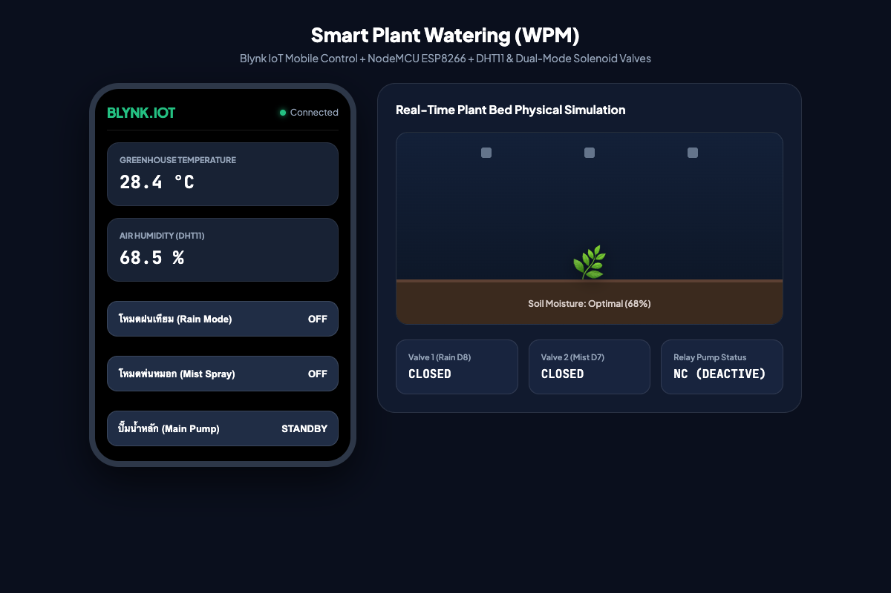

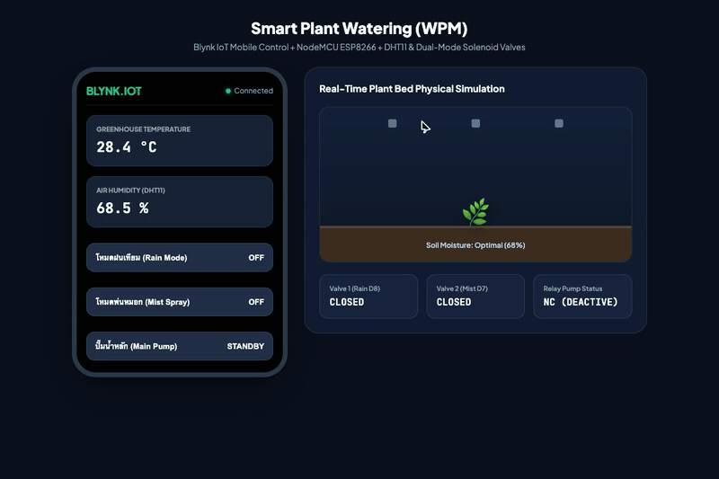

#### เอกสารประกอบโครงงาน
* รายงานโครงงานฉบับสมบูรณ์ (107 หน้าเต็ม พร้อมหน้าปกและคำนำ): [12_Smart-Plant-Watering/docs/รายงาน-พื้นฐานการอินเตอร์เฟซ.pdf](./12_Smart-Plant-Watering/docs/รายงาน-พื้นฐานการอินเตอร์เฟซ.pdf) (หรือ [project_report_full.pdf](./12_Smart-Plant-Watering/docs/project_report_full.pdf))

#### วิธีรันระบบ (How to Run)
1. อัปโหลดเฟิร์มแวร์เข้าสู่ NodeMCU ESP8266:
   ```bash
   arduino-cli compile --fqbn esp8266:esp8266:nodemcuv2 12_Smart-Plant-Watering/arduino/blynk_valve_control.ino
   ```
2. รันโหมดทดสอบจำลอง (Simulation Mode):
   ```bash
   python3 12_Smart-Plant-Watering/test_simulation.py
   ```

---

### 13. [13_General-Education-Web](./13_General-Education-Web) — เว็บไซต์แนะนำการศึกษาประเภทวิชาสามัญ (Seniormath)

> [](https://download-directory.github.io/?url=https://github.com/FANG9356/MyProject/tree/main/13_General-Education-Web)
> *ดาวน์โหลดเฉพาะโฟลเดอร์นี้เป็นไฟล์ ZIP (หรือ [ดาวน์โหลดผ่าน DownGit](https://minhaskamal.github.io/DownGit/#/home?url=https://github.com/FANG9356/MyProject/tree/main/13_General-Education-Web))*

* **หมวดหมู่:** Web Application & Educational Technology
* **เทคโนโลยี:** HTML5, CSS3, JavaScript (ES6), Glassmorphism UI, MediaStream

#### สรุปโปรเจกต์
เว็บพอร์ทัลสื่อการเรียนรู้แบบตอบสนองสำหรับกลุ่มสาระวิชาสามัญ ครอบคลุมวิชาคณิตศาสตร์ ฟิสิกส์ ไฟฟ้าอิเล็กทรอนิกส์ และระบบเลขฐานคอมพิวเตอร์ มาพร้อมระบบแปลงเลขฐาน เครื่องคิดเลขวิทยาศาสตร์แบบกระจกฝ้า (Glassmorphism Calculator) และวิดีโอประกอบการเรียนรู้ในแต่ละหมวดวิชา


#### เอกสารหลักสูตรและเนื้อหา
* เอกสารหลักสูตรวิชาสามัญ: [13_General-Education-Web/docs/](./13_General-Education-Web/docs/)

#### วิธีรันระบบ (How to Run)
เปิดใช้งานผ่านเว็บเบราว์เซอร์:
```bash
open 13_General-Education-Web/index.html
```
รันชุดทดสอบความสมบูรณ์ของโครงสร้างเว็บ:
```bash
python3 13_General-Education-Web/test_simulation.py
```

---

### 14. [14_Computer-Quiz-System](./14_Computer-Quiz-System) — เว็บไซต์ทำแบบทดสอบพื้นฐานคอมพิวเตอร์

> [](https://download-directory.github.io/?url=https://github.com/FANG9356/MyProject/tree/main/14_Computer-Quiz-System)
> *ดาวน์โหลดเฉพาะโฟลเดอร์นี้เป็นไฟล์ ZIP (หรือ [ดาวน์โหลดผ่าน DownGit](https://minhaskamal.github.io/DownGit/#/home?url=https://github.com/FANG9356/MyProject/tree/main/14_Computer-Quiz-System))*

* **หมวดหมู่:** Web Application & Educational Assessment
* **เทคโนโลยี:** Vanilla HTML5, CSS3, JavaScript, JSON Database

#### สรุปโปรเจกต์
ระบบแบบทดสอบออนไลน์วิชาพื้นฐานคอมพิวเตอร์ เชื่อมต่อคลังข้อสอบแบบ JSON จำนวน 400 ข้อ ครอบคลุมทั้งฮาร์ดแวร์ ซอฟต์แวร์ เครือข่าย และความปลอดภัย มีระบบบันทึกและตรวจสอบข้อมูลผู้สอบ ระบบป้องกันการคัดลอกข้อความ และโมดัลประเมินผลคะแนนคำนวณร้อยละและคะแนนตัดเกรดอัตโนมัติ

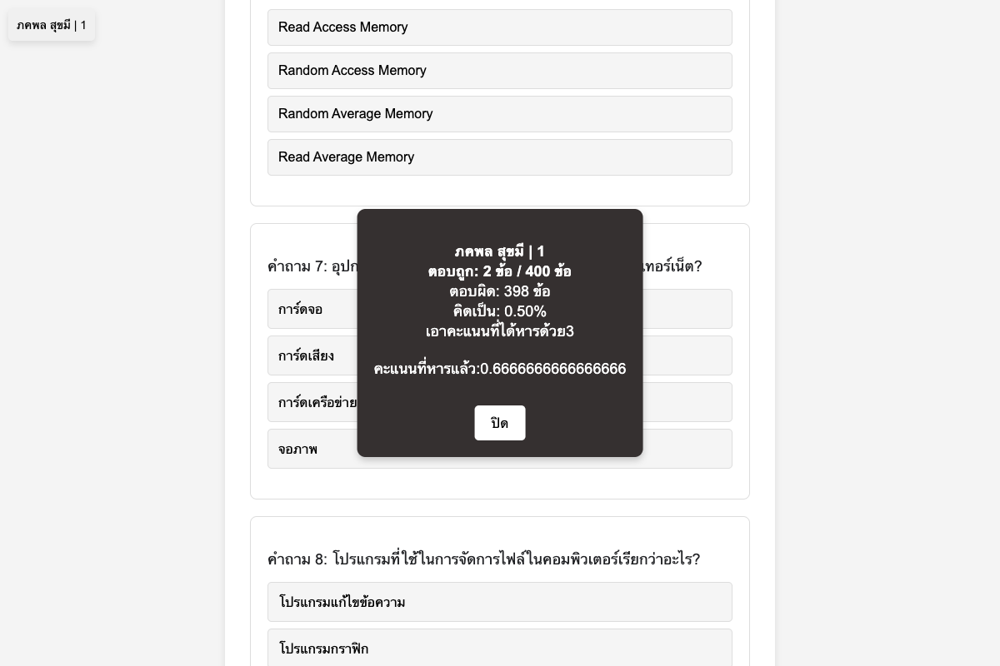


#### เอกสารคลังข้อสอบ
* เอกสารคลังข้อสอบ 400 ข้อ: [14_Computer-Quiz-System/docs/quiz_question_bank_summary.md](./14_Computer-Quiz-System/docs/quiz_question_bank_summary.md)

#### วิธีรันระบบ (How to Run)
เปิดใช้งานผ่านเว็บเบราว์เซอร์:
```bash
open 14_Computer-Quiz-System/index.html
```
รันชุดทดสอบคลังข้อสอบและการคำนวณคะแนน:
```bash
python3 14_Computer-Quiz-System/test_simulation.py
```

---

### 15. [15_SD-Calculator-Python](./15_SD-Calculator-Python) — โปรแกรมคำนวณค่า S.D. ด้วย Python

> [](https://download-directory.github.io/?url=https://github.com/FANG9356/MyProject/tree/main/15_SD-Calculator-Python)
> *ดาวน์โหลดเฉพาะโฟลเดอร์นี้เป็นไฟล์ ZIP (หรือ [ดาวน์โหลดผ่าน DownGit](https://minhaskamal.github.io/DownGit/#/home?url=https://github.com/FANG9356/MyProject/tree/main/15_SD-Calculator-Python))*

* **หมวดหมู่:** Desktop Application & Statistics
* **เทคโนโลยี:** Python 3, Tkinter, ttk, NumPy, PyInstaller

#### สรุปโปรเจกต์
โปรแกรมประยุกต์บนเดสก์ท็อปสำหรับประมวลผลข้อมูลแบบสอบถามและแบบประเมินความพึงพอใจการใช้งาน ผู้ใช้สามารถกำหนดจำนวนกลุ่มตัวอย่างและจำนวนข้อคำถามเพื่อสร้างตารางกรอกคะแนนแบบไดนามิก โปรแกรมประมวลผลคะแนนรวม ค่าเฉลี่ย ส่วนเบี่ยงเบนมาตรฐาน (S.D.) และสัมประสิทธิ์การแปรผัน (C.V. %) แสดงผลบนตาราง Treeview

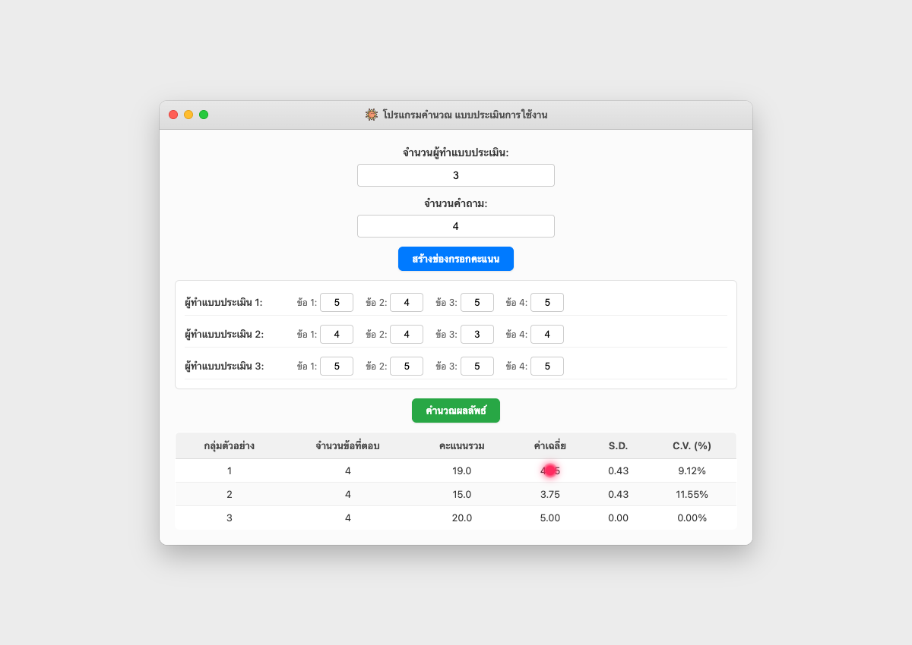


#### เอกสารคู่มือทางสถิติ
* คู่มือสูตรการคำนวณทางสถิติ: [15_SD-Calculator-Python/docs/statistics_formula_manual.md](./15_SD-Calculator-Python/docs/statistics_formula_manual.md)

#### วิธีรันระบบ (How to Run)
```bash
python3 15_SD-Calculator-Python/sd.py
```
รันชุดทดสอบการประมวลผลสถิติ:
```bash
python3 15_SD-Calculator-Python/test_simulation.py
```

---

### 16. [16_Duplicate-File-Cleaner](./16_Duplicate-File-Cleaner) — โปรแกรมค้นหาและลบไฟล์ซ้ำ ด้วย Python

> [](https://download-directory.github.io/?url=https://github.com/FANG9356/MyProject/tree/main/16_Duplicate-File-Cleaner)
> *ดาวน์โหลดเฉพาะโฟลเดอร์นี้เป็นไฟล์ ZIP (หรือ [ดาวน์โหลดผ่าน DownGit](https://minhaskamal.github.io/DownGit/#/home?url=https://github.com/FANG9356/MyProject/tree/main/16_Duplicate-File-Cleaner))*

* **หมวดหมู่:** Desktop Application & Storage Optimizer
* **เทคโนโลยี:** Python 3, CustomTkinter, hashlib (SHA-256), Dark Mode

#### สรุปโปรเจกต์
โปรแกรมยูทิลิตี้สำหรับค้นหาและกำจัดไฟล์ซ้ำซ้อนภายในเครื่องคอมพิวเตอร์ ใช้สถาปัตยกรรมคัดกรอง 2 ชั้น โดยตรวจสอบขนาดไฟล์ก่อน แล้วจึงคำนวณแฮช SHA-256 แบบแบ่งบล็อก 64 KB เพื่อความเร็วสูงสุดและประหยัดแรม ผู้ใช้สามารถเลือกไฟล์ที่ต้องการลบผ่าน Checkbox พร้อมระบบยืนยันความปลอดภัยก่อนลบข้อมูล

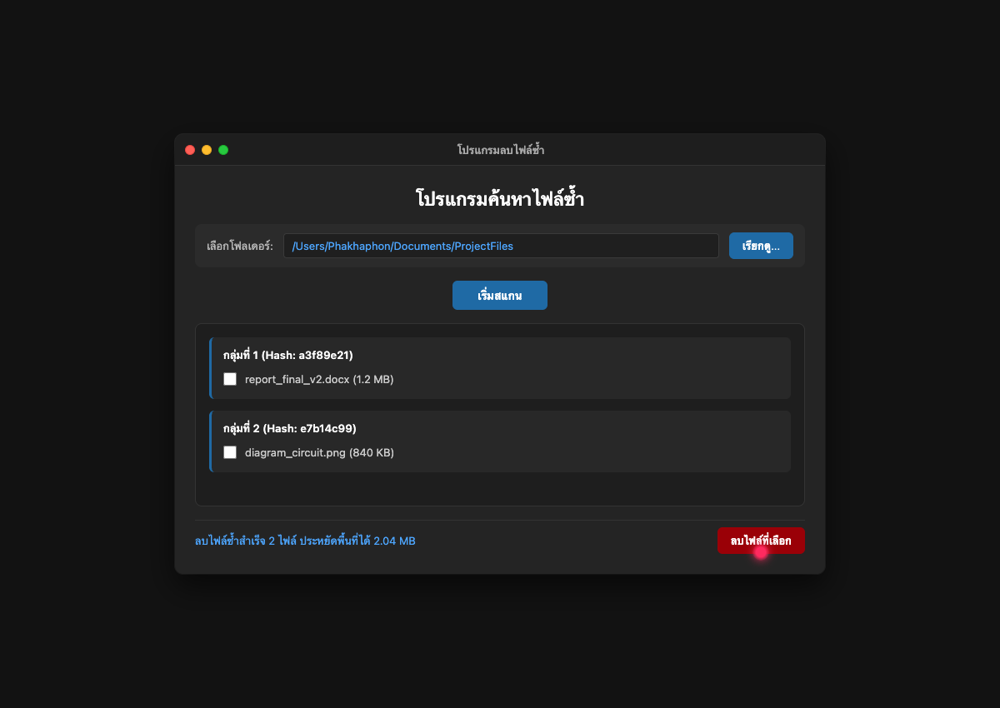


#### เอกสารสถาปัตยกรรม
* รายละเอียดขั้นตอนวิธีตรวจจับไฟล์ซ้ำ: [16_Duplicate-File-Cleaner/docs/duplicate_detection_algorithm.md](./16_Duplicate-File-Cleaner/docs/duplicate_detection_algorithm.md)

#### วิธีรันระบบ (How to Run)
```bash
python3 16_Duplicate-File-Cleaner/clean.py
```
รันชุดทดสอบการจำลองค้นหาและลบไฟล์ซ้ำ:
```bash
python3 16_Duplicate-File-Cleaner/test_simulation.py
```

---

### 17. [17_Grade-Calculator-Python](./17_Grade-Calculator-Python) — โปรแกรมคำนวณเกรด ด้วย Python (GPA & GPAX)

> [](https://download-directory.github.io/?url=https://github.com/FANG9356/MyProject/tree/main/17_Grade-Calculator-Python)
> *ดาวน์โหลดเฉพาะโฟลเดอร์นี้เป็นไฟล์ ZIP (หรือ [ดาวน์โหลดผ่าน DownGit](https://minhaskamal.github.io/DownGit/#/home?url=https://github.com/FANG9356/MyProject/tree/main/17_Grade-Calculator-Python))*

* **หมวดหมู่:** Desktop Application & Educational Utilities
* **เทคโนโลยี:** Python 3, CustomTkinter, Weighted Average Algorithm

#### สรุปโปรเจกต์
โปรแกรมคำนวณแต้มคะแนนเฉลี่ยรายภาคเรียน (GPA) และผลการเรียนเฉลี่ยสะสมทุกภาคเรียน (GPAX) พัฒนาด้วย CustomTkinter ในธีมสีมืด แปลงคะแนนดิบ 0-100 เป็นเกรด 8 ระดับตามมาตรฐานการศึกษา พร้อมระบบเพิ่มรายวิชาแบบไดนามิกและการตรวจสอบความถูกต้องของข้อมูล

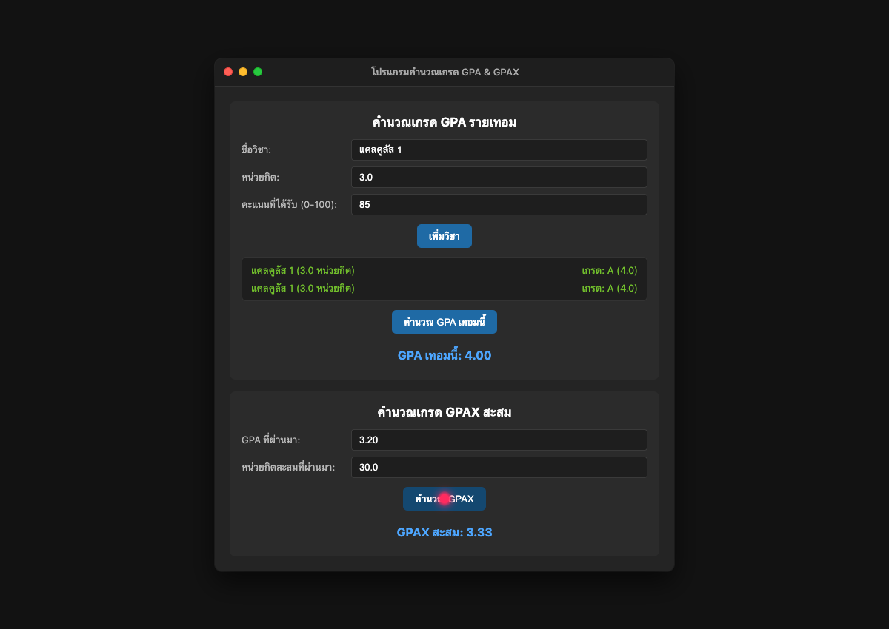

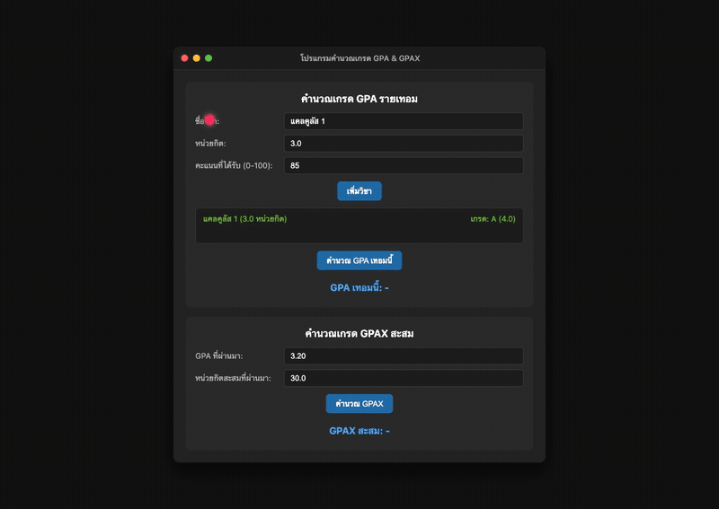

#### เอกสารคู่มือเกณฑ์การตัดเกรด
* คู่มือเกณฑ์มาตรฐานการคำนวณเกรด: [17_Grade-Calculator-Python/docs/grading_system_manual.md](./17_Grade-Calculator-Python/docs/grading_system_manual.md)

#### วิธีรันระบบ (How to Run)
```bash
python3 17_Grade-Calculator-Python/cal.py
```
รันชุดทดสอบการตัดเกรดและสูตรคำนวณ:
```bash
python3 17_Grade-Calculator-Python/test_simulation.py
```

---

### 18. [18_Neo-Web-Chat](./18_Neo-Web-Chat) — เว็บไซต์คุยแชทออนไลน์ และระบบแชทออฟไลน์ BLE

> [](https://download-directory.github.io/?url=https://github.com/FANG9356/MyProject/tree/main/18_Neo-Web-Chat)
> *ดาวน์โหลดเฉพาะโฟลเดอร์นี้เป็นไฟล์ ZIP (หรือ [ดาวน์โหลดผ่าน DownGit](https://minhaskamal.github.io/DownGit/#/home?url=https://github.com/FANG9356/MyProject/tree/main/18_Neo-Web-Chat))*

* **หมวดหมู่:** Web Application & Wireless Networking
* **เทคโนโลยี:** HTML5, Tailwind CSS, JavaScript, Firebase Realtime Database, Web Bluetooth API, Python, Bleak, asyncio

#### สรุปโปรเจกต์
ระบบส่งข้อความสื่อสารสองโหมด ประกอบด้วยเว็บแอปพลิเคชันสไตล์ Neo-Brutalism รองรับการส่งข้อความผ่าน Wi-Fi คลาวด์แบบเรียลไทม์ และการสลับเป็นโหมดออฟไลน์เพื่อสื่อสารผ่านคลื่นสัญญาณ Bluetooth Low Energy (BLE) กับไมโครคอนโทรลเลอร์ ESP32 ในระยะใกล้ พร้อมด้วยไคลเอนต์เดสก์ท็อป Python ควบคุมการเชื่อมต่อแบบอะซิงโครนัส

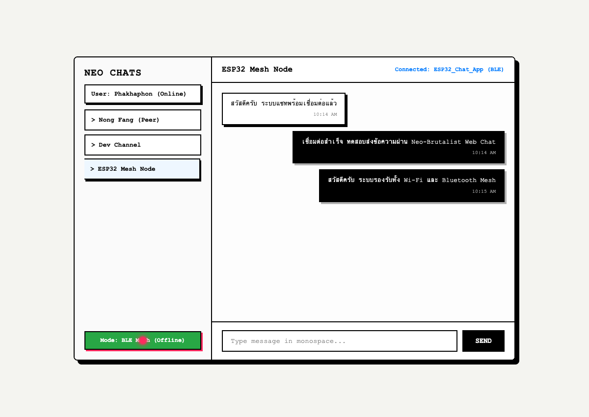


#### เอกสารสถาปัตยกรรมและโปรโตคอล
* รายละเอียดสถาปัตยกรรมและ GATT Profile: [18_Neo-Web-Chat/docs/chat_architecture_and_protocol.md](./18_Neo-Web-Chat/docs/chat_architecture_and_protocol.md)

#### วิธีรันระบบ (How to Run)
เปิดเว็บแอปพลิเคชัน:
```bash
open 18_Neo-Web-Chat/index.html
```
รันไคลเอนต์เดสก์ท็อป Bluetooth:
```bash
python3 18_Neo-Web-Chat/app.py
```
รันชุดทดสอบโครงสร้างระบบแชทและโปรโตคอล BLE:
```bash
python3 18_Neo-Web-Chat/test_simulation.py
```

---

### 19. [19_DevOps-Competition-Platform](./19_DevOps-Competition-Platform) — ระบบแพลตฟอร์มการแข่งขันทักษะวิชาชีพ DevOps 2568

> [](https://download-directory.github.io/?url=https://github.com/FANG9356/MyProject/tree/main/19_DevOps-Competition-Platform)
> *ดาวน์โหลดเฉพาะโฟลเดอร์นี้เป็นไฟล์ ZIP (หรือ [ดาวน์โหลดผ่าน DownGit](https://minhaskamal.github.io/DownGit/#/home?url=https://github.com/FANG9356/MyProject/tree/main/19_DevOps-Competition-Platform))*

* **หมวดหมู่:** DevOps, Full-Stack Web Application, IoT & Enterprise Infrastructure
* **เทคโนโลยี:** Nuxt 3, Vue 3, Express.js, TypeScript, TailwindCSS, GitLab CI/CD, ESP32, MQTT, BMP280, Node-RED, Grafana, Proxmox VE, Docker

#### สรุปโปรเจกต์
โครงงานระดับการแข่งขันประกอบด้วย 3 โมดูลหลักตามเกณฑ์การแข่งขันระดับประเทศ รายการที่ 58 ทักษะเทคโนโลยีสารสนเทศด้าน DevOps:
1. เว็บแอปพลิเคชันบริหารจัดการผู้ใช้งานแบบ Full-Stack ด้วย Nuxt 3, Express.js, JWT และการตรวจสอบสิทธิ์ พร้อมสคริปต์ GitLab CI/CD อัตโนมัติ
2. ระบบโทรมาตร IoT ด้วยบอร์ด ESP32 อ่านค่าอุณหภูมิและความดันบรรยากาศ ส่งผ่าน MQTT เข้า Node-RED ลง MySQL และแสดงผลบน Grafana Dashboard
3. สถาปัตยกรรมโครงสร้างพื้นฐานระดับองค์กรบน Proxmox VE พร้อม Docker Compose สำหรับ Container Registry, Verdaccio, GitLab, EMQX และ Nginx


#### เอกสารประกอบและเกณฑ์การแข่งขัน
* รายละเอียดโครงงาน: [19_DevOps-Competition-Platform/PORTFOLIO_INFO.md](./19_DevOps-Competition-Platform/PORTFOLIO_INFO.md)
* เอกสารเกณฑ์การแข่งขัน: [19_DevOps-Competition-Platform/competition_criteria](./19_DevOps-Competition-Platform/competition_criteria)

#### วิธีรันระบบ (How to Run)
รันแบ็กเอนด์ API:
```bash
cd 19_DevOps-Competition-Platform/backend && node server.js
```
รันชุดทดสอบความถูกต้องของสถาปัตยกรรม:
```bash
node 19_DevOps-Competition-Platform/test_simulation.js
```

---

### 20. [20_Color-Detection-Kalman-YOLO](./20_Color-Detection-Kalman-YOLO) — ระบบตรวจจับสีวัตถุแบบเรียลไทม์และกรองสัญญาณด้วย Kalman Filter

> [](https://download-directory.github.io/?url=https://github.com/FANG9356/MyProject/tree/main/20_Color-Detection-Kalman-YOLO)
> *ดาวน์โหลดเฉพาะโฟลเดอร์นี้เป็นไฟล์ ZIP (หรือ [ดาวน์โหลดผ่าน DownGit](https://minhaskamal.github.io/DownGit/#/home?url=https://github.com/FANG9356/MyProject/tree/main/20_Color-Detection-Kalman-YOLO))*

* **หมวดหมู่:** Computer Vision, Signal Processing & Deep Learning
* **เทคโนโลยี:** Python 3, OpenCV, NumPy, K-Means Clustering, HSV Color Space, 1D Kalman Filter, YOLOv8

#### สรุปโปรเจกต์
ระบบตรวจจับและจำแนกสีวัตถุแบบเรียลไทม์ โดยใช้การสกัดสีเด่นด้วย K-Means Clustering บนพื้นที่ภาพที่ตัดจากกรอบ Bounding Box ของโมเดล YOLOv8 จากนั้นแปลงค่าสีเข้าสู่ระบบพิกัด HSV เพื่อจำแนกเป็นชื่อสีภาษาไทยอย่างแม่นยำ พร้อมทั้งประยุกต์ใช้ 1D Kalman Filter เพื่อกรองสัญญาณรบกวน ลดความผันผวนของระยะทาง และติดตามเสถียรภาพของการเคลื่อนที่แบบเรียลไทม์

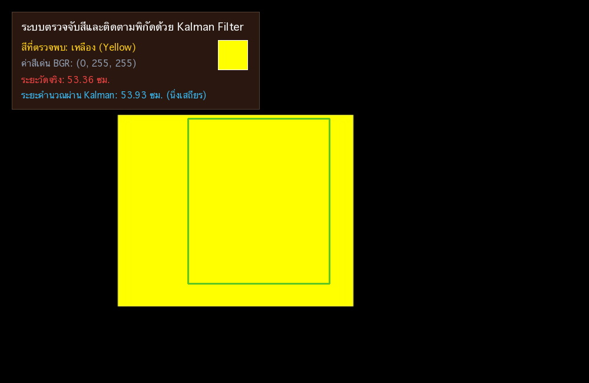

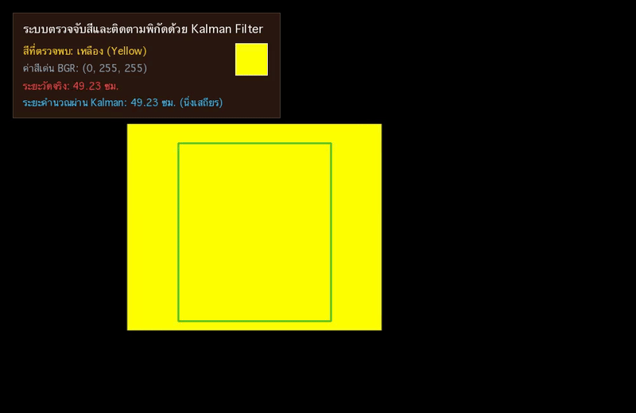

#### เอกสารประกอบโครงงาน
* รายละเอียดโครงงาน: [20_Color-Detection-Kalman-YOLO/PORTFOLIO_INFO.md](./20_Color-Detection-Kalman-YOLO/PORTFOLIO_INFO.md)

#### วิธีรันระบบ (How to Run)
รันระบบตรวจจับสีผ่านกล้อง:
```bash
python3 20_Color-Detection-Kalman-YOLO/realtime_camera.py
```
รันชุดทดสอบโมเดลตัวกรองและอัลกอริทึมจำแนกสี:
```bash
python3 20_Color-Detection-Kalman-YOLO/test_simulation.py
```

---

### 21. [21_Robot-Moisture-Tracker](./21_Robot-Moisture-Tracker) — ระบบติดตามพิกัดหุ่นยนต์และข้อมูลความชื้นเรียลไทม์

> [](https://download-directory.github.io/?url=https://github.com/FANG9356/MyProject/tree/main/21_Robot-Moisture-Tracker)
> *ดาวน์โหลดเฉพาะโฟลเดอร์นี้เป็นไฟล์ ZIP (หรือ [ดาวน์โหลดผ่าน DownGit](https://minhaskamal.github.io/DownGit/#/home?url=https://github.com/FANG9356/MyProject/tree/main/21_Robot-Moisture-Tracker))*

* **หมวดหมู่:** Robotics Telemetry, Geospatial Tracking & IoT Web
* **เทคโนโลยี:** HTML5, CSS3, JavaScript, Leaflet.js, OpenStreetMap, Firebase Realtime Database

#### สรุปโปรเจกต์
เว็บแดชบอร์ดติดตามตำแหน่งพิกัดภูมิศาสตร์ของหุ่นยนต์สำรวจดินแบบเรียลไทม์บนแผนที่โลกจริง OpenStreetMap แสดงผลสถานะการทำงาน ค่าร้อยละความชื้นในดิน พร้อมระบบคลิกบนแผนที่เพื่อสร้างหมุดเป้าหมายใหม่ (Waypoint Target) และส่งคำสั่งพิกัดไปยังหุ่นยนต์เพื่อสั่งการเคลื่อนที่และเก็บข้อมูลความชื้นแบบอัตโนมัติ

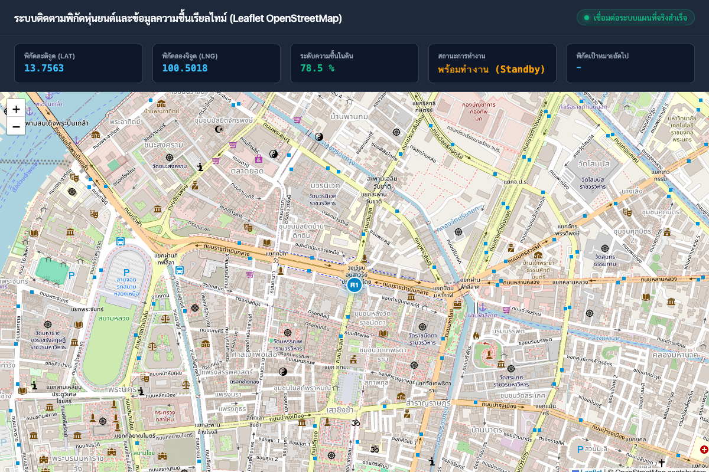

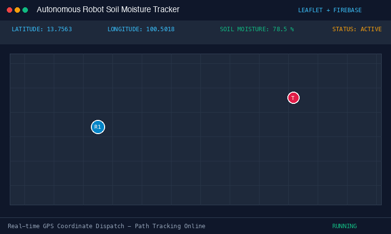

#### เอกสารประกอบโครงงาน
* รายละเอียดโครงงาน: [21_Robot-Moisture-Tracker/PORTFOLIO_INFO.md](./21_Robot-Moisture-Tracker/PORTFOLIO_INFO.md)

#### วิธีรันระบบ (How to Run)
เปิดเว็บแอปพลิเคชัน:
```bash
open 21_Robot-Moisture-Tracker/index.html
```
รันชุดทดสอบโครงสร้างข้อมูลและพิกัดหุ่นยนต์:
```bash
node 21_Robot-Moisture-Tracker/test_simulation.js
```

---

### 22. [22_PDF-Speech-Synthesizer](./22_PDF-Speech-Synthesizer) — ระบบแปลงเอกสาร PDF เป็นไฟล์เสียงพูดภาษาไทย

> [](https://download-directory.github.io/?url=https://github.com/FANG9356/MyProject/tree/main/22_PDF-Speech-Synthesizer)
> *ดาวน์โหลดเฉพาะโฟลเดอร์นี้เป็นไฟล์ ZIP (หรือ [ดาวน์โหลดผ่าน DownGit](https://minhaskamal.github.io/DownGit/#/home?url=https://github.com/FANG9356/MyProject/tree/main/22_PDF-Speech-Synthesizer))*

* **หมวดหมู่:** Natural Language Processing & Audio Synthesis
* **เทคโนโลยี:** Python 3, PyPDF, Google Text-to-Speech (gTTS), MP3 Audio Processing

#### สรุปโปรเจกต์
เครื่องมือสกัดเนื้อหาจากเอกสาร PDF หลายหน้า ทำความสะอาดอักขระและจัดรูปแบบช่องว่างข้อความ จากนั้นแปลงเป็นไฟล์เสียงพูดภาษาไทยธรรมชาติด้วยโมเดลสังเคราะห์เสียง Google Text-to-Speech โดยสามารถกำหนดความเร็วการอ่าน และบันทึกผลลัพธ์เป็นไฟล์เสียง MP3 เพื่อนำไปใช้เป็นหนังสือเสียงหรือสื่อการเรียนรู้

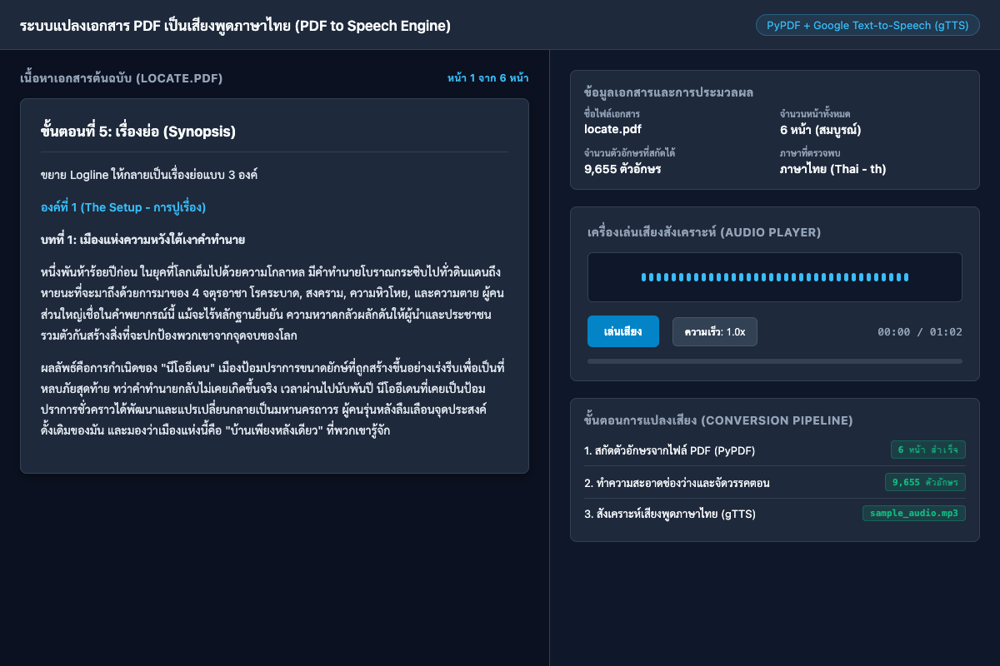

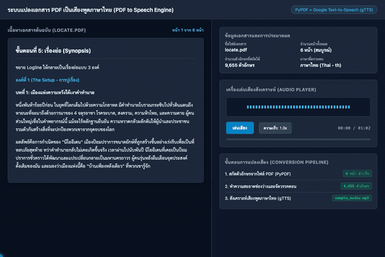

#### เอกสารประกอบโครงงาน
* รายละเอียดโครงงาน: [22_PDF-Speech-Synthesizer/PORTFOLIO_INFO.md](./22_PDF-Speech-Synthesizer/PORTFOLIO_INFO.md)

#### วิธีรันระบบ (How to Run)
รันการแปลงไฟล์เอกสาร:
```bash
python3 22_PDF-Speech-Synthesizer/pdf_to_speech.py
```
รันชุดทดสอบการสกัดข้อความและการสังเคราะห์เสียง:
```bash
python3 22_PDF-Speech-Synthesizer/test_simulation.py
```

---

### 23. [23_Discord-Voice-Screen-Share](./23_Discord-Voice-Screen-Share) — ระบบสตรีมมิ่งหน้าจอและสื่อสารด้วยเสียงแบบเรียลไทม์

> [](https://download-directory.github.io/?url=https://github.com/FANG9356/MyProject/tree/main/23_Discord-Voice-Screen-Share)
> *ดาวน์โหลดเฉพาะโฟลเดอร์นี้เป็นไฟล์ ZIP (หรือ [ดาวน์โหลดผ่าน DownGit](https://minhaskamal.github.io/DownGit/#/home?url=https://github.com/FANG9356/MyProject/tree/main/23_Discord-Voice-Screen-Share))*

* **หมวดหมู่:** Real-Time Network Communication & Streaming
* **เทคโนโลยี:** Python 3, TCP Socket Programming, PyAudio, MSS, OpenCV, Tkinter Dark Theme

#### สรุปโปรเจกต์
ระบบจำลองแอปพลิเคชันสื่อสารสำหรับทีม รองรับการสนทนาด้วยเสียงความหน่วงต่ำผ่าน PyAudio และการแชร์หน้าจอสดแบบความเร็วสูง 60 FPS ด้วยไลบรารี MSS และการบีบอัดภาพ JPEG ของ OpenCV บนสถาปัตยกรรม TCP Socket แบบมัลติเธรด พร้อมอินเทอร์เฟซผู้ใช้สไตล์ Discord Dark Theme


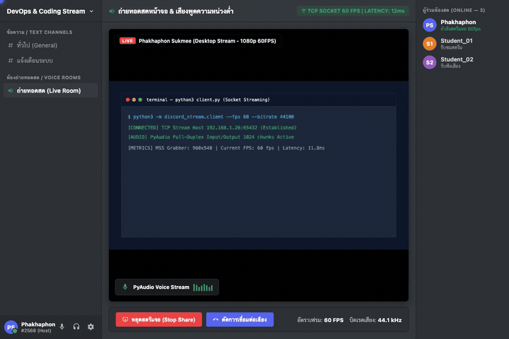

#### เอกสารประกอบโครงงาน
* รายละเอียดโครงงาน: [23_Discord-Voice-Screen-Share/PORTFOLIO_INFO.md](./23_Discord-Voice-Screen-Share/PORTFOLIO_INFO.md)

#### วิธีรันระบบ (How to Run)
รันเซิร์ฟเวอร์สตรีมมิ่ง:
```bash
python3 23_Discord-Voice-Screen-Share/server.py
```
รันไคลเอนต์หน้าจอและเสียง:
```bash
python3 23_Discord-Voice-Screen-Share/client.py
```
รันชุดทดสอบการส่งผ่านแพ็กเก็ตภาพและเสียง:
```bash
python3 23_Discord-Voice-Screen-Share/test_simulation.py
```

---

### 24. [24_LAN-Security-Intruder-Sentinel](./24_LAN-Security-Intruder-Sentinel) — ระบบตรวจจับผู้บุกรุกและตรวจสอบความปลอดภัยเครือข่าย LAN

> [](https://download-directory.github.io/?url=https://github.com/FANG9356/MyProject/tree/main/24_LAN-Security-Intruder-Sentinel)
> *ดาวน์โหลดเฉพาะโฟลเดอร์นี้เป็นไฟล์ ZIP (หรือ [ดาวน์โหลดผ่าน DownGit](https://minhaskamal.github.io/DownGit/#/home?url=https://github.com/FANG9356/MyProject/tree/main/24_LAN-Security-Intruder-Sentinel))*

* **หมวดหมู่:** Network Security & Intrusion Detection System (IDS)
* **เทคโนโลยี:** Node.js, Express, Socket.io, Systeminformation, ARP Table Scanner, Chart.js

#### สรุปโปรเจกต์
ระบบตรวจตราความปลอดภัยเครือข่ายแลนท้องถิ่น ทำหน้าที่ตรวจสอบตาราง ARP เพื่อค้นหาอุปกรณ์ทั้งหมดที่เชื่อมต่อ พร้อมเปรียบเทียบกับรายการบัญชีขาว (MAC Address Whitelist) หากพบอุปกรณ์แปลกปลอมจะทำการติดแท็กแจ้งเตือนผู้บุกรุก (Intruder Alert) ทันทีบนหน้าแดชบอร์ด พร้อมทั้งตรวจวัดค่า Latency การเชื่อมต่อภายนอก WAN และปริมาณทราฟฟิกเครือข่ายแบบเรียลไทม์

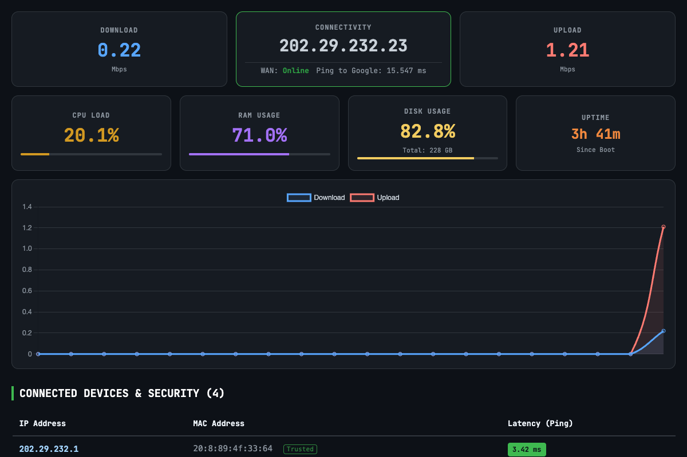


#### เอกสารประกอบโครงงาน
* รายละเอียดโครงงาน: [24_LAN-Security-Intruder-Sentinel/PORTFOLIO_INFO.md](./24_LAN-Security-Intruder-Sentinel/PORTFOLIO_INFO.md)

#### วิธีรันระบบ (How to Run)
รันเซิร์ฟเวอร์ตรวจตราความปลอดภัย:
```bash
cd 24_LAN-Security-Intruder-Sentinel && node server.js
```
รันชุดทดสอบอัลกอริทึมการตรวจจับและ Whitelist:
```bash
node 24_LAN-Security-Intruder-Sentinel/test_simulation.js
```

---

### 25. [25_DormiNetX-Windows-Desktop](./25_DormiNetX-Windows-Desktop) — ระบบบริหารจัดการหอพักแบบ Standalone สำหรับ Windows Desktop

> [](https://download-directory.github.io/?url=https://github.com/FANG9356/MyProject/tree/main/25_DormiNetX-Windows-Desktop)
> *ดาวน์โหลดเฉพาะโฟลเดอร์นี้เป็นไฟล์ ZIP (หรือ [ดาวน์โหลดผ่าน DownGit](https://minhaskamal.github.io/DownGit/#/home?url=https://github.com/FANG9356/MyProject/tree/main/25_DormiNetX-Windows-Desktop))*

* **หมวดหมู่:** Windows Desktop Native Application / Offline-First Management
* **เทคโนโลยี:** Wails v2, Go (Golang), React 18, Vite, Tailwind CSS, SQLite (WAL Mode), NSIS Setup Installer

#### สรุปโปรเจกต์
ระบบบริหารจัดการหอพักแบบเนทีฟเดสก์ท็อปที่คอมไพล์รวมเซิร์ฟเวอร์ Go HTTP และเอนจินฐานข้อมูล SQLite ไว้ในรูปแบบไฟล์ปฏิบัติการเดี่ยว (Single Binary Executable) สามารถทำงานได้แบบออฟไลน์สมบูรณ์โดยไม่ต้องพึ่งพาเซิร์ฟเวอร์คลาวด์ รองรับการทำงานทั้งโหมดเครื่องแม่ข่าย (Host Server) และเครื่องลูกข่าย (Client Terminal) พร้อมระบบตรวจจับ IP เครื่องแม่ข่ายอัตโนมัติในวงแลน มีระบบคำนวณมิเตอร์น้ำ-ไฟและออกใบเสร็จรับเงินผ่านคำสั่ง Wails IPC PrintHtml ส่งตรงสู่เครื่องพิมพ์ของระบบปฏิบัติการ Windows

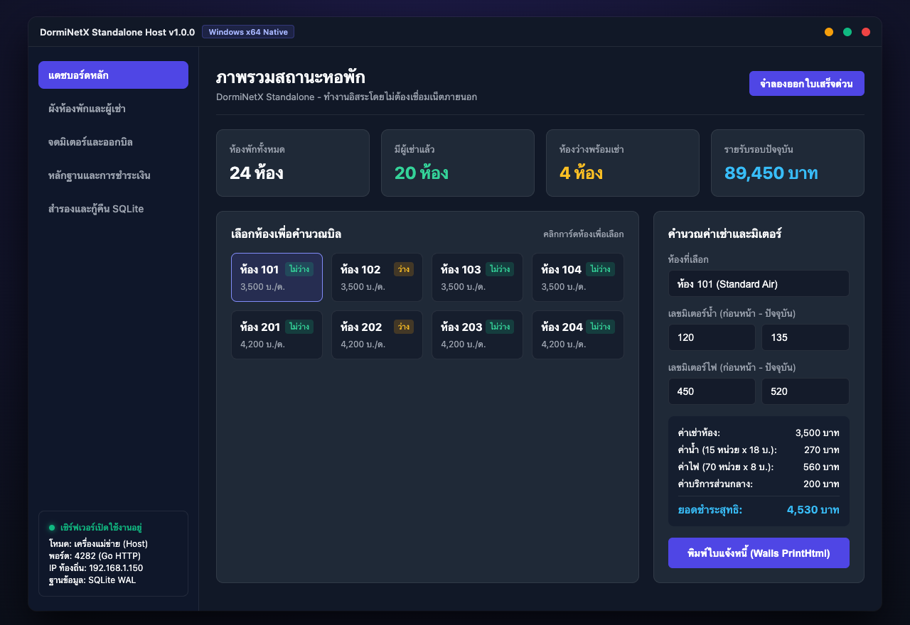

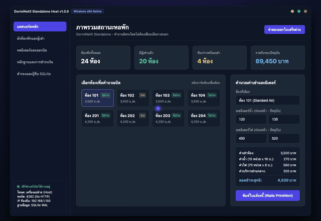

#### เอกสารประกอบโครงงาน
* รายละเอียดโครงงาน: [25_DormiNetX-Windows-Desktop/PORTFOLIO_INFO.md](./25_DormiNetX-Windows-Desktop/PORTFOLIO_INFO.md)
* คู่มือโครงการ: [25_DormiNetX-Windows-Desktop/README.md](./25_DormiNetX-Windows-Desktop/README.md)

#### ไฟล์ปฏิบัติการและตัวติดตั้ง (Binaries)
* ไฟล์รันเดี่ยวแบบพกพา: [`25_DormiNetX-Windows-Desktop/bin/DormiNetX.exe`](./25_DormiNetX-Windows-Desktop/bin/DormiNetX.exe) (ขนาด 30 MB)
* ตัวติดตั้งมาตรฐาน Windows Setup: [`25_DormiNetX-Windows-Desktop/bin/DormiNetX-Installer.exe`](./25_DormiNetX-Windows-Desktop/bin/DormiNetX-Installer.exe) (ขนาด 13 MB)

#### วิธีรันระบบ (How to Run)
รันไฟล์ติดตั้งหรือโปรแกรม Desktop:
```bash
# รันไฟล์ปฏิบัติการ Windows (บนเครื่อง Windows 10/11)
./25_DormiNetX-Windows-Desktop/bin/DormiNetX.exe
```
เปิดหน้าต่างจำลองการทำงานแบบ Interactive (Web Preview):
```bash
open 25_DormiNetX-Windows-Desktop/standalone_demo.html
```
รันชุดทดสอบการคำนวณและสถาปัตยกรรมระบบ:
```bash
node 25_DormiNetX-Windows-Desktop/test_simulation.js
```

---

### 26. [26_DormiNetX-Enterprise-iOS-Cloud](./26_DormiNetX-Enterprise-iOS-Cloud) — ระบบบริหารจัดการหอพักระดับองค์กร Native iOS & Cloud Platform

> [](https://download-directory.github.io/?url=https://github.com/FANG9356/MyProject/tree/main/26_DormiNetX-Enterprise-iOS-Cloud)
> *ดาวน์โหลดเฉพาะโฟลเดอร์นี้เป็นไฟล์ ZIP (หรือ [ดาวน์โหลดผ่าน DownGit](https://minhaskamal.github.io/DownGit/#/home?url=https://github.com/FANG9356/MyProject/tree/main/26_DormiNetX-Enterprise-iOS-Cloud))*

* **หมวดหมู่:** Enterprise Cloud Platform / Native iOS & iPadOS Application / Local-First Architecture
* **เทคโนโลยี:** Swift 5.9, SwiftUI, SwiftData, Go (Golang 1.22), Multi-Tenant SQLite, LINE Messaging API, LINE LIFF, SHA-256 Ledger

#### สรุปโปรเจกต์
ระบบบริหารจัดการหอพักและอพาร์ตเมนต์ระดับองค์กรแบบครบวงจร ออกแบบด้วยสถาปัตยกรรม **Local-First** สำหรับ iPhone และ iPad ทำงานร่วมกับ **Go High-Performance Backend**, **Multi-Tenant SQLite Database**, **LINE Official Account (OA)** และ **LIFF Web Application**

* **Local-First Architecture:** ถือว่าข้อมูลบนอุปกรณ์ iOS เป็น Single Source of Truth สามารถทำงาน ออกบิล จัดการห้องพัก และรับชำระได้ทันทีแม้ไม่มีอินเทอร์เน็ต
* **Dual-Database Multi-Tenant Isolation:** แยกฐานข้อมูลรายหอพักออกจากกัน 100% (Isolated SQLite files) ป้องกันปัญหาข้อมูลรั่วไหลข้ามองค์กร
* **Sync Engine Protocol 2:** ระบบซิงก์ข้อมูลขึ้นคลาวด์แบบ Snapshot Versioning พร้อม SHA-256 Checksum และกลไก Rebase Conflict Resolution อัตโนมัติ
* **Financial Immutable Ledger:** ตารางบันทึกธุรกรรมทางการเงินแบบแก้ไขย้อนหลังไม่ได้ (Void, Refund, Adjust) พร้อม SHA-256 Audit Trail รัดกุม
* **LINE OA & LIFF Portal:** แจ้งหนี้ด้วย LINE Flex Message แบบ Interactive พร้อมพอร์ทัลลูกบ้าน LIFF สำหรับดูประวัติบิล ชำระเงินผ่าน PromptPay QR และระบบตรวจสอบสลิปอัตโนมัติ (Dual-Engine พร้อมนโยบาย Fail-Closed)
* **Enterprise Security:** จัดเก็บข้อมูลลับใน Secure Enclave ผ่าน Apple Keychain, เข้ารหัส TLS 1.3, ป้องกัน Brute Force ด้วย PIN Rate Limiting และปิด Public Access โฟลเดอร์สลิป
* **Multi-Language Engine:** รองรับการแปลภาษา 4 ภาษา (ไทย, อังกฤษ, พม่า, จีน) สมบูรณ์ 100% ครอบคลุมกว่า 670 คำศัพท์

#### เอกสารประกอบโครงงาน
* คู่มือและสถาปัตยกรรมโครงการฉบับสมบูรณ์: [26_DormiNetX-Enterprise-iOS-Cloud/README.md](./26_DormiNetX-Enterprise-iOS-Cloud/README.md)
* เอกสารความปลอดภัยและการดูแลระบบ: [26_DormiNetX-Enterprise-iOS-Cloud/docs](./26_DormiNetX-Enterprise-iOS-Cloud/docs)

#### วิธีรันระบบ (How to Run)
เปิดโปรเจกต์ iOS Native:
```bash
open 26_DormiNetX-Enterprise-iOS-Cloud/DormAppSwift_Sources/DormiNetX/DormiNetX.xcodeproj
```
รันแบ็กเอนด์ Go Cloud:
```bash
cd 26_DormiNetX-Enterprise-iOS-Cloud/backend-dorm && go run main.go
```
รันชุดทดสอบ Backend จาก Origin:
```bash
cd 26_DormiNetX-Enterprise-iOS-Cloud/backend-dorm && go test -count=1 ./core/... ./handlers/... ./utils/...
```

---

## ข้อมูลผู้พัฒนา
* **ชื่อ-นามสกุล:** Phakhaphon Sukmee
* **GitHub:** [@FANG9356](https://github.com/FANG9356)
* **Repository:** [https://github.com/FANG9356/MyProject](https://github.com/FANG9356/MyProject)

