# My Projects

> **ผู้พัฒนา:** Phakhaphon Sukmee
> **GitHub Repository:** [FANG9356/MyProject](https://github.com/FANG9356/MyProject)

คลังรวบรวมโค้ดและโปรเจกต์ต่างๆ ที่ทำไว้ แต่ละโฟลเดอร์มีโค้ด ตัวอย่างการรัน และสคริปต์สำหรับทดสอบ

---

## สารบัญโปรเจกต์

| ลำดับ | โปรเจกต์ | หมวดหมู่ | คำสั่งรัน | URL | คำสั่งทดสอบ |
| :---: | :--- | :--- | :--- | :---: | :---: |
| **01** | [`01_AI-WiFi-Sensing-Wall`](./01_AI-WiFi-Sensing-Wall) | AI & RF Sensing | `python3 ai_web_server.py` | `http://localhost:8050` | `python3 test_simulation.py` |
| **02** | [`02_Smart-Doc-AI`](./02_Smart-Doc-AI) | GenAI Agent | `docker compose up -d` | `http://localhost:5173` | `python3 test_simulation.py` |
| **03** | [`03_Tip-Desk-PromptPay`](./03_Tip-Desk-PromptPay) | FinTech / Web | `uvicorn main:app` & `npm run dev` | `http://localhost:5173` | `python3 test_simulation.py` |
| **04** | [`04_Club-Management-System`](./04_Club-Management-System) | Web Management | `cd backend && node server.js` | `http://localhost:3000` | `node test_simulation.js` |
| **05** | [`05_ATM-YOLOv8-Detector`](./05_ATM-YOLOv8-Detector) | Computer Vision | `python3 person_detector.py` | หน้าต่างกล้อง | `python3 test_simulation.py` |
| **06** | [`06_Karaoke-Streaming-System`](./06_Karaoke-Streaming-System) | Streaming Server | `python3 main.py` | `http://localhost:8000` (รีโมต: `/remote.html`) | `python3 test_simulation.py` |
| **07** | [`07_AdGuard-Time-Portal`](./07_AdGuard-Time-Portal) | Network & Admin | `node server.js` | `http://localhost:8080` (แอดมิน: `/admin.html`) | `node test_simulation.js` |
| **08** | [`08_System-Monitor-Desktop-App`](./08_System-Monitor-Desktop-App) | Desktop Utility | `.exe` (Win) หรือ `node server.js` | `http://localhost:3000` | `node test_simulation.js` |
| **09** | [`09_HomeServer-Infrastructure`](./09_HomeServer-Infrastructure) | Go, SQLite & React | `cd backend && go run .` | `http://localhost:8001` | `python3 test_simulation.py` |
| **10** | [`10_Music-Shuffle-AI`](./10_Music-Shuffle-AI) | AI Desktop Player | `python3 main.py` | หน้าต่างโปรแกรม Desktop | `python3 test_simulation.py` |

---

## การรันชุดทดสอบ

ในโฟลเดอร์หลักมีสคริปต์ [`run_all_tests.sh`](./run_all_tests.sh) สำหรับรัน Simulation Test ของทั้ง 10 โปรเจกต์ สามารถทดสอบได้ด้วยคำสั่ง:
```bash
./run_all_tests.sh
```

---

## รายละเอียดโปรเจกต์

---

### 1. [01_AI-WiFi-Sensing-Wall](./01_AI-WiFi-Sensing-Wall) — ระบบตรวจจับการเคลื่อนไหวผ่านสัญญาณ WiFi (CSI)

> **เทคโนโลยี:** ESP32, WiFi CSI, Scikit-Learn, Python, HTML5 Dashboard

#### ภาพรวมโครงการ (Project Overview)
ระบบตรวจจับการเคลื่อนไหวและการหกล้มของบุคคลผ่านการวิเคราะห์สัญญาณคลื่นวิทยุ WiFi CSI จากบอร์ด ESP32 โดยใช้โมเดล Machine Learning (Random Forest) จำแนกรูปแบบคลื่นสัญญาณที่เปลี่ยนไป (ห้องว่าง, มีคนเดิน, หกล้ม) และแสดงผลบนหน้าเว็บแดชบอร์ด

#### ตัวอย่างหน้าจอ (Screenshots)
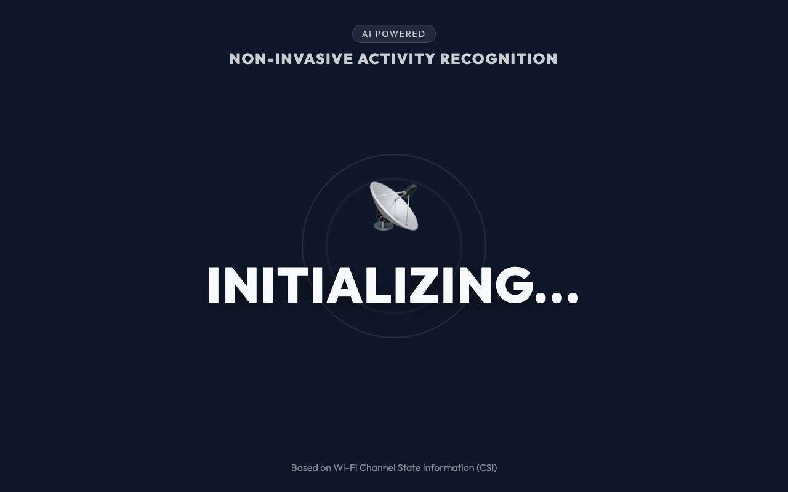

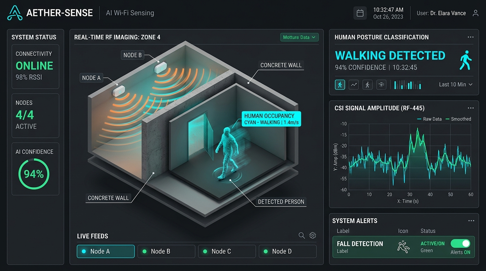

#### แผนภาพการทำงาน (Architecture)
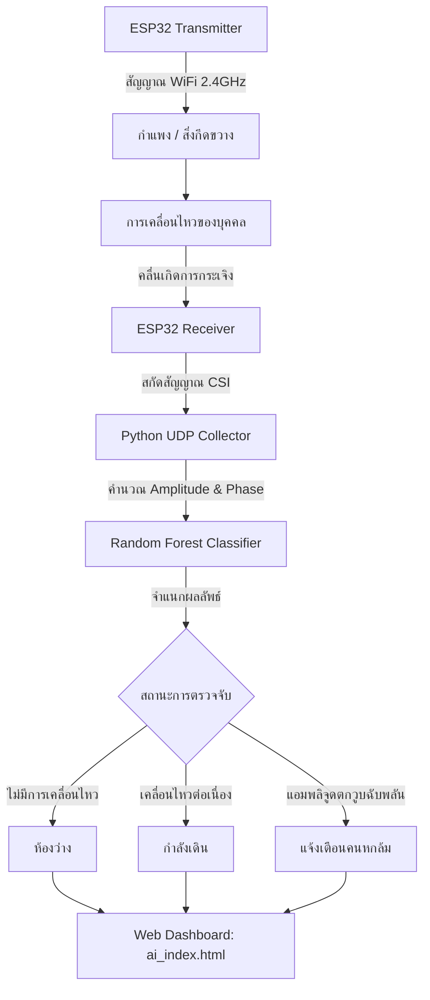

#### วิธีรันระบบ (How to Run)
1. **ติดตั้ง Dependencies:**
  ```bash
  cd 01_AI-WiFi-Sensing-Wall
  pip install scikit-learn pandas numpy joblib
  ```
2. **รันโหมดทดสอบจำลอง (Simulation Mode):**
  ```bash
  python3 test_simulation.py
  ```
3. **เปิดหน้า Web Dashboard:**
  ```bash
  python3 ai_web_server.py
  ```
  เปิดเบราว์เซอร์ที่: `http://localhost:8050`

---

### 2. [02_Smart-Doc-AI](./02_Smart-Doc-AI) — เครื่องมือค้นคว้าข้อมูลและร่างเอกสาร Word

> **เทคโนโลยี:** React, Tailwind CSS, Vite, FastAPI, Wikipedia API, DuckDuckGo, ArXiv API, python-docx, Docker

#### ภาพรวมโครงการ (Project Overview)
ระบบช่วยรวบรวมข้อมูลตามหัวข้อที่ต้องการจากแหล่งข้อมูลออนไลน์ (Wikipedia, ArXiv, Web Search) และจัดรูปแบบเป็นเอกสาร Word (.docx) พร้อมดาวน์โหลด

#### ตัวอย่างหน้าจอ (Screenshots)
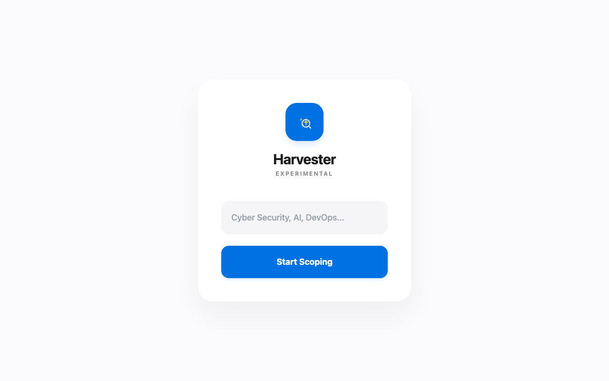

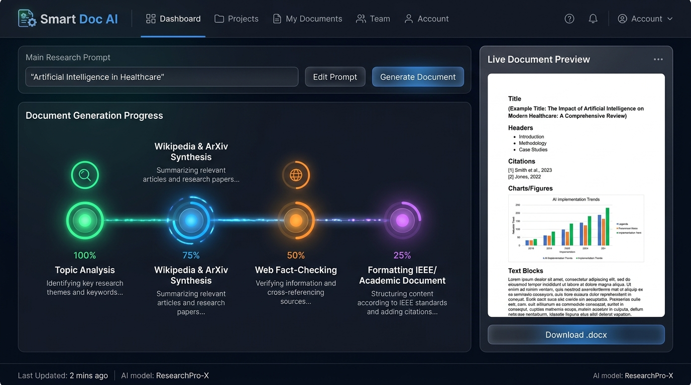

#### แผนภาพการทำงาน (Architecture)
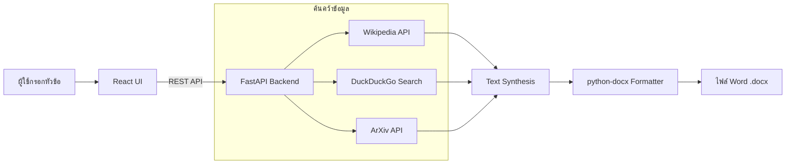

#### วิธีรันระบบ (How to Run)
* **รันผ่าน Docker Compose:**
  ```bash
  cd 02_Smart-Doc-AI
  docker compose up -d
  ```
  เปิดเบราว์เซอร์ที่: `http://localhost:5173`
* **รันแบบ Manual:**
  * Backend: `cd 02_Smart-Doc-AI/app && pip install -r requirements.txt && uvicorn main:app --reload --port 8000`
  * Frontend: `cd 02_Smart-Doc-AI/frontend && npm install && npm run dev`

---

### 3. [03_Tip-Desk-PromptPay](./03_Tip-Desk-PromptPay) — ระบบรับเงินบริจาค PromptPay พร้อมเสียงอ่านชื่อ

> **เทคโนโลยี:** React, TypeScript, Vite, FastAPI, SQLite, EMVCo QR Code, Web Speech API

#### ภาพรวมโครงการ (Project Overview)
ระบบรับบริจาค/ทิปผ่าน PromptPay QR Code ตามมาตรฐาน EMVCo รองรับการอัปเดตยอดเงินแบบเรียลไทม์ และอ่านชื่อผู้ส่งพร้อมข้อความผ่าน Text-to-Speech

#### ตัวอย่างหน้าจอ (Screenshots)


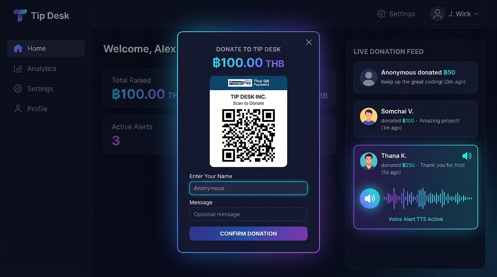

#### แผนภาพการทำงาน (Architecture)
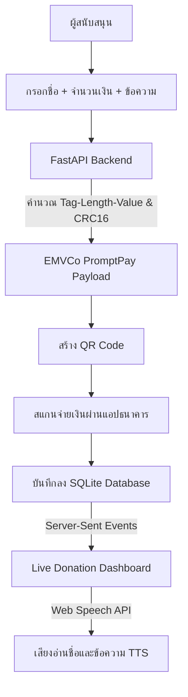

#### วิธีรันระบบ (How to Run)
1. **Backend (FastAPI):**
  ```bash
  cd 03_Tip-Desk-PromptPay/backend
  pip install -r requirements.txt
  cp .env.example .env
  uvicorn main:app --reload --port 8000
  ```
2. **Frontend (React):**
  ```bash
  cd 03_Tip-Desk-PromptPay
  npm install
  npm run dev
  ```
  เปิดเบราว์เซอร์ที่: `http://localhost:5173`

---

### 4. [04_Club-Management-System](./04_Club-Management-System) — ระบบลงทะเบียนและเช็คชื่อสมาชิกชมรม

> **เทคโนโลยี:** Node.js, Express, SQLite, Tailwind CSS, JWT

#### ภาพรวมโครงการ (Project Overview)
เว็บแอปพลิเคชันสำหรับลงทะเบียนสมาชิกชมรม เช็คชื่อเข้าร่วมกิจกรรม และมีหน้าแอดมินสำหรับดูสถิติและรายชื่อสมาชิก

#### ตัวอย่างหน้าจอ (Screenshots)
| หน้าลงทะเบียน (`/register.html`) | หน้าเช็คชื่อ (`/attendance.html`) |
| :---: | :---: |
| 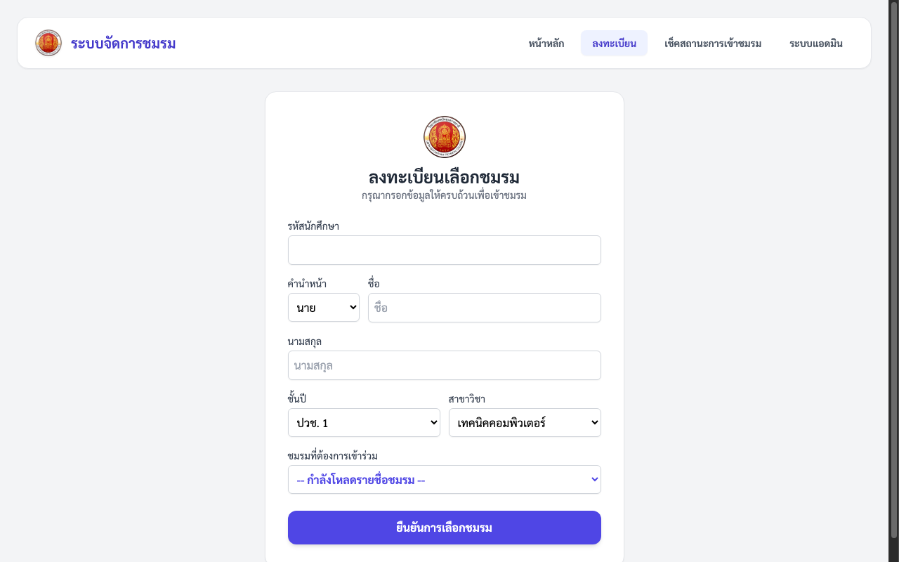 |  |

#### แผนภาพการทำงาน (Architecture)
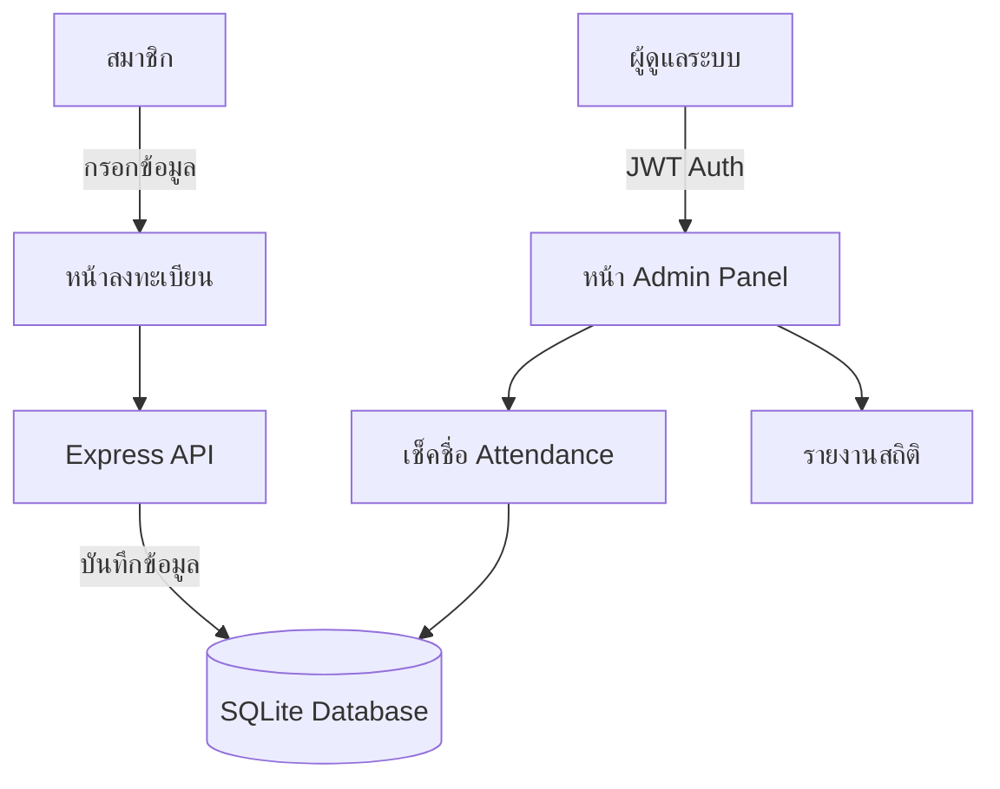

#### วิธีรันระบบ (How to Run)
```bash
cd 04_Club-Management-System/backend
npm install
cp .env.example .env
node server.js
```
เปิดใช้งานที่พอร์ต `3000`:
* หน้าลงทะเบียน: `http://localhost:3000/register.html`
* หน้าเช็คชื่อ: `http://localhost:3000/attendance.html`
* หน้าแอดมิน: `http://localhost:3000/admin.html`

---

### 5. [05_ATM-YOLOv8-Detector](./05_ATM-YOLOv8-Detector) — ระบบตรวจจับบุคคลหน้าตู้ ATM ด้วย YOLOv8

> **เทคโนโลยี:** Python, OpenCV, YOLOv8

#### ภาพรวมโครงการ (Project Overview)
โปรแกรมตรวจจับบุคคลบริเวณหน้าตู้ ATM โดยใช้โมเดล YOLOv8 วิเคราะห์ภาพจากกล้องวงจรปิด บันทึกภาพ Snapshot เมื่อพบบุคคล และเก็บประวัติเวลาไว้ในไฟล์ JSON Log

#### ตัวอย่างหน้าจอ (Screenshots)
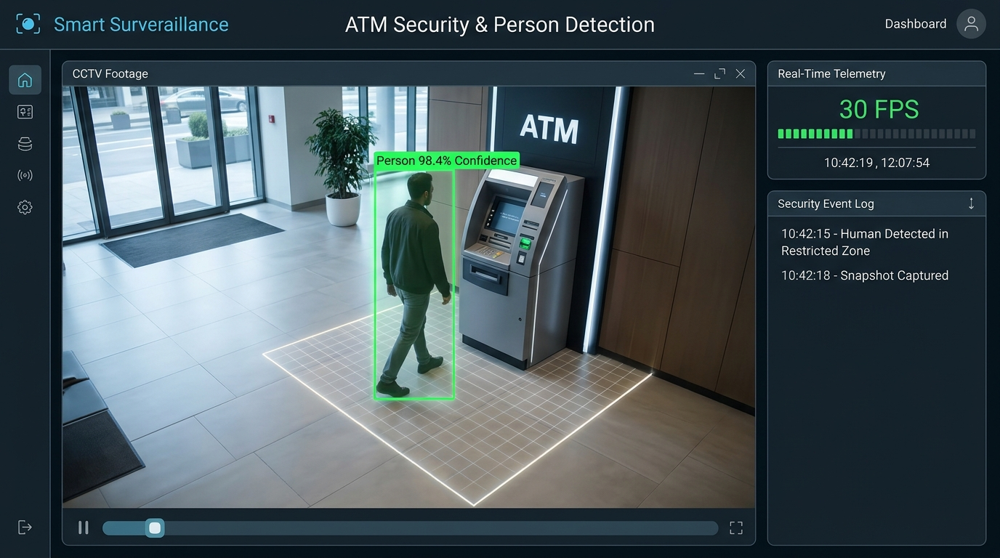

#### แผนภาพการทำงาน (Architecture)
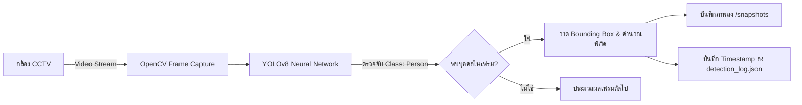

#### วิธีรันระบบ (How to Run)
1. **ติดตั้ง Dependencies:**
  ```bash
  cd 05_ATM-YOLOv8-Detector
  pip install ultralytics opencv-python numpy
  ```
2. **รันผ่านกล้องเว็บแคม:**
  ```bash
  python3 person_detector.py
  ```
3. **หรือรันโหมดจำลอง (Simulation):**
  ```bash
  python3 test_simulation.py
  ```

---

### 6. [06_Karaoke-Streaming-System](./06_Karaoke-Streaming-System) — ระบบสตรีมมิ่งคาราโอเกะพร้อมรีโมตมือถือ

> **เทคโนโลยี:** FastAPI, yt-dlp, HTML5 Video, WebSocket, REST API

#### ภาพรวมโครงการ (Project Overview)
ระบบสตรีมมิ่งคาราโอเกะสำหรับเปิดเล่นเพลงบนหน้าจอหลัก และมีหน้ารีโมตผ่านเว็บสำหรับให้คนอื่นใช้มือถือค้นหาเพลงและจัดการคิวเพลงพร้อมกัน

#### ตัวอย่างหน้าจอ (Screenshots)
**1. หน้าจอหลักเล่นเพลง (`/index.html`):**
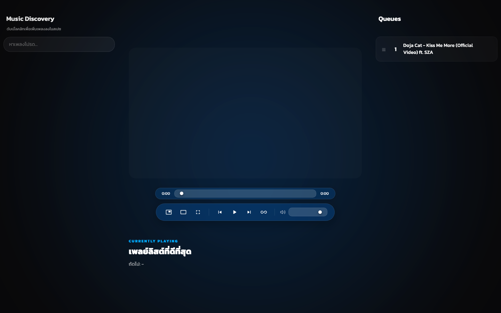

**2. หน้ารีโมตควบคุมบนมือถือ (`/remote.html`):**
<p align="center">
  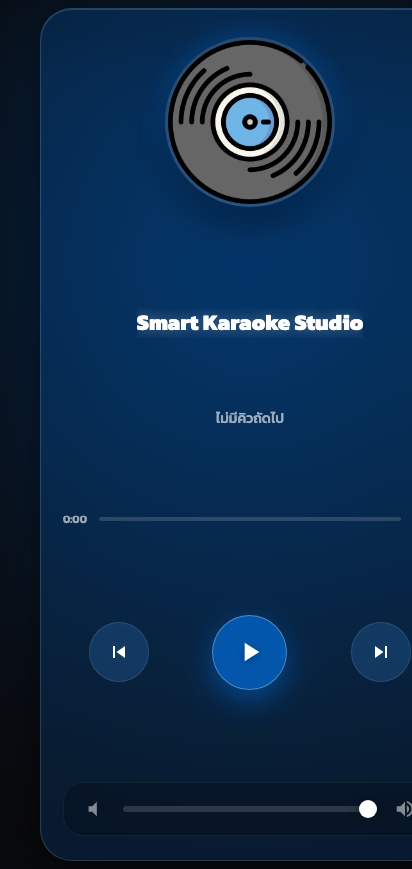
</p>

#### แผนภาพการทำงาน (Architecture)
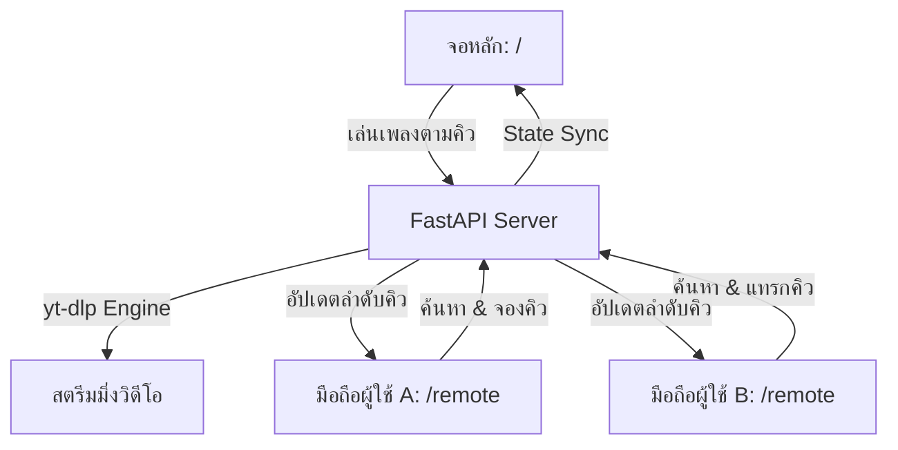

#### วิธีรันระบบ (How to Run)
1. **ติดตั้งและรันเซิร์ฟเวอร์:**
  ```bash
  cd 06_Karaoke-Streaming-System
  pip install fastapi uvicorn yt-dlp
  python3 main.py
  ```
2. **เปิดหน้าจอ:**
  * หน้าจอหลัก (Player): `http://localhost:8000`
  * หน้ารีโมตมือถือ (Remote): `http://localhost:8000/remote.html`

---

### 7. [07_AdGuard-Time-Portal](./07_AdGuard-Time-Portal) — ระบบจัดการเวลาอินเทอร์เน็ตผ่าน AdGuard Home API

> **เทคโนโลยี:** Node.js, Express, AdGuard Home REST API, SQLite, Node-Schedule

#### ภาพรวมโครงการ (Project Overview)
หน้าพอร์ทัลควบคุมการใช้งานอินเทอร์เน็ตของอุปกรณ์ในเครือข่าย โดยผู้ใช้กรอกรหัส PIN เพื่อเปิดใช้งานตามเวลาที่กำหนด และสั่งบล็อกระดับ DNS ผ่าน AdGuard Home API เมื่อหมดเวลา

#### ตัวอย่างหน้าจอ (Screenshots)
| หน้ากรอกรหัส PIN (`/index.html`) | หน้าแอดมินสร้างรหัส PIN (`/admin.html`) |
| :---: | :---: |
| 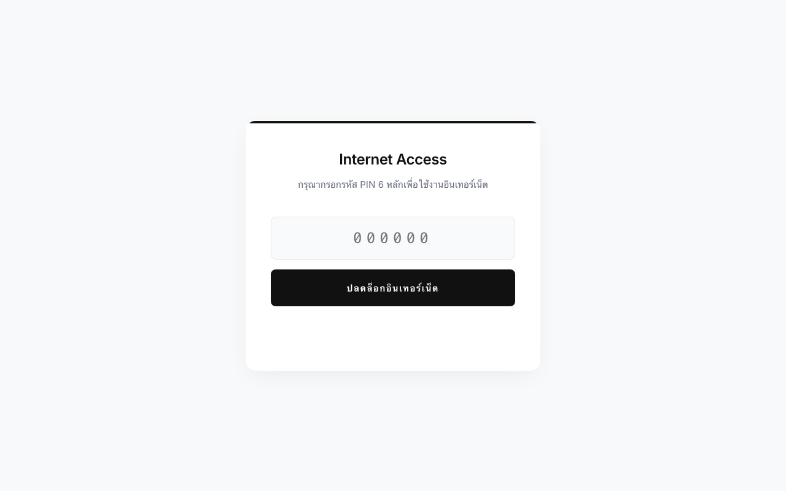 | 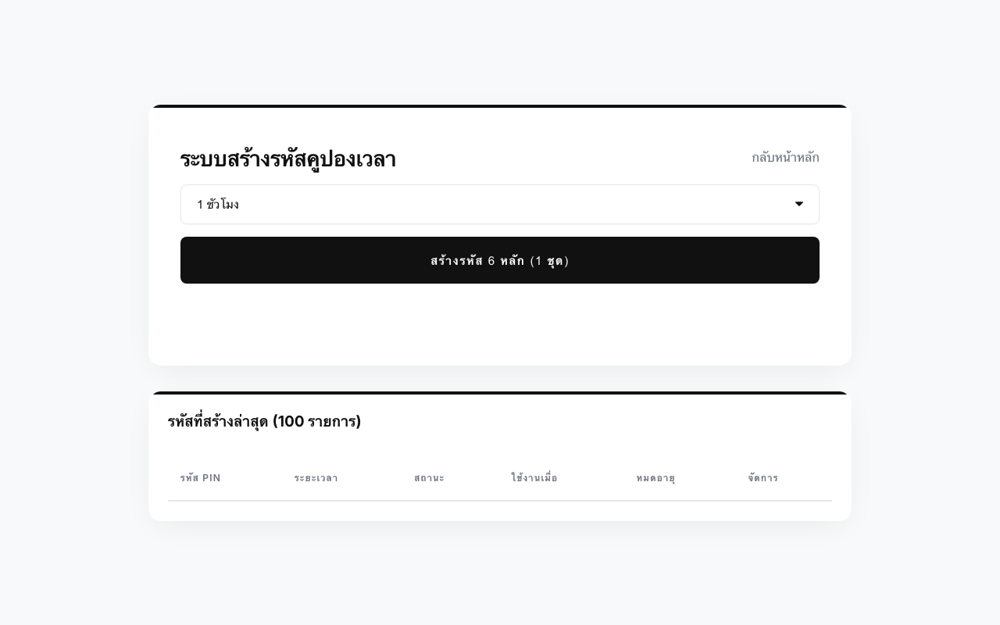 |

#### แผนภาพการทำงาน (Architecture)
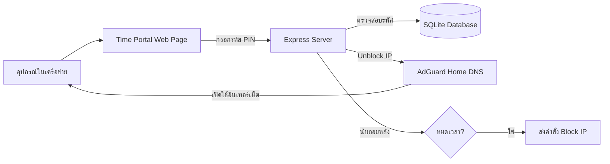

#### วิธีรันระบบ (How to Run)
```bash
cd 07_AdGuard-Time-Portal
npm install
cp .env.example .env
node server.js
```
เปิดใช้งานที่พอร์ต `8080`:
* หน้ากรอก PIN: `http://localhost:8080/index.html`
* หน้าแอดมิน: `http://localhost:8080/admin.html`

---

### 8. [08_System-Monitor-Desktop-App](./08_System-Monitor-Desktop-App) — โปรแกรมมอนิเตอร์สถานะระบบคอมพิวเตอร์

> **เทคโนโลยี:** Node.js, Express, pkg

#### ภาพรวมโครงการ (Project Overview)
โปรแกรมมอนิเตอร์ทรัพยากรเครื่อง (CPU, RAM, Uptime) แสดงผลผ่านหน้าเว็บเบราว์เซอร์ โดยคอมไพล์เป็นไฟล์ .exe แบบ Standalone ใช้งานได้ทันทีโดยไม่ต้องติดตั้ง Node.js เพิ่มเติม

#### ตัวอย่างหน้าจอ (Screenshots)
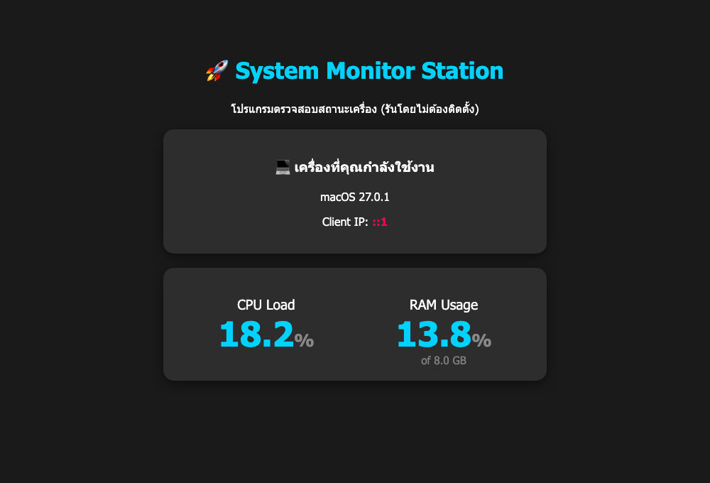

#### แผนภาพการทำงาน (Architecture)
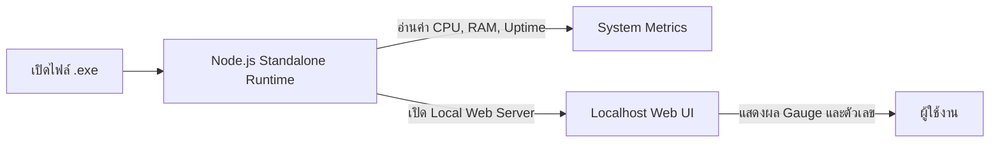

#### วิธีรันระบบ (How to Run)
* **บน Windows:**
  ดับเบิลคลิกไฟล์ `sys-monitor-app-win-x64.exe` ได้ทันที
* **บน macOS / Linux:**
  ```bash
  cd 08_System-Monitor-Desktop-App
  npm install
  node server.js
  ```
  เปิดเบราว์เซอร์ที่: `http://localhost:3000`

---

### 9. [09_HomeServer-Infrastructure](./09_HomeServer-Infrastructure) — HomeServer Services & Network Scanner

> **เทคโนโลยี:** Go, SQLite, React, Tailwind CSS, Docker

#### ภาพรวมโครงการ (Project Overview)
แดชบอร์ดรวบรวมทางเข้าบริการต่างๆ ในบ้าน และมีเครื่องมือสแกนหา IP อุปกรณ์ในเครือข่าย:
1. **Services Hub:** หน้ารวมทางเข้าและเช็กสถานะการทำงานของบริการภายในบ้าน เช่น Immich, Jellyfin, FileBrowser, Bitwarden, Memos
2. **Network Scanner:** ค้นหา IP และอุปกรณ์ที่เชื่อมต่ออยู่ในวง LAN เดียวกัน หรือระบุ Subnet เพื่อค้นหาข้ามวง VLAN พร้อมเช็กพอร์ตพื้นฐานที่เปิดอยู่ และบันทึกผลลง SQLite

#### ตัวอย่างหน้าจอ (Screenshots)
| Services Hub | Network Scanner |
| :---: | :---: |
| 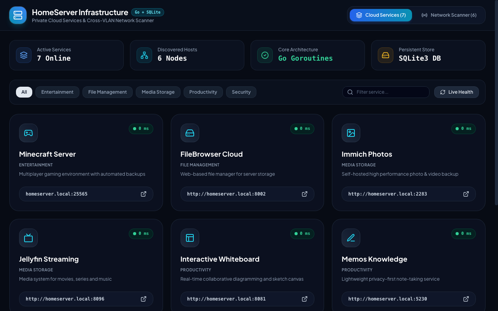 | 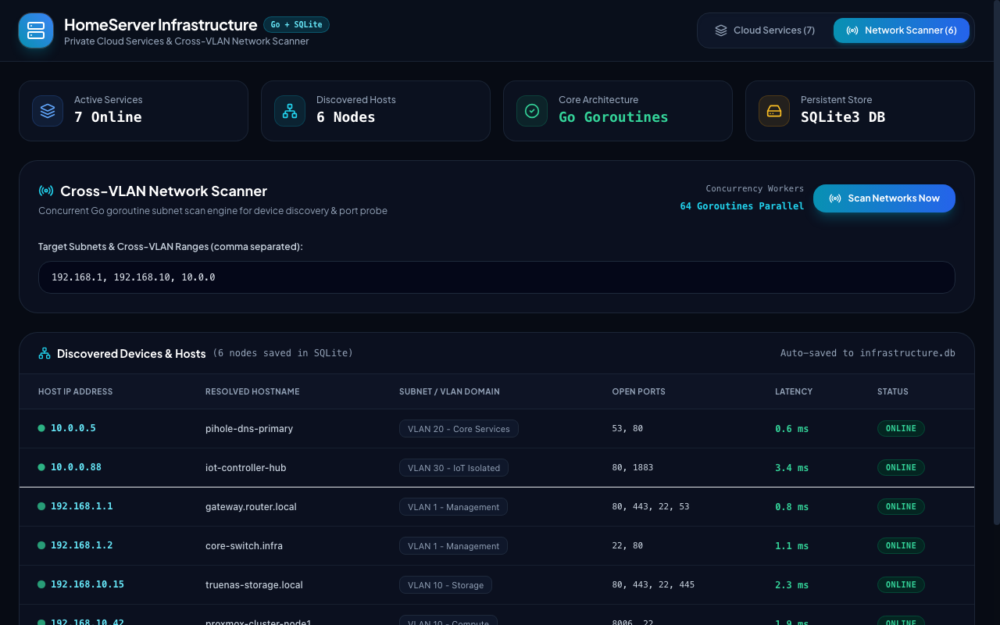 |

#### แผนภาพการทำงาน (Architecture)
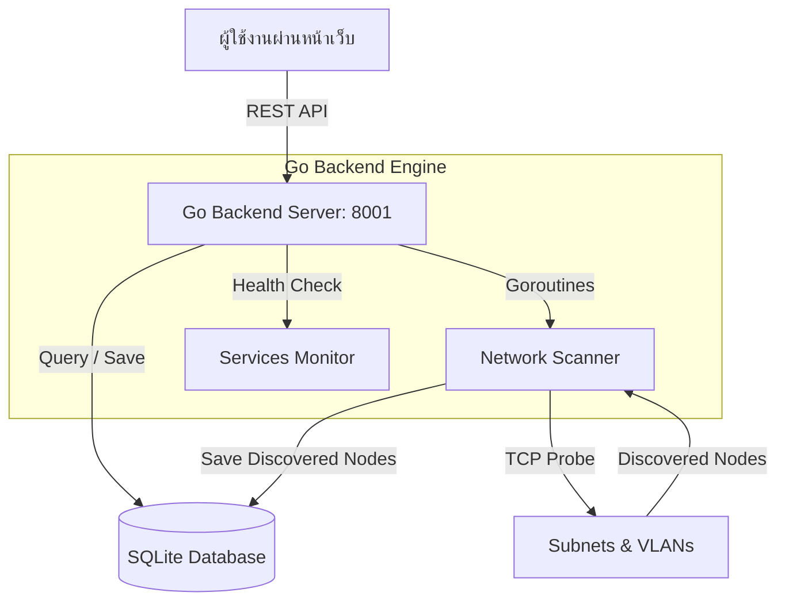

#### วิธีรันระบบ (How to Run)
1. **Backend (Go):**
  ```bash
  cd 09_HomeServer-Infrastructure/backend
  go run .
  ```
2. **Frontend (React + Tailwind):**
  ```bash
  cd 09_HomeServer-Infrastructure/frontend
  npm install
  npm run dev
  ```
  *(หรือรันผ่าน Docker: `docker compose up -d --build`)*
  เปิดเบราว์เซอร์ที่: `http://localhost:8001`

---

### 10. [10_Music-Shuffle-AI](./10_Music-Shuffle-AI) — โปรแกรมเล่นเพลงเดสก์ท็อปพร้อมระบบค้นหาด้วยเสียงผ่าน AI (Whisper)

* **หมวดหมู่:** Desktop Application & AI Audio
* **เทคโนโลยี:** Python, PyQt6, faster-whisper, mutagen, yt-dlp

#### สรุปโปรเจกต์
โปรแกรมเล่นเพลงบนระบบปฏิบัติการเดสก์ท็อปที่พัฒนาด้วย PyQt6 เชื่อมต่อโมเดล faster-whisper เพื่อให้สามารถรับคำสั่งเสียงพูด (Speech-to-Text) ภาษาไทยและภาษาอังกฤษเพื่อค้นหาเพลงในคลังได้โดยตรงบนเครื่อง ตัวโปรแกรมรองรับการสร้างเพลย์ลิสต์ รายการโปรด การแสดงเนื้อเพลงแบบคาราโอเกะ (LRC Sync) และมีเครื่องมือค้นหาและฝังภาพปกเพลงอัตโนมัติผ่าน iTunes API และ YouTube

#### สถาปัตยกรรมระบบ


#### วิธีรันระบบ (How to Run)
```bash
cd 10_Music-Shuffle-AI
pip install -r requirements.txt
python3 main.py
```

โหมดทดสอบด่วน (Quick Test):
```bash
python3 test_simulation.py
```

---

## ข้อมูลผู้พัฒนา
* **ชื่อ-นามสกุล:** Phakhaphon Sukmee
* **GitHub:** [@FANG9356](https://github.com/FANG9356)
* **Repository:** [https://github.com/FANG9356/MyProject](https://github.com/FANG9356/MyProject)
