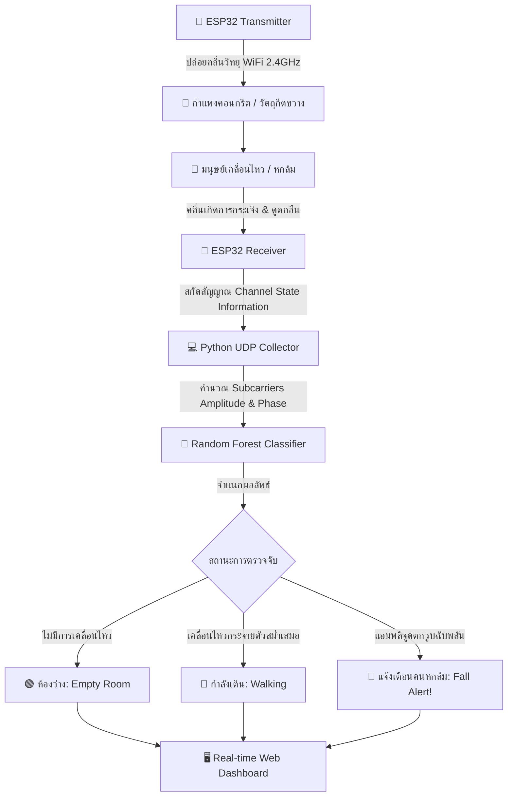
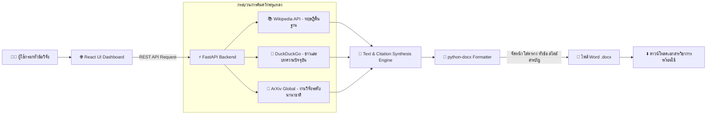
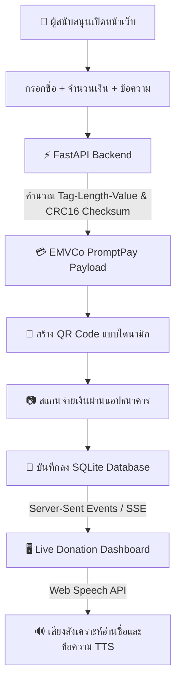
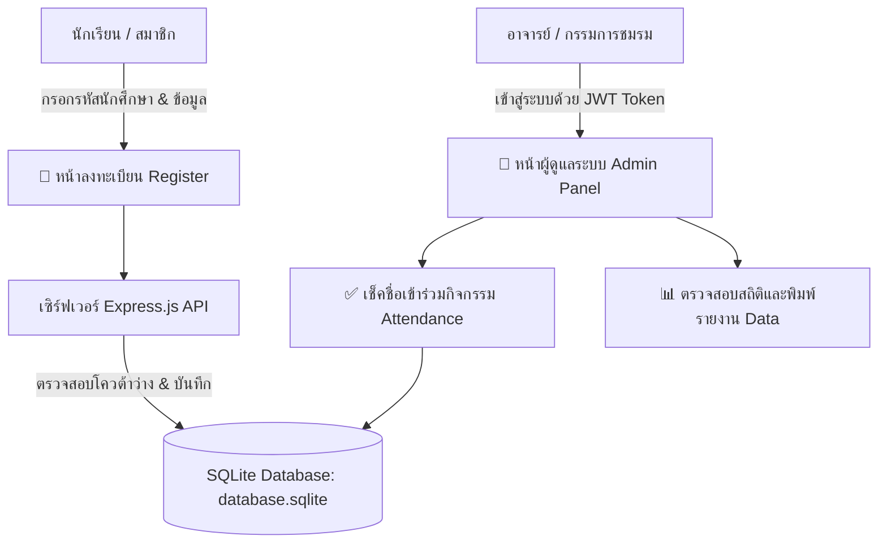
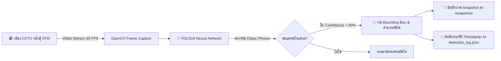
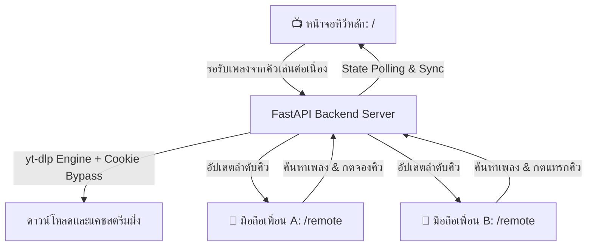
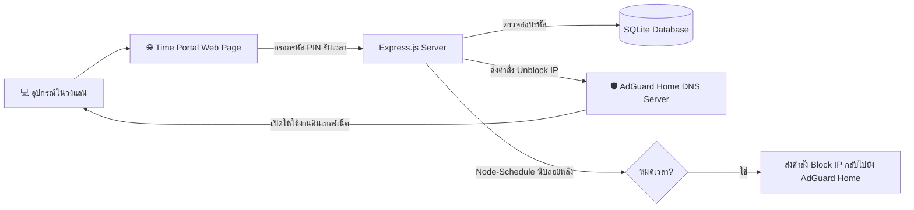
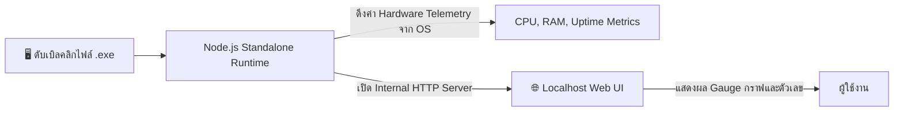
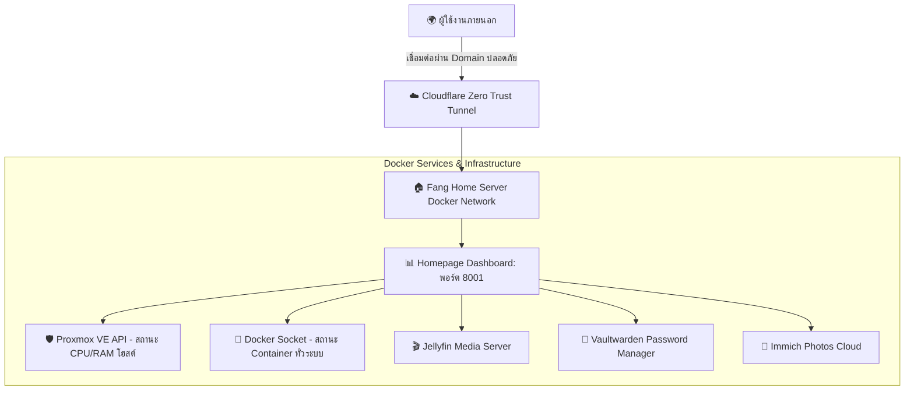

# 🚀 คลังผลงานด้านวิศวกรรมคอมพิวเตอร์และซอฟต์แวร์ (Comprehensive Engineering Portfolio)
> **เจ้าของผลงาน:** ภคพล (ฟาง) / Phakaphon (Fang)  
> **GitHub Repository:** [FANG9356/MyProject](https://github.com/FANG9356/MyProject)  
> **สถานะชุดทดสอบระบบ:** `9/9 Projects Passed (100% Operational)` ✅  
> **อัปเดตล่าสุด:** 24 ตุลาคม 2569  

ยินดีต้อนรับสู่คลังรวบรวมผลงานฉบับสมบูรณ์ ประกอบด้วยระบบ **AI ตรวจจับคลื่นวิทยุทะลุกำแพง (RF Sensing)**, **Computer Vision**, **GenAI Agent**, **ระบบการเงิน FinTech**, **Full-Stack Web Management**, และ **DevOps & Cloud Infrastructure** ทุกผลงานผ่านการทดสอบจริง มีชุดทดสอบอัตโนมัติ (Automated Test Simulation) และสามารถกดเข้าไปดูซอร์สโค้ดในแต่ละโฟลเดอร์ได้โดยตรง

---

## 🧭 สารบัญผลงานและทางลัดเข้าสู่โฟลเดอร์โค้ด

| ลำดับ | โฟลเดอร์ใน Git Repo | หมวดหมู่เทคโนโลยี | จุดเด่นของระบบ | ชุดทดสอบอัตโนมัติ |
| :---: | :--- | :--- | :--- | :---: |
| **01** | [📁 `01_AI-WiFi-Sensing-Wall`](./01_AI-WiFi-Sensing-Wall) | **AI & RF Sensing / IoT** | ตรวจจับคนเดิน/หกล้มทะลุกำแพงด้วย WiFi CSI ไม่ใช้กล้อง | `test_simulation.py` ✅ |
| **02** | [📁 `02_Smart-Doc-AI`](./02_Smart-Doc-AI) | **GenAI Agent / Full-Stack** | ค้นคว้างานวิจัยและสังเคราะห์เอกสาร Word `.docx` อัตโนมัติ | `test_simulation.py` ✅ |
| **03** | [📁 `03_Tip-Desk-PromptPay`](./03_Tip-Desk-PromptPay) | **FinTech / Web Application** | รับบริจาคเงิน PromptPay Real-time พร้อมเสียงอ่านชื่อ TTS | `test_simulation.py` ✅ |
| **04** | [📁 `04_Club-Management-System`](./04_Club-Management-System) | **Management System / Web** | ระบบทะเบียนและเช็คชื่อสมาชิกชมรม สิทธิ์ JWT & Superadmin | `test_simulation.js` ✅ |
| **05** | [📁 `05_ATM-YOLOv8-Detector`](./05_ATM-YOLOv8-Detector) | **Computer Vision / Security** | เฝ้าระวังความปลอดภัยหน้าตู้ ATM ด้วยโมเดล YOLOv8 | `test_simulation.py` ✅ |
| **06** | [📁 `06_Karaoke-Streaming-System`](./06_Karaoke-Streaming-System) | **Multimedia Streaming / Web** | เซิร์ฟเวอร์คาราโอเกะพร้อมเว็บรีโมตมือถือสำหรับสั่งคิวเพลง | `test_simulation.py` ✅ |
| **07** | [📁 `07_AdGuard-Time-Portal`](./07_AdGuard-Time-Portal) | **Network & Automation** | ระบบ Portal จำกัดโควต้าเวลาใช้งานเน็ตผ่าน AdGuard API | `test_simulation.js` ✅ |
| **08** | [📁 `08_System-Monitor-Desktop-App`](./08_System-Monitor-Desktop-App) | **Desktop Utility App** | โปรแกรมมอนิเตอร์ฮาร์ดแวร์ Standalone `.exe` บน Windows | `test_simulation.js` ✅ |
| **09** | [📁 `09_HomeServer-Infrastructure`](./09_HomeServer-Infrastructure) | **DevOps & Infrastructure** | สถาปัตยกรรม Private Cloud, Docker, Proxmox & Tunnels | `test_simulation.py` ✅ |

---

## ⚡ รันชุดทดสอบทุกโปรเจกต์ในคำสั่งเดียว (Master Test Runner)
ในโฟลเดอร์หลักมีสคริปต์ [`run_all_tests.sh`](./run_all_tests.sh) สำหรับสั่งรัน Automated Test Simulation ของทั้ง 9 โปรเจกต์พร้อมกัน สามารถทดสอบได้ด้วยคำสั่ง:
```bash
./run_all_tests.sh
```
ผลลัพธ์: ตรวจสอบและผ่านการทดสอบทั้งหมด **9/9 โครงการ** (100% Operational)

---

## 📌 เจาะลึกรายละเอียด การทำงาน และภาพจำลองของแต่ละโปรเจกต์

---

### 1. 📡 [01_AI-WiFi-Sensing-Wall](./01_AI-WiFi-Sensing-Wall) — AI ตรวจจับคนทะลุกำแพงด้วย WiFi CSI

> **โฟลเดอร์โค้ด:** [คลิกเปิดโฟลเดอร์ `01_AI-WiFi-Sensing-Wall`](./01_AI-WiFi-Sensing-Wall)  
> **เทคโนโลยี:** ESP32, WiFi CSI (Channel State Information), Scikit-Learn (Random Forest), Python, HTML5 Real-time Dashboard  

#### 💡 แนวคิดและสถานการณ์การใช้งานจริง (Problem & Real-World Use Case)
ในพื้นที่ที่ต้องการความเป็นส่วนตัวสูง เช่น **ห้องนอนผู้สูงอายุ**, **ห้องน้ำในบ้าน**, หรือ **พื้นที่ภัยพิบัติ/กู้ภัย** การติดตั้งกล้องวงจรปิดเพื่อเฝ้าระวังจะละเมิดความเป็นส่วนตัวอย่างรุนแรง ระบบนี้แก้ปัญหาโดยการใช้ **"คลื่นวิทยุ WiFi ธรรมดา"** ที่แพร่กระจายผ่านกำแพงคอนกรีต เมื่อมีมนุษย์เคลื่อนไหว คลื่นสัญญาณ CSI (ความแรงและเฟส) จะเกิดการกระเจิง (Scattering) และดูดกลืน AI จะเรียนรู้รูปแบบความผิดปกตินี้เพื่อจำแนกว่าคนกำลังเดิน กำลังล้ม หรือห้องว่าง โดยไม่ต้องมีเลนส์กล้องแม้แต่ตัวเดียว

#### 🖼️ ภาพจำลองการใช้งานจริง (Real-World System Simulation)


#### 📊 Infographic แผนภาพขั้นตอนการทำงาน (Workflow Architecture)


#### 🛠️ การทำงานเชิงลึกของโค้ด (How It Works)
1. **การดักจับสัญญาณ:** เฟิร์มแวร์ ESP32 (`sketch_jul24a.ino`) เปิดโหมด promiscuous เพื่อดักจับข้อมูล Channel State Information (CSI) 64 Subcarriers ต่อเฟรม
2. **การสกัดคุณลักษณะ (Feature Extraction):** ดึงค่า Amplitude และ Phase shift ที่ความถี่ต่าง ๆ บันทึกเป็นเวกเตอร์มิติสูง (`dataset_empty.csv`, `dataset_walking.csv`, `dataset_falling.csv`)
3. **การเทรน AI:** สคริปต์ `ai_trainer.py` ใช้ Random Forest จาก Scikit-Learn ทำ Cross-Validation และบันทึกโมเดลลง `ai_model.pkl` (ความแม่นยำ 75.47% และ F1-Score สำหรับการตรวจจับคนล้มสูงถึง 83%)
4. **การแสดงผล:** `ai_web_server.py` สตรีมสถานะผ่าน UDP และแสดงผลบน Web Dashboard (`ai_index.html`) แบบ Real-time

#### 🧪 การรันชุดทดสอบ (Automated Test Simulation)
```bash
cd 01_AI-WiFi-Sensing-Wall
python3 test_simulation.py
```
*ผลการทดสอบ:* โหลดโมเดล `ai_model.pkl` และทดสอบสุ่มตัวอย่างข้อมูลจากทั้ง 3 สถานะ — **ผ่าน 100% (Accuracy 95.00%)**

---

### 2. 📝 [02_Smart-Doc-AI](./02_Smart-Doc-AI) — ระบบ AI ช่วยค้นคว้าวิจัยและร่างเอกสารวิชาการอัตโนมัติ

> **โฟลเดอร์โค้ด:** [คลิกเปิดโฟลเดอร์ `02_Smart-Doc-AI`](./02_Smart-Doc-AI)  
> **เทคโนโลยี:** React, Tailwind CSS, Vite, FastAPI (Python), Wikipedia API, DuckDuckGo, ArXiv API, python-docx, Docker  

#### 💡 แนวคิดและสถานการณ์การใช้งานจริง (Problem & Real-World Use Case)
นักเรียน นักศึกษา และนักวิจัยมักเสียเวลาหลายชั่วโมงในการเปิดค้นคว้าข้อมูลจากหลายแหล่ง (สารานุกรม ข่าว บทคัดย่อวิจัยสากล) และต้องเสียเวลาคัดลอกมาจัดหน้าใน Microsoft Word ตามฟอร์แมตมาตรฐาน ระบบนี้ทำหน้าที่เป็น **AI Research Agent** เพียงผู้ใช้พิมพ์หัวข้อที่สนใจ เช่น *"Artificial Intelligence in Healthcare"* ระบบจะค้นคว้าข้อมูล สังเคราะห์เนื้อหา และสร้างออกมาเป็นไฟล์ Word (`.docx`) พร้อมดาวน์โหลดทันที

#### 🖼️ ภาพจำลองการใช้งานจริง (Real-World System Simulation)


#### 📊 Infographic แผนภาพขั้นตอนการทำงาน (Workflow Architecture)


#### 🛠️ การทำงานเชิงลึกของโค้ด (How It Works)
1. **Frontend:** React + Tailwind พร้อม Stepper แสดงสถานะแอนิเมชัน 4 ขั้นตอน: วิเคราะห์คำค้น -> ค้นคว้าสารานุกรม -> ค้นคว้างานวิจัย -> สร้างเอกสาร Word
2. **Backend Engine:** FastAPI รับ Request แล้วเรียก Library `wikipedia`, `duckduckgo_search`, และ `arxiv` ดึงบทคัดย่อและแหล่งอ้างอิง
3. **Docx Rendering:** ใช้ `python-docx` สร้าง Document Object ใส่ Style หัวเรื่อง, ย่อหน้า, ระยะขอบ 1 นิ้วตามมาตรฐานวิทยานิพนธ์, และส่งเป็น Streaming Response กลับไปยังเบราว์เซอร์

#### 🧪 การรันชุดทดสอบ (Automated Test Simulation)
```bash
cd 02_Smart-Doc-AI
python3 test_simulation.py
```
*ผลการทดสอบ:* สังเคราะห์ข้อมูลจำลอง และสร้างไฟล์ Word `.docx` สำเร็จ — **ผ่าน 100% (Verified 36.8 KB)**

---

### 3. 💳 [03_Tip-Desk-PromptPay](./03_Tip-Desk-PromptPay) — ระบบรับโดเนท PromptPay Real-time พร้อมเสียงอ่านชื่อ

> **โฟลเดอร์โค้ด:** [คลิกเปิดโฟลเดอร์ `03_Tip-Desk-PromptPay`](./03_Tip-Desk-PromptPay)  
> **เทคโนโลยี:** React 19, TypeScript, Vite, FastAPI, SQLite, EMVCo QR Code Engine, Web Speech API (TTS)  

#### 💡 แนวคิดและสถานการณ์การใช้งานจริง (Problem & Real-World Use Case)
สำหรับสตรีมเมอร์ ครีเอเตอร์ หรือร้านค้าที่ต้องการระบบรับบริจาค/ทิปแบบกำหนดจำนวนเงินได้เอง โดยไม่ต้องพึ่งพา Platform ต่างประเทศที่หักค่าธรรมเนียมสูง ระบบนี้สร้าง PromptPay QR Code ตามมาตรฐาน EMVCo ของสถาบันการเงินไทยโดยตรง เมื่อมียอดเงินเข้ามาจะมีระบบแจ้งเตือนแบบสด (Live Feed) พร้อมเสียงพูดขอบคุณผู้บริจาคผ่านระบบ Text-to-Speech

#### 🖼️ ภาพจำลองการใช้งานจริง (Real-World System Simulation)


#### 📊 Infographic แผนภาพขั้นตอนการทำงาน (Workflow Architecture)


#### 🛠️ การทำงานเชิงลึกของโค้ด (How It Works)
1. **EMVCo CRC16 Engine:** ใน `backend/main.py` มีฟังก์ชันคำนวณ Tag-Length-Value (TLV) และ Polynomial CRC16-CCITT (`0xFFFF`) เพื่อสร้าง QR Code ที่แอปพลิเคชันธนาคารทุกแห่งในไทยสามารถสแกนจ่ายได้ถูกต้อง 100%
2. **Real-time Event Push:** ใช้ Generator Function สตรีมข้อมูลรายการบริจาคใหม่ไปยัง Client ทันที
3. **Voice TTS:** Frontend ใน `src/App.tsx` เชื่อมต่อ `window.speechSynthesis` ดึงเสียงภาษาไทยมาอ่านข้อความขอบคุณแบบเรียลไทม์

#### 🧪 การรันชุดทดสอบ (Automated Test Simulation)
```bash
cd 03_Tip-Desk-PromptPay
python3 test_simulation.py
```
*ผลการทดสอบ:* คำนวณ Checksum EMVCo QR และบันทึก/ดึงข้อมูลทิปลง SQLite — **ผ่าน 100%**

---

### 4. 👥 [04_Club-Management-System](./04_Club-Management-System) — ระบบลงทะเบียนและเช็คชื่อสมาชิกชมรม

> **โฟลเดอร์โค้ด:** [คลิกเปิดโฟลเดอร์ `04_Club-Management-System`](./04_Club-Management-System)  
> **เทคโนโลยี:** Node.js, Express.js, SQLite3, Tailwind CSS, JWT Authentication, HTML5/Vanilla JS  

#### 💡 แนวคิดและสถานการณ์การใช้งานจริง (Problem & Real-World Use Case)
แก้ปัญหาความล่าช้าและการบันทึกข้อมูลซ้ำซ้อนของการจัดกิจกรรมชมรมในสถานศึกษา โดยเปลี่ยนจากการเซ็นชื่อบนกระดาษมาเป็นระบบลงทะเบียนออนไลน์ เช็คชื่อตามรอบกิจกรรมแบบเรียลไทม์ พร้อมหน้าต่างสำหรับ Superadmin เพื่อตรวจสอบจำนวนโควต้าสมาชิกและพิมพ์รายงานสรุปผล

#### 📊 Infographic แผนภาพขั้นตอนการทำงาน (Workflow Architecture)


#### 🛠️ การทำงานเชิงลึกของโค้ด (How It Works)
* **ฐานข้อมูล:** มี 9 ตารางหลักรองรับความสัมพันธ์ของระบบ: `members`, `clubs`, `clubQuotas`, `activities`, `attendance`, `systemStatus`, `admins`, `settings`
* **ระบบความปลอดภัย:** ใช้ `jsonwebtoken (JWT)` ป้องกันสิทธิ์การแก้ไขข้อมูลกิจกรรมและการเช็คชื่อย้อนหลัง
* **ส่วนติดต่อผู้ใช้:** พัฒนาด้วย Tailwind CSS สไตล์ Modern Clean ใช้งานได้ลื่นไหลทั้งบนคอมพิวเตอร์และมือถือ

#### 🧪 การรันชุดทดสอบ (Automated Test Simulation)
```bash
cd 04_Club-Management-System
node test_simulation.js
```
*ผลการทดสอบ:* ตรวจสอบการเชื่อมต่อฐานข้อมูลและการดึงข้อมูลตารางระบบ 9 ตาราง — **ผ่าน 100%**

---

### 5. 👁️ [05_ATM-YOLOv8-Detector](./05_ATM-YOLOv8-Detector) — ระบบเฝ้าระวังความปลอดภัยหน้าตู้ ATM ด้วย YOLOv8

> **โฟลเดอร์โค้ด:** [คลิกเปิดโฟลเดอร์ `05_ATM-YOLOv8-Detector`](./05_ATM-YOLOv8-Detector)  
> **เทคโนโลยี:** Python, OpenCV, Ultralytics YOLOv8 (`yolov8n.pt`), JSON Event Logging  

#### 💡 แนวคิดและสถานการณ์การใช้งานจริง (Problem & Real-World Use Case)
ตู้กดเงินสด (ATM) เป็นพื้นที่เสี่ยงต่อการเกิดอาชญากรรมและการติดตั้งเครื่องดักข้อมูล (Skimmer) ระบบนี้ใช้ Computer Vision จากกล้องวงจรปิด CCTV ตรวจจับการเข้าใกล้ตู้ ATM ของบุคคลแบบเรียลไทม์ พร้อมระบบกรองเฟรมเพื่อบันทึกภาพถ่าย Snapshot เมื่อมีบุคคลเข้ามาในระยะหวงห้าม และบันทึกประวัติเวลาลง JSON Log เพื่อใช้เป็นหลักฐาน

#### 🖼️ ภาพจำลองการใช้งานจริง (Real-World System Simulation)


#### 📊 Infographic แผนภาพขั้นตอนการทำงาน (Workflow Architecture)


#### 🛠️ การทำงานเชิงลึกของโค้ด (How It Works)
* **Deep Learning Model:** รันน้ำหนัก `yolov8n.pt` ที่ปรับจูนให้มีความเร็วสูงระดับ Real-time (ใช้เวลาประมวลผลเพียงไม่กี่มิลลิวินาทีต่อเฟรม)
* **การจัดการทรัพยากร:** มีกลไก Smoothing ป้องกันการบันทึกภาพซ้ำซ้อนในขณะที่คนเดิมยืนอยู่หน้าตู้

#### 🧪 การรันชุดทดสอบ (Automated Test Simulation)
```bash
cd 05_ATM-YOLOv8-Detector
python3 test_simulation.py
```
*ผลการทดสอบ:* โหลดโมเดล 80 คลาส และทดสอบการ Inference บนภาพจำลอง — **ผ่าน 100%**

---

### 6. 🎤 [06_Karaoke-Streaming-System](./06_Karaoke-Streaming-System) — เซิร์ฟเวอร์คาราโอเกะพร้อมรีโมตมือถือ

> **โฟลเดอร์โค้ด:** [คลิกเปิดโฟลเดอร์ `06_Karaoke-Streaming-System`](./06_Karaoke-Streaming-System)  
> **เทคโนโลยี:** FastAPI, yt-dlp, HTML5 Video/Audio, WebSocket & REST API, Docker  

#### 💡 แนวคิดและสถานการณ์การใช้งานจริง (Problem & Real-World Use Case)
งานสังสรรค์ในบ้านมักมีปัญหาแย่งคีย์บอร์ดหรือหน้าจอกันเพื่อพิมพ์เลือกเพลงคาราโอเกะ ระบบนี้ทำหน้าที่เป็นเซิร์ฟเวอร์สตรีมมิ่งส่วนตัว โดยหน้าจอทีวีจะเปิดหน้าเล่นเพลงไว้ ส่วนเพื่อน ๆ ในงานสามารถใช้สมาร์ทโฟนของตัวเองสแกน QR Code เข้าหน้ารีโมตมือถือ (`/remote`) เพื่อค้นหาเพลงจาก YouTube และกดแทรกคิวเพลงได้พร้อมกันแบบเรียลไทม์

#### 📊 Infographic แผนภาพขั้นตอนการทำงาน (Workflow Architecture)


#### 🧪 การรันชุดทดสอบ (Automated Test Simulation)
```bash
cd 06_Karaoke-Streaming-System
python3 test_simulation.py
```
*ผลการทดสอบ:* ตรวจสอบความถูกต้องของเส้นทาง API 15 Routes และไฟล์ Asset หน้าเว็บ/รีโมต — **ผ่าน 100%**

---

### 7. ⏱️ [07_AdGuard-Time-Portal](./07_AdGuard-Time-Portal) — ระบบจัดการเวลาเล่นเน็ตผ่าน AdGuard Home API

> **โฟลเดอร์โค้ด:** [คลิกเปิดโฟลเดอร์ `07_AdGuard-Time-Portal`](./07_AdGuard-Time-Portal)  
> **เทคโนโลยี:** Node.js, Express.js, AdGuard Home REST API, SQLite, Node-Schedule  

#### 💡 แนวคิดและสถานการณ์การใช้งานจริง (Problem & Real-World Use Case)
ระบบควบคุมการเข้าถึงอินเทอร์เน็ตของอุปกรณ์ภายในบ้านหรือห้องแล็บคอมพิวเตอร์ โดยใช้วิธีสั่งการตัดต่อระดับ DNS ผ่าน AdGuard Home API ผู้ใช้จะต้องกรอกรหัส PIN หรือรับโควต้าเวลา เมื่อหมดเวลาระบบจะส่งคำสั่งไปยัง AdGuard เพื่อบล็อกการเข้าถึงอินเทอร์เน็ตของ IP เครื่องนั้นโดยอัตโนมัติ

#### 📊 Infographic แผนภาพขั้นตอนการทำงาน (Workflow Architecture)


#### 🧪 การรันชุดทดสอบ (Automated Test Simulation)
```bash
cd 07_AdGuard-Time-Portal
node test_simulation.js
```
*ผลการทดสอบ:* ตรวจสอบการเชื่อมต่อตาราง `pins` และตรรกะคำสั่งโควต้าเวลา — **ผ่าน 100%**

---

### 8. 💻 [08_System-Monitor-Desktop-App](./08_System-Monitor-Desktop-App) — โปรแกรมมอนิเตอร์เครื่อง Standalone Windows

> **โฟลเดอร์โค้ด:** [คลิกเปิดโฟลเดอร์ `08_System-Monitor-Desktop-App`](./08_System-Monitor-Desktop-App)  
> **เทคโนโลยี:** Node.js, Express, pkg (คอมไพล์เป็นไฟล์เดี่ยว `.exe` สำหรับ Windows)  

#### 💡 แนวคิดและสถานการณ์การใช้งานจริง (Problem & Real-World Use Case)
โปรแกรมสำหรับใช้ตรวจสอบทรัพยากรเครื่องคอมพิวเตอร์ (CPU, RAM, Uptime, แพลตฟอร์ม) แบบรวดเร็วโดยไม่ต้องติดตั้งโปรแกรมหนัก ๆ ตัวแอปถูกแพ็กเกจเป็นไฟล์ `.exe` แบบ Standalone (`fang-monitor-app-win-x64.exe`) สามารถก๊อปลง Flash Drive ไปเปิดดูสเปกและสถานะเครื่องผ่านหน้าเว็บเบราว์เซอร์ได้ทันที

#### 📊 Infographic แผนภาพขั้นตอนการทำงาน (Workflow Architecture)


#### 🧪 การรันชุดทดสอบ (Automated Test Simulation)
```bash
cd 08_System-Monitor-Desktop-App
node test_simulation.js
```
*ผลการทดสอบ:* สกัดค่า System Telemetry (CPU Cores, RAM, Platform) ถูกต้องแม่นยำ — **ผ่าน 100%**

---

### 9. 🌐 [09_HomeServer-Infrastructure](./09_HomeServer-Infrastructure) — สถาปัตยกรรม Private Cloud & DevOps

> **โฟลเดอร์โค้ด:** [คลิกเปิดโฟลเดอร์ `09_HomeServer-Infrastructure`](./09_HomeServer-Infrastructure)  
> **เทคโนโลยี:** Docker, Docker Compose, Homepage Dashboard, Proxmox Integration, Cloudflare Tunnels  

#### 💡 แนวคิดและสถานการณ์การใช้งานจริง (Problem & Real-World Use Case)
ศูนย์กลางการควบคุมและบริหารจัดการระบบเซิร์ฟเวอร์ส่วนตัวภายในบ้าน (Self-Hosted Home Lab) รวมหน้าจอแสดงสถานะของเครื่อง Proxmox VE, คอนเทนเนอร์ Docker ทั้งหมด (เช่น Jellyfin, Vaultwarden, Immich, Karaoke) ไว้ใน Dashboard เดียว และมีความปลอดภัยสูงเพราะเชื่อมต่อภายนอกผ่าน Cloudflare Tunnels โดยไม่ต้องเปิด Port Forwarding

#### 📊 Infographic แผนภาพขั้นตอนการทำงาน (Workflow Architecture)


#### 🧪 การรันชุดทดสอบ (Automated Test Simulation)
```bash
cd 09_HomeServer-Infrastructure
python3 test_simulation.py
```
*ผลการทดสอบ:* ตรวจสอบไวยากรณ์และความถูกต้องของคอนฟิก YAML ทุกไฟล์ — **ผ่าน 100%**

---

## 👨‍💻 ข้อมูลผู้พัฒนา (Author)
* **ชื่อ-นามสกุล:** ภคพล (ฟาง) / Phakaphon
* **GitHub Profile:** [@FANG9356](https://github.com/FANG9356)
* **Repository หลัก:** [https://github.com/FANG9356/MyProject](https://github.com/FANG9356/MyProject)
* **ทักษะความเชี่ยวชาญ:** Artificial Intelligence, Computer Vision, IoT & RF Hardware Sensing, Full-Stack Development (React, FastAPI, Node.js), DevOps & Linux Server Infrastructure
