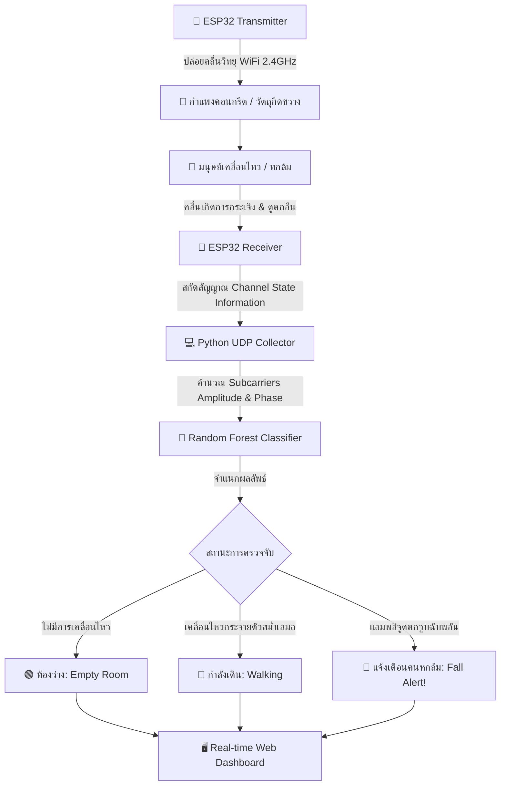
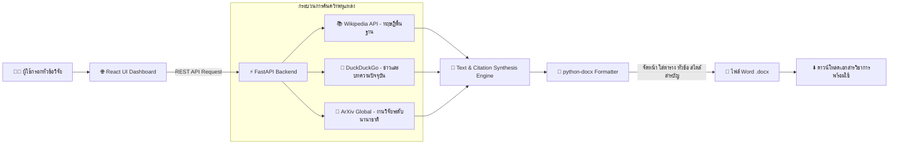
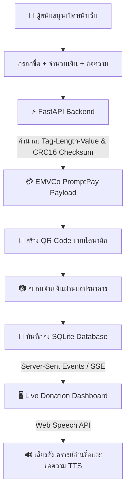
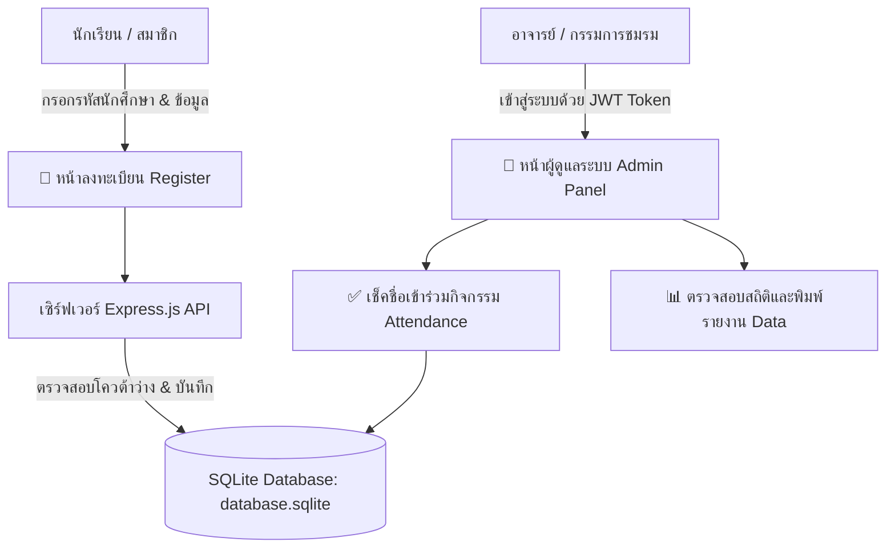
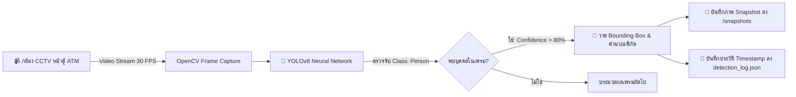
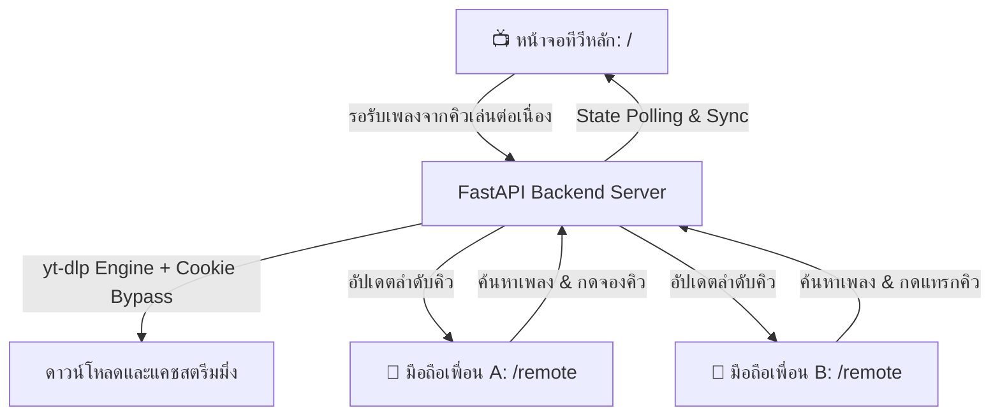
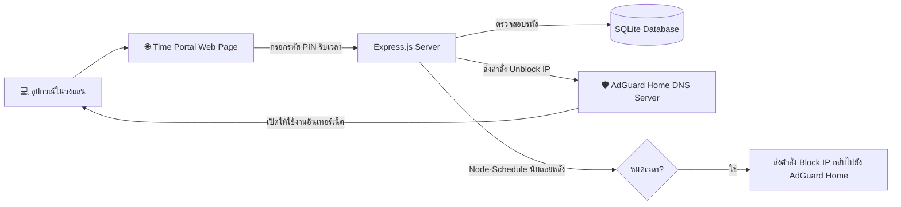
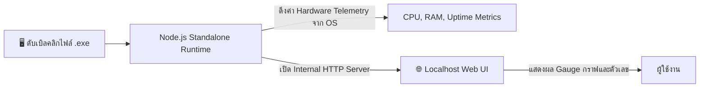
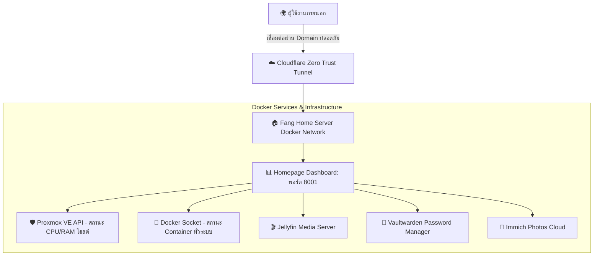

# 🚀 คลังผลงานด้านวิศวกรรมคอมพิวเตอร์และซอฟต์แวร์ (Comprehensive Engineering Portfolio)
> **เจ้าของผลงาน:** ภคพล (ฟาง) / Phakaphon (Fang)  
> **GitHub Repository:** [FANG9356/MyProject](https://github.com/FANG9356/MyProject)  
> **สถานะชุดทดสอบระบบ:** `9/9 Projects Passed (100% Operational)` ✅  
> **อัปเดตล่าสุด:** 24 ตุลาคม 2569  

ยินดีต้อนรับสู่คลังรวบรวมผลงานฉบับสมบูรณ์ ประกอบด้วยระบบ **AI ตรวจจับคลื่นวิทยุทะลุกำแพง (RF Sensing)**, **Computer Vision**, **GenAI Agent**, **ระบบการเงิน FinTech**, **Full-Stack Web Management**, และ **DevOps & Cloud Infrastructure** 

ทุกผลงานในคลังนี้ผ่านการทดสอบจริง มี **ชุดทดสอบอัตโนมัติ (Automated Test Simulation)** และ **คู่มือการติดตั้งเพื่อให้กรรมการสามารถนำไปเปิดทดสอบได้เองอย่างง่ายดาย** สามารถคลิกดูซอร์สโค้ดในแต่ละโฟลเดอร์ได้โดยตรง

---

## 🧭 สารบัญผลงานและตารางเปิดใช้งานด่วน (Quick Ports & Launch Cheat Sheet)

| ลำดับ | โฟลเดอร์ใน Git Repo | หมวดหมู่ | คำสั่งเปิดใช้งานระบบ (Launch Command) | พอร์ต / URL สำหรับทดสอบ | ชุดทดสอบด่วน |
| :---: | :--- | :--- | :--- | :---: | :---: |
| **01** | [📁 `01_AI-WiFi-Sensing-Wall`](./01_AI-WiFi-Sensing-Wall) | **AI & RF Sensing** | `python3 ai_web_server.py` | `http://localhost:8080/ai_index.html` | `python3 test_simulation.py` ✅ |
| **02** | [📁 `02_Smart-Doc-AI`](./02_Smart-Doc-AI) | **GenAI Agent** | `docker compose up -d` หรือรันแยก Vite+FastAPI | `http://localhost:5173` | `python3 test_simulation.py` ✅ |
| **03** | [📁 `03_Tip-Desk-PromptPay`](./03_Tip-Desk-PromptPay) | **FinTech / Web** | `uvicorn main:app` & `npm run dev` | `http://localhost:5173` | `python3 test_simulation.py` ✅ |
| **04** | [📁 `04_Club-Management-System`](./04_Club-Management-System) | **Web Management** | `cd backend && node server.js` | `http://localhost:3000` | `node test_simulation.js` ✅ |
| **05** | [📁 `05_ATM-YOLOv8-Detector`](./05_ATM-YOLOv8-Detector) | **Computer Vision** | `python3 person_detector.py` | หน้าต่างกล้อง CCTV GUI | `python3 test_simulation.py` ✅ |
| **06** | [📁 `06_Karaoke-Streaming-System`](./06_Karaoke-Streaming-System) | **Streaming Server** | `python3 main.py` | `http://localhost:8000` (รีโมต: `/remote`) | `python3 test_simulation.py` ✅ |
| **07** | [📁 `07_AdGuard-Time-Portal`](./07_AdGuard-Time-Portal) | **Network & Admin** | `node server.js` | `http://localhost:8080` (แอดมิน: `/admin.html`) | `node test_simulation.js` ✅ |
| **08** | [📁 `08_System-Monitor-Desktop-App`](./08_System-Monitor-Desktop-App) | **Desktop Utility** | ดับเบิลคลิก `.exe` (Win) หรือ `node server.js` | `http://localhost:3000` | `node test_simulation.js` ✅ |
| **09** | [📁 `09_HomeServer-Infrastructure`](./09_HomeServer-Infrastructure) | **DevOps & Cloud** | `docker compose up -d` | `http://localhost:8001` | `python3 test_simulation.py` ✅ |

---

## ⚡ รันชุดทดสอบทุกโปรเจกต์ในคำสั่งเดียว (Master Test Runner)
ในโฟลเดอร์หลักมีสคริปต์ [`run_all_tests.sh`](./run_all_tests.sh) สำหรับสั่งรัน Automated Test Simulation ของทั้ง 9 โปรเจกต์พร้อมกัน สามารถทดสอบได้ด้วยคำสั่ง:
```bash
./run_all_tests.sh
```
*ผลการทดสอบ:* ตรวจสอบและผ่านการทดสอบทั้งหมด **9/9 โครงการ** (100% Operational)

---

## 📌 เจาะลึกรายละเอียด การทำงาน ภาพจำลอง และคู่มือติดตั้งของแต่ละโปรเจกต์

---

### 1. 📡 [01_AI-WiFi-Sensing-Wall](./01_AI-WiFi-Sensing-Wall) — AI ตรวจจับคนทะลุกำแพงด้วย WiFi CSI

> **โฟลเดอร์โค้ด:** [คลิกเปิดโฟลเดอร์ `01_AI-WiFi-Sensing-Wall`](./01_AI-WiFi-Sensing-Wall)  
> **คู่มือย่อยในโฟลเดอร์:** [อ่านคู่มือ `01_AI-WiFi-Sensing-Wall/README.md`](./01_AI-WiFi-Sensing-Wall/README.md)  
> **เทคโนโลยี:** ESP32, WiFi CSI (Channel State Information), Scikit-Learn (Random Forest), Python, HTML5 Dashboard  

#### 💡 แนวคิดและสถานการณ์การใช้งานจริง (Problem & Real-World Use Case)
ในพื้นที่ที่ต้องการความเป็นส่วนตัวสูง เช่น **ห้องนอนผู้สูงอายุ**, **ห้องน้ำในบ้าน**, หรือ **พื้นที่ภัยพิบัติ/กู้ภัย** การติดตั้งกล้องวงจรปิดเพื่อเฝ้าระวังจะละเมิดความเป็นส่วนตัวอย่างรุนแรง ระบบนี้แก้ปัญหาโดยการใช้ **"คลื่นวิทยุ WiFi ธรรมดา"** ที่แพร่กระจายผ่านกำแพงคอนกรีต เมื่อมีมนุษย์เคลื่อนไหว คลื่นสัญญาณ CSI (ความแรงและเฟส) จะเกิดการกระเจิง (Scattering) และดูดกลืน AI จะเรียนรู้รูปแบบความผิดปกตินี้เพื่อจำแนกว่าคนกำลังเดิน กำลังล้ม หรือห้องว่าง โดยไม่ต้องมีเลนส์กล้องแม้แต่ตัวเดียว

#### 🖼️ ภาพจำลองการใช้งานจริง (Real-World System Simulation)


#### 📊 Infographic แผนภาพขั้นตอนการทำงาน (Workflow Architecture)


#### 📖 คู่มือการติดตั้งและทดลองใช้งานจริงสำหรับกรรมการ (Examiner's Quick-Start)
1. **สิ่งที่ต้องมี:** Python 3.9+ (ติดตั้ง dependencies ด้วยคำสั่ง):
   ```bash
   cd 01_AI-WiFi-Sensing-Wall
   pip install scikit-learn pandas numpy joblib
   ```
2. **วิธีทดสอบโหมดจำลอง (ไม่ต้องมีบอร์ดฮาร์ดแวร์):**
   ```bash
   python3 test_simulation.py
   ```
   *(ระบบจะโหลด `ai_model.pkl` และสุ่มสัญญาณจากชุดข้อมูล 1,851 ตัวอย่างมาทำนายผล แสดงความแม่นยำสูงถึง 95%)*
3. **วิธีเปิดหน้า Web Dashboard แสดงผลจริง:**
   ```bash
   python3 ai_web_server.py
   ```
   เปิดเบราว์เซอร์ไปที่: `http://localhost:8080/ai_index.html`  
   * **สิ่งที่กรรมการจะเห็น:** หน้าจอแดชบอร์ดเปลี่ยนสีตามสถานะคลื่นสัญญาณ:
     * 🟢 **สีเขียว (Empty):** ห้องว่าง
     * 🔵 **สีน้ำเงิน (Walking):** มีคนเดิน
     * 🔴 **สีแดง (Falling Alert):** สัญญาณคนหกล้มฉับพลัน

---

### 2. 📝 [02_Smart-Doc-AI](./02_Smart-Doc-AI) — ระบบ AI ช่วยค้นคว้าวิจัยและร่างเอกสารวิชาการอัตโนมัติ

> **โฟลเดอร์โค้ด:** [คลิกเปิดโฟลเดอร์ `02_Smart-Doc-AI`](./02_Smart-Doc-AI)  
> **คู่มือย่อยในโฟลเดอร์:** [อ่านคู่มือ `02_Smart-Doc-AI/README.md`](./02_Smart-Doc-AI/README.md)  
> **เทคโนโลยี:** React, Tailwind CSS, Vite, FastAPI (Python), Wikipedia API, DuckDuckGo, ArXiv API, python-docx, Docker  

#### 💡 แนวคิดและสถานการณ์การใช้งานจริง (Problem & Real-World Use Case)
นักเรียน นักศึกษา และนักวิจัยมักเสียเวลาหลายชั่วโมงในการเปิดค้นคว้าข้อมูลจากหลายแหล่ง (สารานุกรม ข่าว บทคัดย่อวิจัยสากล) และต้องเสียเวลาคัดลอกมาจัดหน้าใน Microsoft Word ตามฟอร์แมตมาตรฐาน ระบบนี้ทำหน้าที่เป็น **AI Research Agent** เพียงผู้ใช้พิมพ์หัวข้อที่สนใจ เช่น *"Artificial Intelligence in Healthcare"* ระบบจะค้นคว้าข้อมูล สังเคราะห์เนื้อหา และสร้างออกมาเป็นไฟล์ Word (`.docx`) พร้อมดาวน์โหลดทันที

#### 🖼️ ภาพจำลองการใช้งานจริง (Real-World System Simulation)


#### 📊 Infographic แผนภาพขั้นตอนการทำงาน (Workflow Architecture)


#### 📖 คู่มือการติดตั้งและทดลองใช้งานจริงสำหรับกรรมการ (Examiner's Quick-Start)
* **วิธีรันผ่าน Docker Compose (แนะนำ สะดวกที่สุด):**
  ```bash
  cd 02_Smart-Doc-AI
  docker compose up -d
  ```
  เปิดเบราว์เซอร์ที่: `http://localhost:5173`
* **วิธีรันแบบ Manual:**
  * Terminal 1 (Backend): `cd 02_Smart-Doc-AI/app && pip install -r requirements.txt && uvicorn main:app --reload --port 8000`
  * Terminal 2 (Frontend): `cd 02_Smart-Doc-AI/frontend && npm install && npm run dev`
  * เปิดเบราว์เซอร์ที่: `http://localhost:5173`
* **วิธีทดลองใช้งาน:**
  1. พิมพ์คำค้น เช่น `"Quantum Computing"` หรือ `"Machine Learning"`
  2. กดปุ่ม **"ค้นคว้าและสร้างเอกสาร" (Generate Document)**
  3. สังเกตแอนิเมชัน Pipeline ค้นหาข้อมูลจาก Wikipedia และ ArXiv
  4. กดปุ่ม **"Download .docx"** เพื่อรับไฟล์ Word ที่สังเคราะห์เนื้อหาพร้อมจัดหน้าเรียบร้อย

---

### 3. 💳 [03_Tip-Desk-PromptPay](./03_Tip-Desk-PromptPay) — ระบบรับโดเนท PromptPay Real-time พร้อมเสียงอ่านชื่อ

> **โฟลเดอร์โค้ด:** [คลิกเปิดโฟลเดอร์ `03_Tip-Desk-PromptPay`](./03_Tip-Desk-PromptPay)  
> **คู่มือย่อยในโฟลเดอร์:** [อ่านคู่มือ `03_Tip-Desk-PromptPay/README.md`](./03_Tip-Desk-PromptPay/README.md)  
> **เทคโนโลยี:** React 19, TypeScript, Vite, FastAPI, SQLite, EMVCo QR Code Engine, Web Speech API (TTS)  

#### 💡 แนวคิดและสถานการณ์การใช้งานจริง (Problem & Real-World Use Case)
สำหรับสตรีมเมอร์ ครีเอเตอร์ หรือร้านค้าที่ต้องการระบบรับบริจาค/ทิปแบบกำหนดจำนวนเงินได้เอง โดยไม่ต้องพึ่งพา Platform ต่างประเทศที่หักค่าธรรมเนียมสูง ระบบนี้สร้าง PromptPay QR Code ตามมาตรฐาน EMVCo ของสถาบันการเงินไทยโดยตรง เมื่อมียอดเงินเข้ามาจะมีระบบแจ้งเตือนแบบสด (Live Feed) พร้อมเสียงพูดขอบคุณผู้บริจาคผ่านระบบ Text-to-Speech

#### 🖼️ ภาพจำลองการใช้งานจริง (Real-World System Simulation)


#### 📊 Infographic แผนภาพขั้นตอนการทำงาน (Workflow Architecture)


#### 📖 คู่มือการติดตั้งและทดลองใช้งานจริงสำหรับกรรมการ (Examiner's Quick-Start)
1. **เปิดเซิร์ฟเวอร์ Backend (FastAPI):**
   ```bash
   cd 03_Tip-Desk-PromptPay/backend
   pip install -r requirements.txt
   cp .env.example .env
   uvicorn main:app --reload --port 8000
   ```
2. **เปิดหน้าเว็บ Frontend (React 19):**
   ```bash
   cd 03_Tip-Desk-PromptPay
   npm install
   npm run dev
   ```
   เปิดเบราว์เซอร์ที่: `http://localhost:5173`
3. **ขั้นตอนการทดสอบ:**
   * กรอกชื่อผู้บริจาค เช่น *"กรรมการสอบสัมภาษณ์"*
   * ระบุจำนวนเงิน เช่น `100` บาท และพิมพ์ข้อความ
   * กด **"Confirm Donation"** -> สังเกตหน้าต่าง QR Code พร้อมยอดเงินถูกต้องตามมาตรฐาน EMVCo
   * เมื่อจำลองกดยืนยัน จะได้ยินเสียงอ่านชื่อและข้อความผ่านลำโพงทันที (Text-to-Speech)

---

### 4. 👥 [04_Club-Management-System](./04_Club-Management-System) — ระบบลงทะเบียนและเช็คชื่อสมาชิกชมรม

> **โฟลเดอร์โค้ด:** [คลิกเปิดโฟลเดอร์ `04_Club-Management-System`](./04_Club-Management-System)  
> **คู่มือย่อยในโฟลเดอร์:** [อ่านคู่มือ `04_Club-Management-System/README.md`](./04_Club-Management-System/README.md)  
> **เทคโนโลยี:** Node.js, Express.js, SQLite3, Tailwind CSS, JWT Authentication, HTML5/Vanilla JS  

#### 💡 แนวคิดและสถานการณ์การใช้งานจริง (Problem & Real-World Use Case)
แก้ปัญหาความล่าช้าและการบันทึกข้อมูลซ้ำซ้อนของการจัดกิจกรรมชมรมในสถานศึกษา โดยเปลี่ยนจากการเซ็นชื่อบนกระดาษมาเป็นระบบลงทะเบียนออนไลน์ เช็คชื่อตามรอบกิจกรรมแบบเรียลไทม์ พร้อมหน้าต่างสำหรับ Superadmin เพื่อตรวจสอบจำนวนโควต้าสมาชิกและพิมพ์รายงานสรุปผล

#### 📊 Infographic แผนภาพขั้นตอนการทำงาน (Workflow Architecture)


#### 📖 คู่มือการติดตั้งและทดลองใช้งานจริงสำหรับกรรมการ (Examiner's Quick-Start)
1. **การติดตั้งและเปิดเซิร์ฟเวอร์:**
   ```bash
   cd 04_Club-Management-System/backend
   npm install
   cp .env.example .env
   node server.js
   ```
   เปิดใช้งานที่พอร์ต `3000`
2. **ลิงก์หน้าเว็บสำหรับทดสอบ:**
   * 📝 **หน้าลงทะเบียนสมาชิกใหม่:** `http://localhost:3000/register.html`
   * ✅ **หน้าเช็คชื่อเข้าร่วมกิจกรรม:** `http://localhost:3000/attendance.html`
   * 🔐 **หน้า Dashboard แอดมินดูสถิติ:** `http://localhost:3000/admin.html`

---

### 5. 👁️ [05_ATM-YOLOv8-Detector](./05_ATM-YOLOv8-Detector) — ระบบเฝ้าระวังความปลอดภัยหน้าตู้ ATM ด้วย YOLOv8

> **โฟลเดอร์โค้ด:** [คลิกเปิดโฟลเดอร์ `05_ATM-YOLOv8-Detector`](./05_ATM-YOLOv8-Detector)  
> **คู่มือย่อยในโฟลเดอร์:** [อ่านคู่มือ `05_ATM-YOLOv8-Detector/README.md`](./05_ATM-YOLOv8-Detector/README.md)  
> **เทคโนโลยี:** Python, OpenCV, Ultralytics YOLOv8 (`yolov8n.pt`), JSON Event Logging  

#### 💡 แนวคิดและสถานการณ์การใช้งานจริง (Problem & Real-World Use Case)
ตู้กดเงินสด (ATM) เป็นพื้นที่เสี่ยงต่อการเกิดอาชญากรรมและการติดตั้งเครื่องดักข้อมูล (Skimmer) ระบบนี้ใช้ Computer Vision จากกล้องวงจรปิด CCTV ตรวจจับการเข้าใกล้ตู้ ATM ของบุคคลแบบเรียลไทม์ พร้อมระบบกรองเฟรมเพื่อบันทึกภาพถ่าย Snapshot เมื่อมีบุคคลเข้ามาในระยะหวงห้าม และบันทึกประวัติเวลาลง JSON Log เพื่อใช้เป็นหลักฐาน

#### 🖼️ ภาพจำลองการใช้งานจริง (Real-World System Simulation)


#### 📊 Infographic แผนภาพขั้นตอนการทำงาน (Workflow Architecture)


#### 📖 คู่มือการติดตั้งและทดลองใช้งานจริงสำหรับกรรมการ (Examiner's Quick-Start)
1. **ติดตั้ง Dependencies:**
   ```bash
   cd 05_ATM-YOLOv8-Detector
   pip install ultralytics opencv-python numpy
   ```
2. **รันระบบตรวจจับผ่านกล้องเว็บแคม (Live Camera Mode):**
   ```bash
   python3 person_detector.py
   ```
   * กล้องจะเปิดขึ้นและตีกรอบสีเขียวล้อมรอบตัวบุคคล พร้อมระบุค่าความมั่นใจ (Confidence Score เช่น 98%)
   * รูปภาพจะถูกบันทึกอัตโนมัติลงโฟลเดอร์ `snapshots/` และเขียน Log ลง `detection_log.json`
3. **หรือรันชุดทดสอบจำลอง (Simulation Mode):**
   ```bash
   python3 test_simulation.py
   ```

---

### 6. 🎤 [06_Karaoke-Streaming-System](./06_Karaoke-Streaming-System) — เซิร์ฟเวอร์คาราโอเกะพร้อมรีโมตมือถือ

> **โฟลเดอร์โค้ด:** [คลิกเปิดโฟลเดอร์ `06_Karaoke-Streaming-System`](./06_Karaoke-Streaming-System)  
> **คู่มือย่อยในโฟลเดอร์:** [อ่านคู่มือ `06_Karaoke-Streaming-System/README.md`](./06_Karaoke-Streaming-System/README.md)  
> **เทคโนโลยี:** FastAPI, yt-dlp, HTML5 Video/Audio, WebSocket & REST API, Docker  

#### 💡 แนวคิดและสถานการณ์การใช้งานจริง (Problem & Real-World Use Case)
งานสังสรรค์ในบ้านมักมีปัญหาแย่งคีย์บอร์ดหรือหน้าจอกันเพื่อพิมพ์เลือกเพลงคาราโอเกะ ระบบนี้ทำหน้าที่เป็นเซิร์ฟเวอร์สตรีมมิ่งส่วนตัว โดยหน้าจอทีวีจะเปิดหน้าเล่นเพลงไว้ ส่วนเพื่อน ๆ ในงานสามารถใช้สมาร์ทโฟนของตัวเองสแกน QR Code เข้าหน้ารีโมตมือถือ (`/remote`) เพื่อค้นหาเพลงจาก YouTube และกดแทรกคิวเพลงได้พร้อมกันแบบเรียลไทม์

#### 📊 Infographic แผนภาพขั้นตอนการทำงาน (Workflow Architecture)


#### 📖 คู่มือการติดตั้งและทดลองใช้งานจริงสำหรับกรรมการ (Examiner's Quick-Start)
1. **ติดตั้งและรันเซิร์ฟเวอร์:**
   ```bash
   cd 06_Karaoke-Streaming-System
   pip install fastapi uvicorn yt-dlp
   python3 main.py
   ```
2. **ทดสอบใช้งานแบบ 2 จอ (จำลองจอทีวี + จอมือถือ):**
   * **จอทีวีหลัก (Player):** เปิดที่ `http://localhost:8000`
   * **จอรีโมตมือถือ (Remote):** เปิดแท็บใหม่ที่ `http://localhost:8000/remote.html` (หรือสแกนเปิดบนมือถือในวงแลนเดียวกัน)
   * **การสั่งการ:** พิมพ์ค้นหาเพลงในหน้ารีโมต -> กดเพิ่มเข้าคิว -> สังเกตหน้าจอทีวีหลักจะอัปเดตคิวและเล่นเพลงอัตโนมัติ

---

### 7. ⏱️ [07_AdGuard-Time-Portal](./07_AdGuard-Time-Portal) — ระบบจัดการเวลาเล่นเน็ตผ่าน AdGuard Home API

> **โฟลเดอร์โค้ด:** [คลิกเปิดโฟลเดอร์ `07_AdGuard-Time-Portal`](./07_AdGuard-Time-Portal)  
> **คู่มือย่อยในโฟลเดอร์:** [อ่านคู่มือ `07_AdGuard-Time-Portal/README.md`](./07_AdGuard-Time-Portal/README.md)  
> **เทคโนโลยี:** Node.js, Express.js, AdGuard Home REST API, SQLite, Node-Schedule  

#### 💡 แนวคิดและสถานการณ์การใช้งานจริง (Problem & Real-World Use Case)
ระบบควบคุมการเข้าถึงอินเทอร์เน็ตของอุปกรณ์ภายในบ้านหรือห้องแล็บคอมพิวเตอร์ โดยใช้วิธีสั่งการตัดต่อระดับ DNS ผ่าน AdGuard Home API ผู้ใช้จะต้องกรอกรหัส PIN หรือรับโควต้าเวลา เมื่อหมดเวลาระบบจะส่งคำสั่งไปยัง AdGuard เพื่อบล็อกการเข้าถึงอินเทอร์เน็ตของ IP เครื่องนั้นโดยอัตโนมัติ

#### 📊 Infographic แผนภาพขั้นตอนการทำงาน (Workflow Architecture)


#### 📖 คู่มือการติดตั้งและทดลองใช้งานจริงสำหรับกรรมการ (Examiner's Quick-Start)
1. **ติดตั้งและเริ่มทำงาน:**
   ```bash
   cd 07_AdGuard-Time-Portal
   npm install
   cp .env.example .env
   node server.js
   ```
   เปิดใช้งานที่พอร์ต `8080`
2. **ทดลองเปิดดูหน้าเว็บ:**
   * หน้ากรอกรหัส PIN ผู้ใช้: `http://localhost:8080/index.html`
   * หน้าแอดมินสร้างรหัส PIN กำหนดเวลา: `http://localhost:8080/admin.html`

---

### 8. 💻 [08_System-Monitor-Desktop-App](./08_System-Monitor-Desktop-App) — โปรแกรมมอนิเตอร์เครื่อง Standalone Windows

> **โฟลเดอร์โค้ด:** [คลิกเปิดโฟลเดอร์ `08_System-Monitor-Desktop-App`](./08_System-Monitor-Desktop-App)  
> **คู่มือย่อยในโฟลเดอร์:** [อ่านคู่มือ `08_System-Monitor-Desktop-App/README.md`](./08_System-Monitor-Desktop-App/README.md)  
> **เทคโนโลยี:** Node.js, Express, pkg (คอมไพล์เป็นไฟล์เดี่ยว `.exe` สำหรับ Windows)  

#### 💡 แนวคิดและสถานการณ์การใช้งานจริง (Problem & Real-World Use Case)
โปรแกรมสำหรับใช้ตรวจสอบทรัพยากรเครื่องคอมพิวเตอร์ (CPU, RAM, Uptime, แพลตฟอร์ม) แบบรวดเร็วโดยไม่ต้องติดตั้งโปรแกรมหนัก ๆ ตัวแอปถูกแพ็กเกจเป็นไฟล์ `.exe` แบบ Standalone (`fang-monitor-app-win-x64.exe`) สามารถก๊อปลง Flash Drive ไปเปิดดูสเปกและสถานะเครื่องผ่านหน้าเว็บเบราว์เซอร์ได้ทันที

#### 📊 Infographic แผนภาพขั้นตอนการทำงาน (Workflow Architecture)


#### 📖 คู่มือการติดตั้งและทดลองใช้งานจริงสำหรับกรรมการ (Examiner's Quick-Start)
* **บน Windows (ไม่ต้องติดตั้งโปรแกรมเสริม):**  
  ดับเบิลคลิกเปิดไฟล์ `fang-monitor-app-win-x64.exe` ได้ทันที
* **บน macOS / Linux:**  
  ```bash
  cd 08_System-Monitor-Desktop-App
  npm install
  node server.js
  ```
  เปิดเบราว์เซอร์ที่: `http://localhost:3000`  
  *กรรมการจะเห็นมาตรวัด CPU Cores, RAM ทั้งหมด และสถานะ Uptime ของเครื่องแบบสด*

---

### 9. 🌐 [09_HomeServer-Infrastructure](./09_HomeServer-Infrastructure) — สถาปัตยกรรม Private Cloud & DevOps

> **โฟลเดอร์โค้ด:** [คลิกเปิดโฟลเดอร์ `09_HomeServer-Infrastructure`](./09_HomeServer-Infrastructure)  
> **คู่มือย่อยในโฟลเดอร์:** [อ่านคู่มือ `09_HomeServer-Infrastructure/README.md`](./09_HomeServer-Infrastructure/README.md)  
> **เทคโนโลยี:** Docker, Docker Compose, Homepage Dashboard, Proxmox Integration, Cloudflare Tunnels  

#### 💡 แนวคิดและสถานการณ์การใช้งานจริง (Problem & Real-World Use Case)
ศูนย์กลางการควบคุมและบริหารจัดการระบบเซิร์ฟเวอร์ส่วนตัวภายในบ้าน (Self-Hosted Home Lab) รวมหน้าจอแสดงสถานะของเครื่อง Proxmox VE, คอนเทนเนอร์ Docker ทั้งหมด (เช่น Jellyfin, Vaultwarden, Immich, Karaoke) ไว้ใน Dashboard เดียว และมีความปลอดภัยสูงเพราะเชื่อมต่อภายนอกผ่าน Cloudflare Tunnels โดยไม่ต้องเปิด Port Forwarding

#### 📊 Infographic แผนภาพขั้นตอนการทำงาน (Workflow Architecture)


#### 📖 คู่มือการติดตั้งและทดลองใช้งานจริงสำหรับกรรมการ (Examiner's Quick-Start)
1. **การเปิดใช้งาน Dashboard ด้วย Docker:**
   ```bash
   cd 09_HomeServer-Infrastructure
   docker compose up -d
   ```
2. เปิดเบราว์เซอร์ที่: `http://localhost:8001`
3. **สิ่งที่กรรมการจะเห็น:** แผงควบคุมเซิร์ฟเวอร์ Homepage มอนิเตอร์ Docker Containers, ทรัพยากรโฮสต์ Proxmox, และบุ๊กมาร์ก Service ในบ้านทั้งหมด

---

## 👨‍💻 ข้อมูลผู้พัฒนา (Author)
* **ชื่อ-นามสกุล:** ภคพล (ฟาง) / Phakaphon
* **GitHub Profile:** [@FANG9356](https://github.com/FANG9356)
* **Repository หลัก:** [https://github.com/FANG9356/MyProject](https://github.com/FANG9356/MyProject)
* **ทักษะความเชี่ยวชาญ:** Artificial Intelligence, Computer Vision, IoT & RF Hardware Sensing, Full-Stack Development (React, FastAPI, Node.js), DevOps & Linux Server Infrastructure
